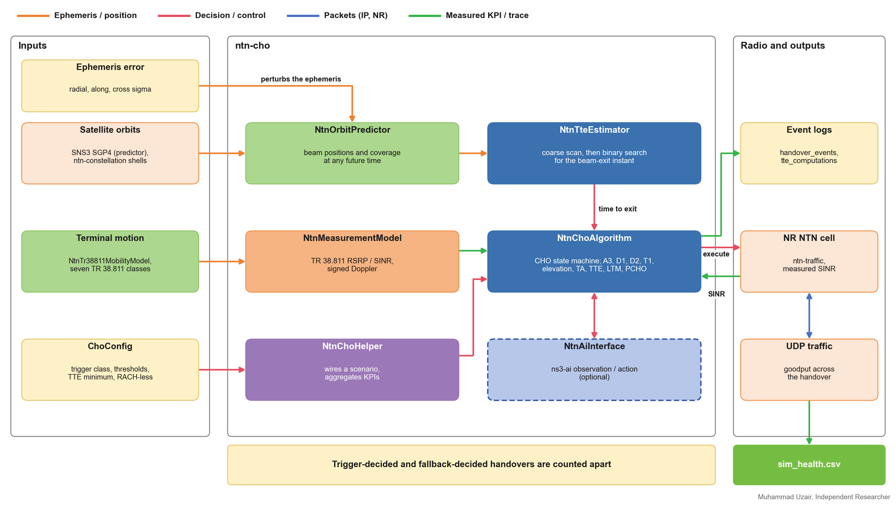
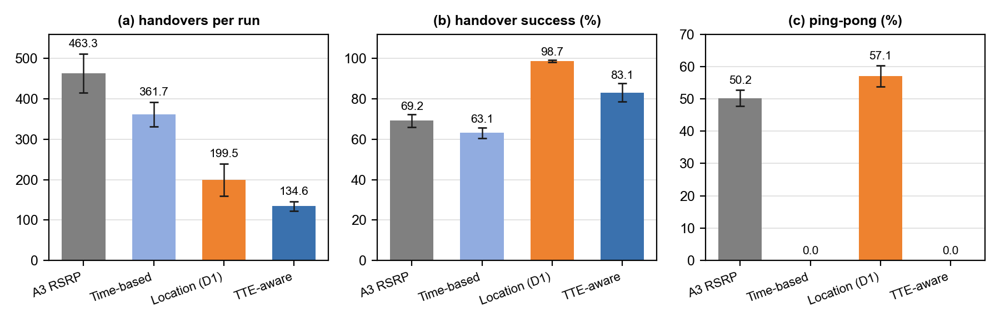
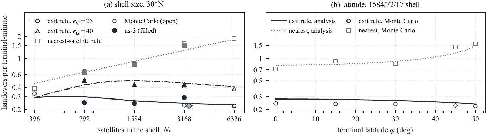

<h1 align="center">ntn-cho</h1>

<p align="center"><strong>Conditional handover for LEO: time-to-exit estimation from the ephemeris and the full standardized NTN trigger set</strong></p>

<p align="center">
  <a href="https://www.nsnam.org"></a>
  <a href="https://www.gnu.org/licenses/old-licenses/gpl-2.0.en.html"></a>
  
  
  
</p>

<p align="center">
  <a href="https://github.com/Muhammaduazir69/ns3-ntn-toolkit">Toolkit</a>
  &nbsp;|&nbsp;
  <a href="https://muhammaduazir69.github.io/ns3-ntn-toolkit/modules/ntn-cho/">Docs</a>
  &nbsp;|&nbsp;
  <a href="INSTALL.md">Install</a>
  &nbsp;|&nbsp;
  <a href="#examples">Examples</a>
  &nbsp;|&nbsp;
  <a href="#results">Results</a>
</p>

---

## Why this module

A LEO satellite is a cell that leaves. Terrestrial handover logic asks which neighbor looks best right now, and in orbit that question often answers itself wrongly: the best-looking neighbor is frequently the one about to set. This module estimates **time to exit**, how long a candidate will still be serviceable, from propagated orbits, and conditions the handover decision on it.

The standardized trigger set is implemented rather than approximated: TS 38.331 CondEvent A3, D1 on a fixed reference location, T1 on its absolute broadcast window, and Rel-18 D2 on a moving ephemeris reference, plus the elevation and timing-advance mechanisms that TR 38.821 studies. Each evaluates its own condition against live geometry, so they fire at different times. On the shipped two-cell pass, D2 and TA fired at 8 s, D1 at 69 s, A3 at 81 s, T1 at 125 s and elevation at 248 s, when the serving satellite finally reached the 10 degree floor.

A firing trigger does not always perform the cell change. `ntn-cho-handover-traffic` reports trigger-decided and fallback-decided handovers separately; on that pass five of the six classes fired without deciding a handover, because the vendored NR A3-RSRP and X2 machinery had already moved the terminal, and only D2 decided one. The counts are kept apart so that the CHO layer is never credited with a cell change the radio would have made on its own.

## System design

<p align="center">
  
</p>

<p align="center"><em>Figure 1. Classes of ntn-cho. The orbit predictor propagates the (optionally perturbed) ephemeris; the TTE estimator searches for each candidate's beam-exit instant; the measurement model and the measured SINR of a real NR NTN cell feed <code>NtnChoAlgorithm</code>, which executes on the cell and logs every decision. Source: <code>doc/figures/make_architecture.py</code>.</em></p>

| Class | Header | Role |
|---|---|---|
| `NtnChoAlgorithm` | `model/ntn-cho-algorithm.h` | Rel-17 CHO state machine (`CHO_IDLE`, `CHO_PREPARED`, `CHO_CONDITION_MONITORING`, `CHO_EXECUTING`, `CHO_COMPLETED`) with trigger classes `TRIGGER_EVENT_A3`, `TRIGGER_LOCATION_D1`, D2 (moving reference, TS 38.331 Section 5.5.4.15a), `TRIGGER_TIME_T1`, `TRIGGER_ELEVATION`, `TRIGGER_TIMING_ADVANCE`, `TRIGGER_TTE_AWARE`, `TRIGGER_LTM_CONDITIONAL` (Rel-19 conditional LTM), `TRIGGER_TRAJECTORY_PREDICTIVE`. `combineWithA4` enforces the Rel-17 rule that T1, D1 and D2 are configured with the A4 leg. Optional RACH-less execution from ephemeris TA pre-compensation. `GetMechanismStats()` reports LTM switches, PCHO triggers, RACH-less and RACH executions, interruption. |
| `NtnTteEstimator` | `model/ntn-tte-estimator.h` | Time to exit per candidate: a coarse forward scan brackets the exit, then a binary search refines it, both propagating the satellite through time (`GetBeamSnapshotAtTime`) rather than freezing it at `Now()`. |
| `NtnOrbitPredictor` | `model/ntn-orbit-predictor.h` | Wraps SNS3 SGP4 mobility and antenna patterns to predict beam positions, coverage and best beams at future times. |
| `NtnMeasurementModel` | `model/ntn-measurement-model.h` | TR 38.811 RSRP and SINR from satellite beams, with signed Doppler. |
| `NtnTr38811MobilityModel` | `model/ntn-tr38811-mobility-model.h` | The TR 38.811 Section 6.1.1.1 UE classes (handheld, pedestrian, vehicular, HST, maritime, aviation, fixed IoT) as an ns-3 `MobilityModel` in ECEF, plus geodetic, elevation and slant utilities. `NtnGeodeticFixedMobilityModel` for fixed sites. |
| `NtnAiInterface` | `model/ntn-ai-interface.h` | ns3-ai shared-memory bridge with a candidate-cell observation and action space (optional). |
| `NtnChoHelper`, `NtnRealisticMobilityHelper` | `helper/` | Wire a CHO scenario and aggregate KPIs; generate UE populations by TR 38.811 class. |

**Signaling scope.** CHO is modeled at the decision and timing level. The radio underneath runs the mmwave ideal RRC (bearers set up synchronously) with no over-the-air conditional-reconfiguration PDU, and RACH is latency accounting: the interruption is priced as slant RTT plus processing (2d/c pre-compensation when RACH-less), not a PRACH Msg1 to Msg4 exchange. The core is the LTE EPC with real GTP-U, not a 5GC. Trigger classes and counters are exact and measured; the lower-layer handover protocol is abstracted.

## Results

### Four policies, ten seeds

<p align="center">
  
</p>

<p align="center"><em>Figure 2. <code>ntn-cho-full-constellation</code>, four policies x ten seeds (40 runs): 66 satellites (6 planes x 11) at 780 km and 86.4 deg, 30 UEs, 600 s, suburban scenario. Bars: mean; whiskers: Student-t 95 % half-width over the ten seeds. Built by <code>doc/figures/make_results.py</code> from each run's <code>kpi_summary.txt</code>.</em></p>

| Policy (ten seeds) | Handovers per run | Success (%) | Ping-pong (%) |
|---|---|---|---|
| A3 RSRP (baseline) | 463.3 ± 47.8 | 69.16 ± 3.06 | 50.23 ± 2.51 |
| Time-based | 361.7 ± 30.3 | 63.14 ± 2.64 | 0.00 |
| Location (D1) | 199.5 ± 40.1 | 98.69 ± 0.48 | 57.07 ± 3.26 |
| **TTE-aware** | **134.6 ± 11.6** | **83.14 ± 4.59** | **0.00** |

The TTE-aware policy made 71 percent fewer handovers than A3 with no ping-pong, while location-based CHO reached the highest success rate and paid for it with 57 percent ping-pong. Source: `papers/sim_runs/ntn-cho/<policy>-seed<k>/` in the toolkit workspace. These runs date from April 2026 and predate later fixes to this module (TTE binary-search refinement on propagated geometry, CSV sentinel handling, the first-handover time of stay), so a rerun with the current code may not reproduce them digit for digit.

### Handover rate of the exit-triggered rule

<p align="center">
  
</p>

<p align="center"><em>Figure 3. Handover rate under line of sight on a 550 km, 53 deg Walker shell (phasing F = 17). (a) Against the number of satellites at 30 deg N; (b) against terminal latitude for 1584 satellites. Lines: analysis; open markers: exact-geometry Monte Carlo; filled markers: ns-3 with <code>ntn-cho-tte-campaign</code>, fresh seeds 11 to 20, 1200 s horizon, 95 % intervals.</em></p>

From the November 2026 campaign of `examples/ntn-cho-tte-campaign.cc` (all runs from one recorded binary and frozen libraries; code and data in the toolkit workspace under `paper/taes-2026-cho-ephemeris/`, `runs_nov/` with `PROVENANCE.txt`, analysis in `analysis_nov/` and `analysis_rate/`): the exit-triggered maximum-service-time rule handed over 0.242 ± 0.004 times per terminal-minute in ns-3 against 0.234 in the exact-geometry Monte Carlo, and the nearest-satellite rule 0.826 against 0.847. The Poisson pass model overstated Walker rates by 4 to 18 percent for shells with enough satellites in view.

## Quick start

Inside the toolkit, where the module is already present and built:

```bash
./ns3 run "ntn-cho-real-stack --trigger=d2 --duration=60"
./ns3 run "ntn-cho-full-constellation --algorithm=tte-aware --simTime=600"
./test.py -s ntn-cho
```

Standalone, into an existing ns-3.43 tree:

```bash
git clone -b main https://github.com/Muhammaduazir69/ntn-cho-framework.git contrib/ntn-cho
./ns3 configure --enable-examples --enable-tests
./ns3 build
```

`INSTALL.md` lists the dependencies. The real-stack examples build on `ntn-traffic` and `ntn-constellation`, so the toolkit tree is the easiest place to run them.

## Examples

Binaries land in `build/contrib/ntn-cho/examples/`.

| Example | What it shows | Command |
|---|---|---|
| `ntn-cho-real-stack` | TTE-aware CHO (or Rel-19 LTM, or trajectory-predictive CHO) deciding on the measured SINR of a real NR NTN cell while satellites fly SGP4 Walker orbits and UEs move by TR 38.811 class; prints the mechanism counters. | `./ns3 run "ntn-cho-real-stack --duration=60 --trigger=pcho --rachLess=1"` |
| `ntn-cho-handover-traffic` | Real UDP downlink handed over by `NtnChoAlgorithm` as the serving satellite recedes and its in-plane neighbor approaches; every trigger class selectable; trigger-decided and fallback-decided handovers reported apart. | `./ns3 run "ntn-cho-handover-traffic --simSeconds=60 --trigger=elevation"` |
| `ntn-cho-full-constellation` | Walker constellation, multi-beam satellites, four policies (a3, location, time, tte-aware), CSV and GeoJSON layers per timestep, `kpi_summary.txt`. | `./ns3 run "ntn-cho-full-constellation --algorithm=tte-aware --numUes=50"` |
| `ntn-cho-tte-campaign` | Constellation-scale system-level campaign: every terminal runs its own `NtnChoAlgorithm` against every satellite of a Walker shell, with a configurable ephemeris error. Policies `a3`, `d2`, `t1`, `elev`, `tte-eager`, `mst`, `tte-cho`. | `./ns3 run "ntn-cho-tte-campaign --policy=tte-cho --numUes=100 --simTime=600"` |
| `ntn-cho-leo-basic` | Smoke test: one SGP4 serving satellite, TR 38.811 UEs, real UDP traffic, CHO on a 200 ms cadence with measured SINR. | `./ns3 run "ntn-cho-leo-basic --trigger=tte-aware --simTime=12 --numUes=4"` |
| `ntn-realistic-mobility-demo` | One UE per TR 38.811 class, trajectories written to `mobility_trace.csv`. | `./ns3 run "ntn-realistic-mobility-demo --simTime=600"` |

## Tests

```bash
./test.py -s ntn-cho
./test.py -s ntn-standards-validation
```

- `ntn-cho` registers 35 test cases: the algorithm and state machine, D2 trigger, A4 combination and time to trigger, slant-based RACH interruption, RACH-less execution and its timing advance, the standardized triggers, T1 as an absolute window, LTM cadence, TTE estimation and its sigma propagation under ephemeris error, orbit-predictor time offsets and accuracy, exit-triggered selection, and well-formed handover CSVs.
- `ntn-standards-validation` registers 4: SGP4 against Kepler theory, the zenith-pass Doppler envelope, ENU pass geometry, and the elevation and slant relation (about 1932 km at 10 deg for LEO-600).

## Dependencies

- **Required:** ns-3.43 and the SNS3 [`satellite`](https://github.com/sns3/sns3-satellite) module (`NtnOrbitPredictor` uses its SGP4 mobility and antenna patterns); toolkit module `ntn-rrc` (linked by `CMakeLists.txt`).
- **Examples:** `ntn-traffic` (`NtnRealStackHelper`, `NtnRealisticTrafficHelper`), `ntn-constellation` (`Sgp4MobilityModel`, `WalkerConstellation`), the toolkit's `mmwave` and `lte`.
- **Optional:** `ns3-ai` or `ns3-ai-ntn`, only for `NtnAiInterface`.

## Scope and limitations

- Decision and timing level CHO over an ideal RRC; no over-the-air conditional reconfiguration and no PRACH procedure (see the signaling note above).
- On short two-cell passes the vendored NR A3 and X2 handover can move the terminal before a CHO trigger trips; read the trigger-decided count, not the total.
- `ntn-cho-tte-campaign` is a system-level simulation in the TR 38.821 Section 6.1 sense: link budget per terminal and satellite on the ns-3 event queue, not a packet-level PHY.
- The elevation and TA mechanisms are TR 38.821 study items, not standardized CondEvents.

## Standards

3GPP TS 38.331 (conditional reconfiguration, CondEvent A3, A4, D1, D2, T1, SIB19), TS 38.300 (handover), TS 38.133 (measurement), TS 38.321 (random access), TR 38.821 (NTN mobility, interruption budget, Set-1), TR 38.811 (UE classes, channel).

## Citation

If you use this module, please cite the toolkit article:

```bibtex
@article{uzair2026ns3ntn,
  author  = {Uzair, Muhammad and others},
  title   = {ns3-ntn-toolkit: An Integrated ns-3 Platform for {6G} Non-Terrestrial Networks},
  journal = {IEEE Open Journal of the Communications Society},
  year    = {2026},
  doi     = {10.1109/OJCOMS.2026.3745010}
}
```

## License

GPL-2.0-only, matching ns-3. See [LICENSE](LICENSE).

## Contact

**Muhammad Uzair**, Independent Researcher
muhammaduzairr69@gmail.com · [ORCID 0009-0002-4104-2680](https://orcid.org/0009-0002-4104-2680)

Part of the [ns3-ntn-toolkit](https://github.com/Muhammaduazir69/ns3-ntn-toolkit), an integrated ns-3.43 platform for 6G non-terrestrial network research. Mirrored on [GitLab](https://gitlab.com/ns3-ntn-toolkit).
