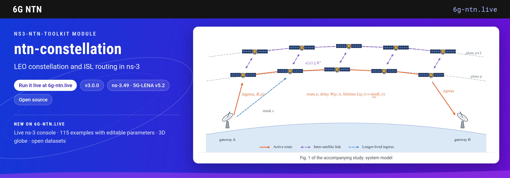
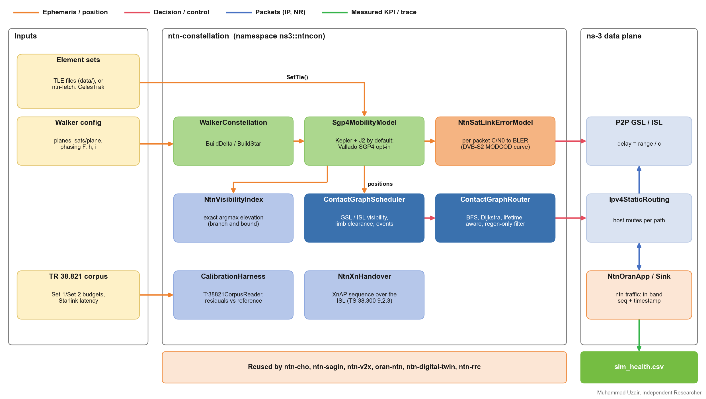
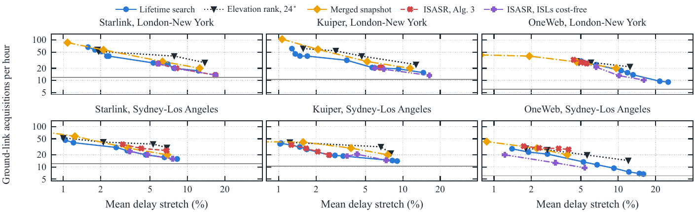
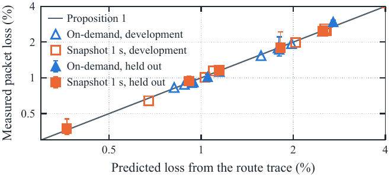

<!-- hero-banner -->
<p align="center"><a href="https://muhammaduazir69.github.io/ntn-constellation/"></a></p>

<h1 align="center">ntn-constellation</h1>

<p align="center"><strong>LEO shells from element sets or Walker parameters, propagated inside ns-3, with a contact graph and routing over inter-satellite links</strong></p>

<p align="center">
  <a href="https://youtu.be/JNStiBst68I"></a><br/>
  <a href="https://youtu.be/JNStiBst68I"></a><br/>
  <a href="https://6g-ntn.live"></a><br/>
  <sub><b>Try it live:</b> <a href="https://6g-ntn.live">6g-ntn.live</a> runs the toolkit's examples in the browser, with open datasets, a scenario gallery and a research forum.</sub><br/>
  <sub>The NTN Control Center runs and visualizes the ntn-constellation examples on a live 3D globe (5-minute video).</sub>
  <a href="https://muhammaduazir69.github.io/ntn-constellation/"></a>
  <a href="https://github.com/Muhammaduazir69/ntn-constellation/releases/latest"></a>
  <a href="https://www.linkedin.com/in/muhammad-uzair-285331185/"></a><br/>
  <sub><b>New on 6g-ntn.live:</b> a live ns-3 console, 115 examples with editable parameters, a 3D globe of real constellations, open datasets (CC BY 4.0) and a validation page with 690 test cases in 41 suites.</sub><br/>
</p>


<p align="center">
  <a href="https://www.nsnam.org"></a>
  <a href="https://www.gnu.org/licenses/old-licenses/gpl-2.0.en.html"></a>
  
  
  
</p>

<p align="center">
  <a href="https://github.com/Muhammaduazir69/ns3-ntn-toolkit">Toolkit</a>
  &nbsp;|&nbsp;
  <a href="https://muhammaduazir69.github.io/ns3-ntn-toolkit/modules/ntn-constellation/">Docs</a>
  &nbsp;|&nbsp;
  <a href="INSTALL.md">Install</a>
  &nbsp;|&nbsp;
  <a href="#examples">Examples</a>
  &nbsp;|&nbsp;
  <a href="#results">Results</a>
</p>

---

## Why this module

Every layer above this one needs to know where the satellites are, and it needs the same answer at every layer. `ntn-constellation` builds a shell from two-line element sets or from Walker parameters, propagates it during `Simulator::Run()`, and hands one ephemeris to the radio, the handover logic, the routing and the visualization. On top of the geometry sits a network view: a contact graph over ground and inter-satellite links, with limb clearance so that a link which would graze the atmosphere is never offered, and path computation that ranges from plain shortest delay to a lifetime-aware search that prefers routes which will last.

The free-space link budget is checked against the TR 38.821 corpus rather than against itself. That distinction has a history here: an earlier calibration test compared the reference corpus with a synthetic offset of itself and never touched the toolkit.

## System design

<p align="center">
  
</p>

<p align="center"><em>Figure 1. Classes of ntn-constellation and how they connect. Element sets or a Walker configuration feed <code>Sgp4MobilityModel</code>; the contact-graph scheduler turns positions into link up and down events; the router installs the chosen path as IPv4 host routes on point-to-point links whose delay follows the live range. Source: <code>doc/figures/make_architecture.py</code>.</em></p>

Everything lives in the `ns3::ntncon` namespace.

| Header | Key types | Role |
|---|---|---|
| `walker-constellation.h` | `WalkerConfig`, `WalkerConstellation` | Walker-Delta and Walker-Star generation (`BuildDelta`, `BuildStar`): planes, satellites per plane, phasing, altitude, inclination. |
| `orbital-elements.h` | `TleRecord`, `KeplerianElements` | TLE parsing with checksums, classical elements. |
| `sgp4-mobility-model.h` | `Sgp4MobilityModel` | ns-3 `MobilityModel` for one satellite. Default backend: analytic Kepler with secular J2 on RAAN and argument of perigee. `SetUseVallado(true)` switches a TLE-sourced orbit to full Vallado SGP4 (drag term included); Walker elements use the Kepler + J2 path through `SetElements()`, or Vallado SGP4 through `SetElementsSgp4()` (a TLE synthesized by `MakeTleFromElements()`, B* = 0); `IsUsingSgp4()` reports which one is running. ECEF, ECI and geodetic accessors, `GetElevationDeg()`, `SetSimulationEpochUnix()` for a common time origin. |
| `contact-graph-scheduler.h` | `ContactGraphScheduler`, `ContactEvent` | Ground-to-satellite and satellite-to-satellite visibility over time, limb clearance, range caps; raises up, down and update events and counts them per link class. |
| `contact-graph-router.h` | `ContactGraphRouter` | Path computation over the time-varying graph: BFS, weighted Dijkstra, `ShortestPathCost` with a caller-supplied edge cost, `LifetimeAwarePath`, and a regenerative-only transit filter (`SetRegenMode`). Returns node-ID vectors; it installs no forwarding table itself. |
| `ntn-visibility-index.h` | `NtnVisibilityIndex` | Exact argmax-elevation lookup by branch and bound, the same satellite a brute-force scan would choose, without the satellites x terminals loop. |
| `ntn-sat-link-error-model.h` | `NtnSatLinkErrorModel` | Per-packet error model for GSL and ISL hops: Es/N0 from the live slant range, mapped through a DVB-S2 MODCOD waterfall to a block error probability. |
| `ntn-xn-handover.h`, `ntn-xnap-messages.h` | `NtnXnHandover`, `NtnXnapHeader` | The TS 38.300 Section 9.2.3 Xn sequence between two regenerative satellites, carried over the ISL. |
| `tr38821-corpus.h` | `Tr38821CorpusReader`, `CalibrationHarness` | TR 38.821 Set-1 and Set-2 reference budgets plus a Starlink latency corpus, with residuals against the toolkit's own predictions. |

**Two propagators, two fidelity levels.** In C++, `Sgp4MobilityModel::SetTle()` runs Vallado SGP4/SDP4 by default (`SetUseVallado(false)` switches to Kepler + J2); `SetElements()` installs generated classical elements (Walker shells) on the faster Kepler + J2 path, and `SetElementsSgp4()` runs generated elements through SGP4. The Python companion (`ntn_constellation`, below) always uses the `sgp4` library and Skyfield.

**Earth-fixed accuracy.** The TEME to Earth-fixed rotation uses GMST. Set UT1 - UTC (IERS Bulletin A DUT1) with `Sgp4MobilityModel::SetUt1MinusUtc()` or `--NtnUt1MinusUtc=` to match Skyfield's ITRS positions to 0.02-0.36 m for VLEO, SSO, LEO and GEO element sets; with the default 0 the rotation uses UTC and the positions are off by DUT1 of Earth rotation (about 0.09 s in late 2026: 15-46 m at LEO, 262 m at GEO). Polar motion is applied by neither side (about 0.3 arcsec, roughly 10 m at LEO radius, against the full ITRF). Test `Sgp4VsSkyfieldTest`.

## Results

The figures and numbers below come from the route-break study built on this module (`paper/taes-2026-route-breaks/`: code and data). Every number is read from its stored outputs (`out/p7_v8.jsonl`, `out/p7_v9.jsonl` and the law checks), produced by `examples/ntn-constellation-route-lifetime.cc` through the campaign drivers in that folder. Setup: Starlink (72 x 22, 550 km, 53 deg), Kuiper (34 x 34, 630 km, 51.9 deg) and OneWeb (12 x 49, 1200 km, 87.9 deg) shells with +Grid laser links, plus real Starlink and OneWeb shells from CelesTrak element sets of 2 October 2026; gateway pairs London and New York, Sydney and Los Angeles; every link a 100 Mb/s IPv4 point-to-point link that drops all packets while its contact is down; one 20 packet/s UDP flow for 45 min per run.

<p align="center">
  
</p>

<p align="center"><em>Figure 2. Ground-link acquisitions per hour against mean delay stretch for five route recomputation families on the development shells, means over 6 start instants. Each line is one family as its budget, window or weight varies; the grey line is the longest-pass floor on any policy that switches before its route breaks.</em></p>

<p align="center">
  
</p>

<p align="center"><em>Figure 3. Packet loss of reactive routing (on demand, and snapshot routing every 1 s) measured in ns-3 against the loss predicted from a route trace taken at other start instants. Hollow markers: development cells; filled: held-out cells, with the range over runs.</em></p>

| Measured quantity | Value |
|---|---|
| Largest +Grid inter-plane range, Starlink / Kuiper / OneWeb development shells | 1972 / 1317 / 1983 km, against a 5000 km cap |
| Largest range over every phasing factor, same shells | 2353 / 2284 / 2196 km |
| Inter-satellite link drops recorded by the scheduler | 0 in 828 packet-level runs; 0 in all 3352 lattice runs |
| Packet loss, on-demand routing / 1 s snapshot routing | 1.35 % / 1.65 % |
| Error of predicted cell-mean loss, development cells | median 2.2 %, largest 4.6 % |
| Error of predicted cell-mean loss, held-out cells | median 2.9 %, largest 9.6 % |
| Loss with one terminal per gateway: lifetime search (budget 0.05) / merged snapshots (120 s) / on demand | 0.70 % / 0.82 % / 1.35 % |
| Ground-link acquisitions relative to the lifetime search, real orbits: elevation ranking / ISASR | 1.05 to 1.13 times / 1.63 to 2.18 times |

What these say about the module: with range-limited +Grid links on these shells, every forced route change the scheduler logged was a ground link setting, so the contact graph and the ISL range law did their job, and the loss of reactive routing could be predicted from a route trace without a fitted parameter. The margin of the lifetime search is modest: merged snapshots traded places with it depending on the delay metric. The study ran on the copy of this module recorded in `paper/taes-2026-route-breaks/ns3_patch/`; `make_macros_corr.py` and `make_figs.py` there regenerate every number and figure from `out/`.

## Quick start

Inside the toolkit, where the module is already present and built:

```bash
./ns3 run "ntn-constellation-real-routed --duration=40"
./ns3 run "ntn-constellation-route-lifetime --policy=life --eps=0.05"
./test.py -s ntn-constellation
```

Standalone, into an existing ns-3.49 tree:

```bash
git clone -b ntn-constellation-v4 https://github.com/Muhammaduazir69/ntn-constellation.git contrib/ntn-constellation
./ns3 configure --enable-examples --enable-tests
./ns3 build
```

`INSTALL.md` lists the dependencies. The two access-link examples build on `ntn-traffic` (the toolkit's real NR stack) and on `ntn-cho` (TR 38.811 terminal classes), so the toolkit tree is the easiest place to run them.

## Examples

Binaries land in `build/contrib/ntn-constellation/examples/` as `ns3.49-<name>-default`.

| Example | What it shows | Command |
|---|---|---|
| `ntn-constellation-walker-traffic` | A Walker-Delta shell gives the contact-graph context while one serving satellite carries a real NR NTN cell (`NtnRealStackHelper`, nr FR1 by default, `--radio=mmwave` for FR2) to TR 38.811 ground terminals at its sub-point. SINR, TBLER and throughput come off the PHY trace. | `./ns3 run "ntn-constellation-walker-traffic --simSeconds=20 --numPlanes=4 --satsPerPlane=11 --altKm=550 --inclinationDeg=53"` |
| `ntn-constellation-sgp4-mobility-traffic` | One LEO satellite from a TLE drives a real NR cell; the scheduler tracks GSL up and down from the live geometry. Without `--gsLat/--gsLon` the ground station sits under the satellite's sub-point at mid-run, so the run is centred on the zenith of a real pass. | `./ns3 run "ntn-constellation-sgp4-mobility-traffic --simSeconds=20 --tle=contrib/ntn-rrc/data/iss-zarya.tle"` |
| `ntn-constellation-isl-routed-traffic` | `GS1 -> satA -> ISL -> satB -> GS2` with real IPv4 forwarding through the satellites, per-hop delay from the live range and a contact gate per hop. Delay, jitter and loss are measured at `NtnOranSink` from the in-band header. | `./ns3 run "ntn-constellation-isl-routed-traffic --duration=40"` |
| `ntn-constellation-real-routed` | The routing decision installs IPv4 static routes, and the flow reroutes from satA to satB when satA sets and satB rises (two Walker neighbors and two WGS-84 ground stations, all in ECEF). satA leaves contact at about 270 s, so the reroute needs `--duration=300`; the 40 s run shows the route via satA only. | `./ns3 run "ntn-constellation-real-routed --duration=300"` |
| `ntn-constellation-route-lifetime` | Ground-to-ground routing over a +Grid shell under the recomputation policies of the route-break study (`snap`, `ondemand`, `asr`, `asrk`, `life`, `elev`, `elevb`, `track`, `alpr`, `isasr`). Every link drops packets while down, so the cost of a stale route is measured. Real shells via `--tle`, `--edges`, `--epochUnix`. | `./ns3 run "ntn-constellation-route-lifetime --policy=life --eps=0.05"` |

Each example writes `sim_health.csv` to `--outputDir` (where it has one) and prints a measured summary on stdout. The walker and SGP4 examples need the toolkit's `mmwave` module; the routed examples need only core ns-3 plus `ntn-traffic` and `ntn-cho`.

## Python companion

The `ntn_constellation` package (`pip install -e .` in this directory) is the tool-side pipeline: fresh element sets from CelesTrak or Space-Track with an on-disk cache, canonical SGP4/SDP4 through `sgp4` and Skyfield, presets (Starlink, OneWeb, Kuiper, Telesat Lightspeed, Iridium NEXT), Walker generators that emit valid TLEs, ISL topology builders, and exporters for the SNS3 scenario layout and CesiumJS CZML. It does not touch the C++ build.

```bash
python3 -m venv .venv && .venv/bin/pip install -e .[test]
.venv/bin/ntn-fetch kuiper --out data/kuiper --isl-walker --czml       # preset, no network
.venv/bin/ntn-fetch starlink --out data/starlink-now --max-sats 200 --czml   # live CelesTrak
```

Against an independent Skyfield reference it showed 0 NaN over 24 h, 66 satellites and 1440 samples, and a largest error of 23.5 us over an 1800 s STARLINK-1008 pass (`tests/`).

## Tests

```bash
./test.py -s ntn-constellation
```

`test/ntn-constellation-test-suite.cc` registers 36 test cases: TLE parsing and checksums, periodic return, ECEF altitude and the geocentric contract of `Sgp4MobilityModel`, Vallado SGP4 verification and its offset from Kepler + J2 on a real LEO element set, Walker-Delta geometry, contact scheduling (LEO pass, ISL pair, gate hysteresis, range updates, limb clearance, contact-end prediction, ISL candidates), the router (direct edges, BFS, weighted Dijkstra, regenerative-only paths, `LifetimeAwarePath`, several under `Simulator::Run()`), `NtnVisibilityIndex` against brute force, the Xn handover procedure, the satellite link error model, and the TR 38.821 and Starlink calibration harness. The orbit models are also checked against Kepler theory, the Doppler envelope and TR 38.821 geometry by `ntn-standards-validation` in `ntn-cho`.

## Dependencies

- ns-3.49 with `core` and `mobility`; `satellite` (SNS3) and `thz-ntn` are linked by the module's `CMakeLists.txt`.
- Examples: `ntn-traffic` (NR stack, `NtnOranApplication`), `ntn-cho` (TR 38.811 terminals, ENU projection), the toolkit's `mmwave`.
- Python companion: Python 3.10+, `sgp4`, `skyfield` (see `pyproject.toml`).

## Scope and limitations

- The C++ default is Kepler + J2 secular, accurate to a few km over hours for near-circular LEO shells; drag enters only through `SetUseVallado(true)` on a TLE-sourced satellite.
- `ContactGraphRouter` computes paths; examples install them. Nothing in the module writes an ns-3 forwarding table by itself.
- `RegenMode` filters transit nodes and, through `NtnXnHandover`, decides whether a satellite may run an Xn handover. It does not build a gNB on the satellite. The XnAP messages are an ns-3 `Header` with toolkit-internal type values, not ASN.1 APER with TS 38.423 procedure codes.
- Contact-graph routing follows CCSDS concepts; there is no bundle protocol.

## Standards

3GPP TR 38.821 (NTN reference constellations, Set-1 and Set-2, link budget), TR 38.811 (geometry, elevation dependence), TS 38.300 Section 9.2.3 (Xn handover sequence). SGP4/SDP4 after Vallado et al. (2006).

## Citation

If you use this module, please cite the toolkit article:

```bibtex
@article{uzair2026ns3ntn,
  author  = {Uzair, Muhammad and others},
  title   = {ns3-ntn-toolkit: An Integrated ns-3 Platform for {6G} Non-Terrestrial Networks},
  journal = {IEEE Open Journal of the Communications Society},
  year    = {2026},
  doi     = {10.1109/OJCOMS.2026.3745010}
}
```

## License

GPL-2.0-only, matching ns-3. See [LICENSE](LICENSE). Element sets in `paper/` and `data/` are public CelesTrak data.

## Contact

**Muhammad Uzair**, Independent Researcher
muhammaduzairr69@gmail.com · [ORCID 0009-0002-4104-2680](https://orcid.org/0009-0002-4104-2680)

Part of the [ns3-ntn-toolkit](https://github.com/Muhammaduazir69/ns3-ntn-toolkit), an integrated ns-3.49 platform for 6G non-terrestrial network research. Mirrored on [GitLab](https://gitlab.com/ns3-ntn-toolkit).
