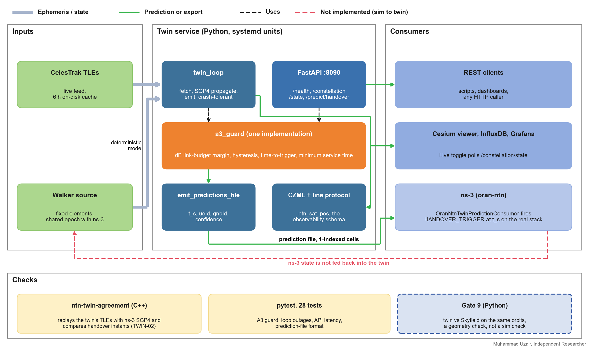
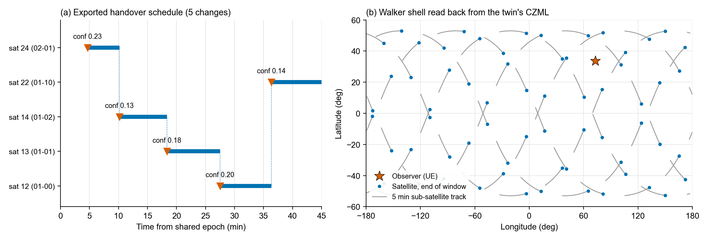

<h1 align="center">ntn-digital-twin</h1>

<p align="center"><strong>A live constellation twin that predicts handovers from ephemeris and hands the schedule to a running ns-3 simulation, which actuates it</strong></p>

<p align="center">
  <a href="https://www.nsnam.org"></a>
  <a href="https://www.gnu.org/licenses/old-licenses/gpl-2.0.en.html"></a>
  
  
  
  <a href="https://doi.org/10.1109/OJCOMS.2026.3745010"></a>
</p>

<p align="center">
  <a href="https://github.com/Muhammaduazir69/ns3-ntn-toolkit">Toolkit</a>
  &nbsp;·&nbsp;
  <a href="https://muhammaduazir69.github.io/ns3-ntn-toolkit/modules/ntn-digital-twin/">Docs</a>
  &nbsp;·&nbsp;
  <a href="INSTALL.md">Install</a>
  &nbsp;·&nbsp;
  <a href="#results">Results</a>
  &nbsp;·&nbsp;
  <a href="#examples">Examples</a>
</p>

---

## Why this module

A digital twin that only predicts is a dashboard. This one propagates two-line
elements, evaluates a handover guard, and exports the decisions to a running ns-3
simulation, where the handover either happens or does not. Prediction and
actuation share one guard implementation. They used to be two copies of the same
logic in two languages, and extracting them into one evaluator exposed three
places where they had quietly diverged: the ranking quantity was not the
comparison quantity, initial acquisition was counted as a handover, and the
time-to-trigger window did not restart when the best target changed. Both paths
now compare a dB link-budget margin rather than topocentric degrees.

## System design

<p align="center">
  
</p>

<p align="center"><sub>The twin sync loop. Inputs on the left, the Python service in the middle, consumers on the right. The red dashed path (ns-3 state back into the twin) is not implemented. Script: <code>doc/figures/make_ntn_digital_twin_design.py</code>.</sub></p>

The loop, every `--interval` seconds:

1. Fetch TLEs from CelesTrak through a 6 h on-disk cache, or, for a deterministic
   run, generate Walker elements on the epoch the ns-3 scenario uses.
2. Propagate the constellation with SGP4 (`ntn-constellation`, raw `Satrec`).
3. Write CZML for a Cesium viewer and line protocol (`ntn_sat_pos`, the
   `ntn-observability` schema) for InfluxDB and Grafana.
4. Optionally write the handover schedule with `emit_predictions_file`: an
   `epoch_unix` header, then `t_s,ueId,recommendedGnbId,confidence` lines, where
   `t_s` is seconds from the shared epoch (equal to ns-3 simulation time) and
   `recommendedGnbId` is 1-indexed in the order the ns-3 scenario builds its E2
   nodes.

On the ns-3 side, `OranNtnTwinPredictionConsumer` in `oran-ntn` loads the file
and, at each `t_s` whose confidence clears a floor, fires a `HANDOVER_TRIGGER`
into the E2 and CHO loop, or calls `NtnRealStackHelper::TriggerHandover`
directly. A failed iteration is logged and the next one runs on schedule.

## Results

<p align="center">
  
</p>

<p align="center"><sub>One deterministic twin run (Walker source, 66 satellites in 6 planes of 11 at 53 degrees, observer 33.68 N 73.05 E, 2700 s horizon, 10 s step), artifacts written 6 Oct 2026: <code>toolkit-audit-2026-10-06/runs/A6-ai-twin-security/twin-walker/</code> (<code>twin-orbits.tle</code>, <code>twin-pred.txt</code>, <code>twin.czml</code>, <code>twin.lp</code>). Panel (b) is the 5 min CZML window at loop time, 30 s samples. Script: <code>doc/figures/make_ntn_digital_twin_results.py</code>.</sub></p>

The twin exported 5 handovers in 45 minutes, at 280, 610, 1100, 1650 and 2180 s,
each to a different satellite, with confidence between 0.13 and 0.23 (the
elevation margin over the runner-up divided by 30 degrees, clipped to [0, 1]). The first serving satellite is
not listed because initial acquisition is not a handover. The CZML and line
protocol hold one record per satellite (66 each), which is what the Cesium viewer
and the Grafana dashboards read.

Verification figures quoted in earlier releases (a 144-iteration compressed 24 h
loop with 0 errors and 0 m position error against direct SGP4, and a
`/predict/handover` p99 of 29.9 ms over 100 calls for 50 satellites and a 10 min
horizon) come from a verification run whose raw log is not stored in the tree.
`test_api_predict_handover_under_500ms` and `test_run_iteration_handles_missing_network`
check the bounds that matter on every test run.

## Classes and components

| Component | Role | Location |
|---|---|---|
| `twin_loop` | refresher: fetch, propagate, emit CZML and line protocol; crash-tolerant; `LoopStats` | `ntn_digital_twin/twin_loop.py` |
| `emit_predictions_file` | writes the handover schedule for ns-3 over the shared epoch | `ntn_digital_twin/twin_loop.py` |
| `a3_guard` | the one A3 guard both paths use: dB margin, hysteresis, time-to-trigger, minimum service time | `ntn_digital_twin/a3_guard.py` |
| FastAPI server | `GET /health`, `GET /constellation/state`, `POST /predict/handover` on port 8090; closed-form ECEF to ENU elevation on the hot path | `ntn_digital_twin/api/server.py` |
| Pydantic v2 schemas | typed requests and responses | `ntn_digital_twin/api/schemas.py` |
| `ntntwin::CompareHandovers`, `TwinAgreement` | C++ metric that compares twin and ns-3 handover sequences (TWIN-02) | `model/ntn-twin-agreement.h` |
| systemd units | `ntn-twin.service` (loop), `ntn-twin-api.service` (API) | `systemd/` |
| Viewer patch | adds a Live toggle to a CesiumJS page that polls `/constellation/state` every 5 s | `viewer-patches/index.html.patch` |

## Quick start

Inside the toolkit:

```bash
pip install -e contrib/ntn-constellation -e "contrib/ntn-digital-twin[test]"
ntn-twin-loop --max-iterations=3 --czml /tmp/twin.czml --lp /tmp/twin.lp --max-sats=50 --interval=2
ntn-twin-api --host 0.0.0.0 --port 8090 &
curl -X POST http://localhost:8090/predict/handover \
     -H 'content-type: application/json' \
     -d '{"ue_lat_deg":33.68,"ue_lon_deg":73.05,"horizon_min":10}'
```

Standalone:

```bash
git clone -b ntn-digital-twin-v2 https://github.com/Muhammaduazir69/ntn-digital-twin.git contrib/ntn-digital-twin
cd contrib/ntn-digital-twin && pip install -e .[test]
```

The C++ half (`ntn-twin-agreement`) builds with the toolkit: `./ns3 build ntn-digital-twin`.
For a long-running service, install the units in `systemd/` and run
`systemctl --user enable --now ntn-twin.service ntn-twin-api.service`.
The Docker image `uzairdocker69/ns3-ntn-toolkit` ships the twin server.

## Examples

This module has no ns-3 C++ examples; its entry points are the two CLIs and the
prediction file.

| Entry point | What it does |
|---|---|
| `ntn-twin-loop` | runs the refresher; `--czml`, `--lp` (or UDP), `--max-sats`, `--interval`, `--max-iterations` |
| `ntn-twin-api` | serves the REST API on port 8090 |
| `emit_predictions_file(...)` | Python call that writes the schedule `OranNtnTwinPredictionConsumer` reads; see `tests/test_wsc_predictions_export.py` for a 45 min example |
| `oran-ntn` scenarios with `OranNtnTwinPredictionConsumer` | actuate the schedule inside ns-3; `OranNtnTwinConsumerClosesLoopTest` drives it end to end |

## Tests

```bash
cd contrib/ntn-digital-twin && pytest tests/ -v   # 28 tests in 5 files
./test.py -s ntn-digital-twin                      # 2 C++ cases (TWIN-02)
```

| File | Tests | Covers |
|---|---:|---|
| `tests/test_twin_loop.py` | 8 | line-protocol schema, network outages without a crash, API health, state, latency under 500 ms, response schema, A3 hysteresis against bare argmax, Walker source on the shared epoch |
| `tests/test_twin04_a3_guard.py` | 8 | slant range, dB SNR, A3 offset and minimum-service dwell, predictions emitted only when configured, exporter and REST agree event for event |
| `tests/test_twin04_shared_guard.py` | 10 | ranking quantity equals comparison quantity, initial acquisition is not a handover, time-to-trigger restarts on a new target, minimum service and minimum elevation, `run_a3` matches stepping by hand |
| `tests/test_wsc_predictions_export.py` | 1 | the prediction file format the C++ loader parses |
| `tests/test_gate9_twin_sim_agreement.py` | 1 | twin serving selection against Skyfield geometry on the same orbits |

The C++ case "ns-3 replays the twin's orbits" loads the twin's TLEs into
`Sgp4MobilityModel`, walks the window inside `Simulator::Run()` and compares
handover instants. It runs only when `NTN_TWIN_ARTIFACT_DIR` points at a
directory holding `twin-orbits.tle` and `twin-pred.txt` (for example the
`twin-walker` run above); otherwise it returns without asserting.

## Dependencies

Python 3.10 or newer, the sibling `ntn-constellation` Python package (SGP4),
FastAPI 0.110 or newer, Uvicorn, Pydantic v2, requests; pytest and httpx for
the tests, Skyfield for the gate-9 test. The
C++ half needs ns-3.43 core and mobility and `ntn-constellation`. See
[INSTALL.md](INSTALL.md).

## Honest scope

- The twin is a standalone constellation mirror. It consumes live TLEs (or a
  deterministic Walker source) and serves REST, CZML and line protocol; it does
  not ingest ns-3 state. Sim-to-twin mirroring is not implemented.
- Twin-to-sim is implemented: the prediction file is actuated by
  `OranNtnTwinPredictionConsumer` in `oran-ntn`.
- Gate 9 compares the twin's closed-form elevation with Skyfield over the same
  Python-propagated orbits. That is a geometry check, close to a tautology, not a
  twin-versus-simulator check. The C++ TWIN-02 case is the one that compares with
  ns-3, and it needs the twin artifacts to run. Its agreement is expected to be
  below 1, because the twin applies an A3 guard while the replay uses bare
  argmax elevation.
- The viewer patch was written against a CesiumJS page that has since been
  retired; it remains as the reference integration.

## Standards

3GPP TS 38.331 (A3 event, conditional reconfiguration), TR 38.821 (NTN link
budget and geometry); SGP4 and SDP4 propagation; CelesTrak two-line element
formats; CZML; InfluxDB line protocol.

## Citation

If this module contributes to a publication, please cite the toolkit article:

> M. Uzair et al., "ns3-ntn-toolkit: An integrated ns-3 platform for 6G
> non-terrestrial networks," *IEEE Open Journal of the Communications Society*,
> 2026, doi: [10.1109/OJCOMS.2026.3745010](https://doi.org/10.1109/OJCOMS.2026.3745010).

```bibtex
@article{uzair2026ns3ntntoolkit,
  author  = {Uzair, Muhammad and others},
  title   = {ns3-ntn-toolkit: An Integrated ns-3 Platform for 6G Non-Terrestrial Networks},
  journal = {IEEE Open Journal of the Communications Society},
  year    = {2026},
  doi     = {10.1109/OJCOMS.2026.3745010}
}
```

## License

GPL-2.0-only, matching ns-3.

## Contact

**Muhammad Uzair**, Independent Researcher.
Email [muhammaduzairr69@gmail.com](mailto:muhammaduzairr69@gmail.com),
ORCID [0009-0002-4104-2680](https://orcid.org/0009-0002-4104-2680).
Part of the [ns3-ntn-toolkit](https://github.com/Muhammaduazir69/ns3-ntn-toolkit),
mirrored on [GitLab](https://gitlab.com/ns3-ntn-toolkit).
