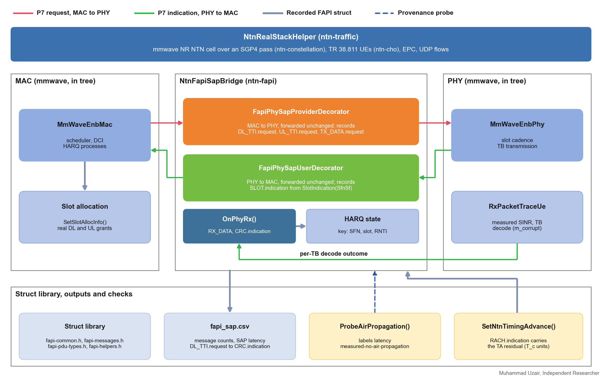
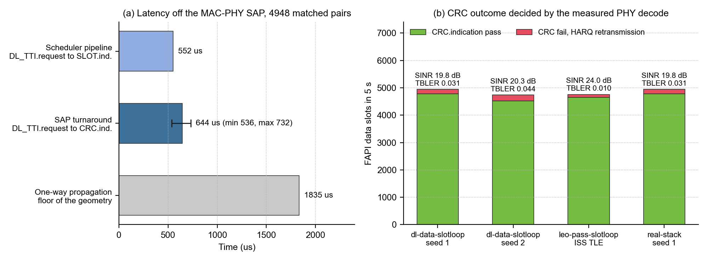

<h1 align="center">ntn-fapi</h1>

<p align="center"><strong>A Small Cell Forum FAPI MAC-PHY adapter on a live NR service access point, with a latency figure that says what it does not contain</strong></p>

<p align="center">
  <a href="https://www.nsnam.org"></a>
  <a href="https://www.gnu.org/licenses/old-licenses/gpl-2.0.en.html"></a>
  
  
  
</p>

<p align="center">
  <a href="https://github.com/Muhammaduazir69/ns3-ntn-toolkit">Toolkit</a>
  &nbsp;·&nbsp;
  <a href="https://muhammaduazir69.github.io/ns3-ntn-toolkit/modules/ntn-fapi/">Docs</a>
  &nbsp;·&nbsp;
  <a href="INSTALL.md">Install</a>
  &nbsp;·&nbsp;
  <a href="#examples">Examples</a>
  &nbsp;·&nbsp;
  <a href="#results">Results</a>
</p>

---

## Why this module

FAPI is the interface between MAC and PHY that real base stations are built on. The reason to model it in a simulator is to ask what an NTN round trip does to a slot pipeline designed for a terrestrial one, and that question needs messages produced by a real scheduler at real slot timing, not structs filled on a timer.

`ntn-fapi` gives ns-3 the SCF-222 message vocabulary and a bridge that decorates the live mmwave MAC-PHY service access point (SAP). SLOT.indication fires at the radio's own cadence, DL_TTI.request comes from real downlink allocations, and CRC.indication carries the real per-TB decode outcome. HARQ state is keyed by frame, subframe, slot and RNTI, because keying by slot alone let two terminals in the same slot overwrite each other.

One point the module states rather than implies: the backend it decorates has no propagation delay model, so the measured request-to-indication interval is a slot-pipeline turnaround and not an NR-NTN one. The bridge probes the channel and labels the value `measured-no-air-propagation`, and the test gate asserts that the mean stays below the geometric one-way floor of the configured link.

## System design

<p align="center">
  
</p>

*Figure 1. `NtnFapiSapBridge` interposes two forwarding decorators between an already-wired `MmWaveEnbMac` and `MmWaveEnbPhy`. Every SAP call is forwarded unchanged; the FAPI struct is recorded as a side effect, so the bridge observes the slot timing without perturbing it. The reverse path (RX_DATA.indication, CRC.indication) is fed from the PHY reception trace, where the mmwave error model has already decided the TB. Source: [`doc/figures/make_architecture.py`](doc/figures/make_architecture.py).*

## Results

The figure and table below are built from stored runs of the shipped examples, made during the toolkit audit of 6 October 2026 (`ns-3-dev/toolkit-audit-2026-10-06/runs/A1-cho-rrc-fapi/`). Each configuration ran once for 5 simulated seconds with 4 UEs on the default 2.185 GHz, 20 MHz mmwave NTN cell. The script that reads them is [`doc/figures/make_results.py`](doc/figures/make_results.py).

<p align="center">
  
</p>

*Figure 2. (a) Latency read off the MAC-PHY SAP in `ntn-fapi-real-stack` (4948 SFN/slot-matched DL_TTI.request and CRC.indication pairs; the range bar spans min to max) against the one-way propagation floor that the link geometry implies. (b) FAPI data slots per run, split by the CRC outcome that the measured PHY decode produced, with the measured mean DL SINR and TBLER of each run.*

| Run (5 s, 4 UEs) | Measured SINR (dB) | Measured TBLER | Data slots sent | CRC pass | HARQ retx | TX_DATA.request | PHY TBs (`phy_rx_tb`) |
|---|---:|---:|---:|---:|---:|---:|---:|
| `ntn-fapi-dl-data-slotloop`, seed 1 | 19.78 | 0.031 | 4948 | 4782 | 166 | 19094 | 19094 |
| `ntn-fapi-dl-data-slotloop`, `--RngRun=2` | 20.26 | 0.044 | 4736 | 4523 | 213 | 19041 | 19041 |
| `ntn-fapi-leo-pass-slotloop`, ISS TLE | 23.99 | 0.010 | 4759 | 4645 | 114 | 18894 | 18894 |
| `ntn-fapi-real-stack`, seed 1 | 19.78 | 0.031 | 4948 | 4782 | 166 | not printed | 19094 |

What the data say:

- TX_DATA.request equals the PHY's own TB count in every run that prints both. A free-running slot loop could not produce that identity; it is the check that the messages come from the SAP.
- The SAP turnaround (DL_TTI.request to CRC.indication) had a mean of 643.8 us, min 535.7 us and max 732.1 us; the scheduler pipeline (DL_TTI.request to SLOT.indication) averaged 552.2 us. Both sit well below the 1834.6 us one-way floor derived from the geometry, which is the arithmetic sign that no air propagation is in them (`fapi_sap.csv`, `air_propagation_present = 0`).
- `ntn-fapi-real-stack` and `ntn-fapi-dl-data-slotloop` at seed 1 produced identical radio numbers: both ride the same cell recipe and differ only in what they print.
- `--scsKhz` changes the FAPI-side slot label only. The 15 kHz audit run (`fapi-dl-scs15`) reproduced the 30 kHz numbers exactly, because the mmwave cell keeps its own numerology.

## Architecture and classes

All types live in `namespace ns3::fapi`.

| Class / header | Role |
|---|---|
| `NtnFapiSapBridge` (`model/ntn-fapi-sap-bridge.h`) | Decorates a live `MmWaveEnbMac` / `MmWaveEnbPhy` pair (`InstallEnb()`); records SLOT.indication, DL_TTI.request, UL_TTI.request, TX_DATA.request, RX_DATA.indication, CRC.indication and RACH.indication; measures SAP latency and labels its provenance; `SetNtnTimingAdvance()` puts the TA residual into RACH.indication as a TS 38.213 section 4.2 TA command index (units of 16 x 64 T_c / 2^mu, saturating at 3846); SLOT.indication is emitted once per slot, although the mmwave PHY calls the SAP once per variable TTI. |
| `fapi-common.h` | `MessageId` codes and names, `Numerology` with `SubCarrierSpacingKhz()`, `CarrierConfig`, `CellConfig`, `BwpInfo`, `DmrsConfig`; tracked spec versions `kScfFapiBase` and `kScfFapiAddendum`. |
| `fapi-messages.h` | Message structs, each with a `static constexpr MessageId kId`: `DlTtiRequest`, `UlTtiRequest`, `SlotIndication`, `UlDciRequest`, `TxDataRequest` (carries the TB bytes), `RxDataIndication`, `CrcIndication`, `SrsIndication`, `RachIndication`. |
| `fapi-pdu-types.h` | PDU descriptors with SCF field names: `PdcchPdu`, `PdschPdu`, `CsiRsPdu`, `PuschPdu`, `PucchPdu`, `SrsPdu`, `PrachPdu`. |
| `fapi-helpers.h` | `DmrsFapiToBitArray()` and its inverse, `GetMessageId<Msg>()`. |

## Quick start

Inside the toolkit, where the module is already present and built:

```bash
./ns3 run "ntn-fapi-real-stack --duration=5"
./ns3 run "ntn-fapi-leo-pass-slotloop --simSeconds=5"
```

This module ships only inside the toolkit tree; there is no standalone repository for it. It decorates the NR MAC-PHY SAP that `ntn-traffic` builds, so it needs that spine rather than a bare ns-3. Configure with `./ns3 configure --enable-examples --enable-tests` and build as usual. `INSTALL.md` lists the dependencies.

## Examples

| Example | What it shows | Command |
|---|---|---|
| `ntn-fapi-real-stack` | Flagship: the full FAPI data path on a measured mmwave NTN cell over an SGP4 Walker satellite; writes `fapi_sap.csv` (message counts, SAP latency, provenance) and `sim_health.csv` | `./ns3 run "ntn-fapi-real-stack --duration=20 --numUes=4"` |
| `ntn-fapi-dl-data-slotloop` | Per-slot TX_DATA, RX_DATA and CRC.indication with HARQ retransmission on CRC failure; prints the message counts the bridge emitted next to the PHY's TB count | `./ns3 run "ntn-fapi-dl-data-slotloop --simSeconds=20 --tbBytes=1500"` |
| `ntn-fapi-leo-pass-slotloop` | Same data path with the satellite propagated from a TLE and the ground station at its t = 0 sub-point, so a real pass occurs | `./ns3 run "ntn-fapi-leo-pass-slotloop --simSeconds=20 --tle=contrib/ntn-rrc/data/iss-zarya.tle"` |

Other arguments, depending on the example (`--help` lists them): `--numUes`, `--tbBytes`, `--altitude` (km), `--satEirpDbm`, `--outputDir`. Each example also writes a KPM flow series (`<example>_kpm_series.csv`).

## Tests

```bash
./test.py -s ntn-fapi
```

The `ntn-fapi` suite (`Type::UNIT`, 9 test cases) checks SCF 222.10.02/.04 message IDs and names, numerology to SCS against TS 38.211 Table 4.2-1, DMRS bitmap round trips, DL_TTI PDU ordering, UL indication shapes, the SAP bridge on real mmwave slot timing with a finite gate-15 latency, UL_TTI.request built from real uplink grants, the RACH.indication timing-advance residual in T_c units, and per-UE HARQ process IDs in CRC.indication. The audit run of 6 October 2026 passed all 9 (`t-ntn-fapi/run.log`).

## Dependencies

ns-3.43 core and network; the in-tree `mmwave` module (the decorated SAP); `ntn-traffic`, `ntn-constellation` and `ntn-cho` for the examples.

## Scope and limitations

- The structs are a source-level C++ model with SCF field names. They use `std::vector` and `std::variant`, have no fixed byte layout and are not serialized, so they are not a drop-in ABI for NVIDIA Aerial cuPHY or OAI nFAPI.
- The decorated mmwave channel has no propagation delay model, so the SAP latency excludes the NTN round trip. Read it as a slot-pipeline turnaround.
- In the stored example runs UL_TTI.request carried no grant (20000 requests, 0 with a grant), since those scenarios carry downlink traffic; the uplink path is exercised by the unit test.
- `--scsKhz` does not change the radio numerology; see Results.
- The `--radio=nr` path of `ntn-fapi-real-stack` has no stored output; the bridge is written against the mmwave SAP.

## Standards

Small Cell Forum FAPI 222.10.02 and the 222.10.04 addendum (P5 configuration and P7 slot messages). 3GPP TS 38.211 and TS 38.213 for the slot and frame timing the messages carry; TR 38.821 for the NTN delay budget the latency gate is anchored to.

## Citation

If you use this module, please cite the toolkit article:

```bibtex
@article{uzair2026ns3ntntoolkit,
  author  = {Uzair, Muhammad and others},
  title   = {ns3-ntn-toolkit: An Integrated ns-3 Platform for {6G} Non-Terrestrial Networks},
  journal = {IEEE Open Journal of the Communications Society},
  year    = {2026},
  doi     = {10.1109/OJCOMS.2026.3745010}
}
```

## License

GPL-2.0-only, matching ns-3.

## Contact

**Muhammad Uzair**, Independent Researcher. muhammaduzairr69@gmail.com, [ORCID 0009-0002-4104-2680](https://orcid.org/0009-0002-4104-2680).
Part of the [ns3-ntn-toolkit](https://github.com/Muhammaduazir69/ns3-ntn-toolkit); mirrored on [GitLab](https://gitlab.com/ns3-ntn-toolkit).
