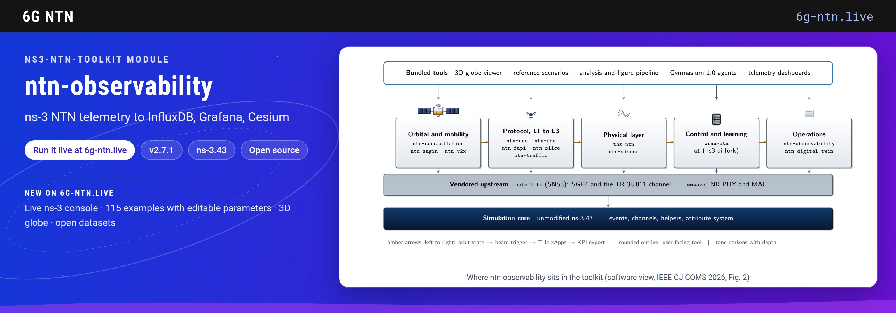
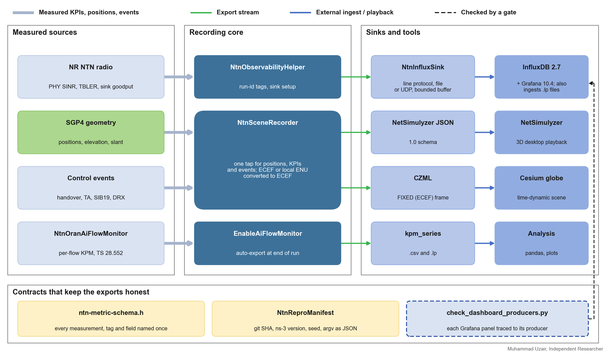
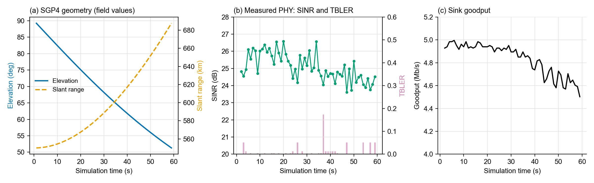

<!-- hero-banner -->
<p align="center"><a href="https://muhammaduazir69.github.io/ntn-observability/"></a></p>

<h1 align="center">ntn-observability</h1>

<p align="center"><strong>One scene recorder feeding InfluxDB, Grafana, NetSimulyzer and Cesium from measured KPIs, with a documented time anchor and a reproducibility manifest</strong></p>

<p align="center">
  <a href="https://youtu.be/JNStiBst68I"></a><br/>
  <a href="https://youtu.be/JNStiBst68I"></a><br/>
  <a href="https://6g-ntn.live"></a><br/>
  <sub><b>Try it live:</b> <a href="https://6g-ntn.live">6g-ntn.live</a> runs the toolkit's examples in the browser, with open datasets, a scenario gallery and a research forum.</sub><br/>
  <sub>The NTN Control Center runs and visualizes the ntn-observability examples on a live 3D globe (5-minute video).</sub>
  <a href="https://muhammaduazir69.github.io/ntn-observability/"></a>
  <a href="https://github.com/Muhammaduazir69/ntn-observability/releases/latest"></a>
  <a href="https://www.linkedin.com/in/muhammad-uzair-285331185/"></a><br/>
  <sub><b>New on 6g-ntn.live:</b> a live ns-3 console, 115 examples with editable parameters, a 3D globe of real constellations, open datasets (CC BY 4.0) and a validation page with 690 test cases in 41 suites.</sub><br/>
</p>


<p align="center">
  <a href="https://www.nsnam.org"></a>
  <a href="https://www.gnu.org/licenses/old-licenses/gpl-2.0.en.html"></a>
  
  
  
  <a href="https://doi.org/10.1109/OJCOMS.2026.3745010"></a>
</p>

<p align="center">
  <a href="https://github.com/Muhammaduazir69/ns3-ntn-toolkit">Toolkit</a>
  &nbsp;·&nbsp;
  <a href="https://muhammaduazir69.github.io/ns3-ntn-toolkit/modules/ntn-observability/">Docs</a>
  &nbsp;·&nbsp;
  <a href="INSTALL.md">Install</a>
  &nbsp;·&nbsp;
  <a href="#results">Results</a>
  &nbsp;·&nbsp;
  <a href="#examples">Examples</a>
</p>

---

## Why this module

A multi-hour, multi-satellite run produces the telemetry a real RAN does (SINR,
TBLER, goodput, timing advance, satellite positions, handovers), but ns-3's
default trace surface stops at flat ASCII files. Visualizing an orbital
simulation is also a question of what you refuse to draw: a globe that shows
satellites moving is easy, while one that shows which satellite actually serves
which terminal, at a time that maps back to simulation time, is the one that can
catch a bug. This module records the scene once and exports it to the tools
operators already use, with links traveling alongside positions, labels escaped
on the way out, and a manifest that makes each run reproducible.

## System design

<p align="center">
  
</p>

<p align="center"><sub>Measured sources on the left, the recording core in the middle, sinks and external tools on the right. The schema names every measurement once; <code>tools/check_dashboard_producers.py</code> traces each Grafana panel back to the code that emits it. Script: <code>doc/figures/make_ntn_observability_design.py</code>.</sub></p>

## Results

<p align="center">
  
</p>

<p align="center"><sub>One run of <code>ntn-observability-traffic</code> (60 s, 550 km SGP4 pass, 20 GHz, 85 dBm EIRP, seed 1), plotted from the line-protocol file the sink wrote rather than from simulator memory: <code>sweep-results-2026-06-25/ntn-observability/traffic-heavy.lp</code> in the toolkit workspace (59 points, 58 with a PHY sample). Script: <code>doc/figures/make_ntn_observability_results.py</code>.</sub></p>

Read back from the export: elevation 89.2 to 51.3 degrees, slant range 550 to
688 km, mean per-second SINR 25.08 dB, mean per-second goodput 4.84 Mb/s. The
run's own health record (`traffic-heavy-out/sim_health.csv`, all rows passing)
gives the whole-run values: 26,119 transport blocks received, SINR 24.96 dB,
TBLER 0.033, 4.71 Mb/s throughput, 7.81 ms one-way delay from in-band
timestamps, 3.3 % application loss. Goodput eases from about 4.9 to 4.5 Mb/s over
the last 20 s as the slant range grows; the plot is drawn from the exported
series, not from a separate log.

Also stored from the same sweep: `ntn-netsimulyzer-official-demo` (6 SGP4
satellites, 4 TR 38.811 UEs, 15 s) wrote a NetSimulyzer scene with 190 events,
a CZML file and a manifest that round-trips (`netsim-scene.log`: mean DL SINR
17.34 dB, TBLER 0.041, 16.58 Mb/s).

## Classes

| Header | Provides |
|---|---|
| `model/ntn-metric-schema.h` | header-only canonical schema: `measurement::`, `tag::`, `field::` tables naming every KPI once; pinned by a test |
| `model/ntn-influx-sink.h` | `NtnInfluxSink`: InfluxDB v2 line protocol with key escaping, file or UDP transport, run-id tags, `MaxBufferPoints` (default 1,000,000; oldest points dropped and counted), base epoch reported |
| `model/ntn-netsimulyzer-exporter.h` | `NtnNetSimulyzerExporter`: streaming JSON in the NIST NetSimulyzer 1.0 schema |
| `model/ntn-scene-recorder.h` | `NtnSceneRecorder`: one tap that reads mobility positions (ECEF or local ENU, converted to ECEF), KPIs and events, and fans them out to NetSimulyzer and CZML |
| `model/ntn-repro-manifest.h` | `NtnReproManifest`: git SHA, ns-3 version, scenario, seed, TLE epoch, service models, argv; `WriteJson()` and `LoadJson()` |
| `helper/ntn-observability-helper.h` | `NtnObservabilityHelper`: one-call setup of the sinks with consistent run-id tagging |
| `helper/ntn-scene-helper.h` | wiring helpers for the scene recorder |
| `dashboards/` | four Grafana dashboards: Overview, Handover, Radio, ISL |
| `docker/` | InfluxDB 2.7, Grafana 10.4 and a Telegraf sidecar, with provisioning |

The per-flow KPM exporter `NtnOranAiFlowMonitor` lives in `ntn-traffic`; the
canonical wiring is `NtnRealStackHelper::EnableAiFlowMonitor(prefix)`, which
writes `<prefix>_kpm_series.csv` and `.lp` at the end of the run.

## Quick start

Inside the toolkit, where the module is present and built:

```bash
./ns3 run "ntn-observability-traffic --simSeconds=40 --out=/tmp/ntn-obs.lp"
./ns3 run "ntn-observability-demo --simTime=20 --runId=local-1 --influxFile=/tmp/run.lp --netSim=/tmp/run.json"

cd contrib/ntn-observability/docker && docker compose up -d   # then open http://localhost:3000
```

Standalone, into an existing ns-3.49 tree (the examples need `ntn-traffic` and
`ntn-rrc`, so the toolkit tree is the easier path):

```bash
git clone -b ntn-observability-v2 https://github.com/Muhammaduazir69/ntn-observability.git contrib/ntn-observability
./ns3 configure --enable-examples --enable-tests
./ns3 build ntn-observability
```

With Docker, prebuilt:

```bash
docker run --rm uzairdocker69/ns3-ntn-toolkit:latest \
  ./ns3 run "ntn-observability-traffic --simSeconds=40 --out=/tmp/ntn-obs.lp"
```

## Examples

| Example | What it does | Main outputs |
|---|---|---|
| `ntn-observability-traffic` | an NR NTN cell on an SGP4 pass with a saturating eMBB `NtnOranApplication` flow; each second exports measurement `ntn_downlink` (goodput, SINR, TBLER, elevation, slant range) | `--out` line protocol (or UDP to `--influxHost`), `_kpm_series.csv` and `.lp`, `sim_health.csv`; args `--simSeconds`, `--leoAltKm`, `--freqGHz`, `--satEirpDbm` |
| `ntn-observability-demo` | the same radio plus `ntn-rrc` control-plane components (timing advance, SIB19, UE location reports, DRX); every KPI goes through `NtnObservabilityHelper` | `--influxFile` line protocol, `--netSim` NetSimulyzer JSON, `sim_health.csv` |
| `ntn-netsimulyzer-official-demo` | drives the official usnistgov NetSimulyzer module from a live NR or mmWave NTN cell | `--out` NetSimulyzer JSON, plus CZML and manifest; args `--sats`, `--ues`, `--duration`, `--radio` |

## Tests

```bash
./test.py -s ntn-observability
python3 -m pytest contrib/ntn-observability/tests-py/   # end-to-end pipeline check
```

The suite registers 17 cases: line-protocol encoding and escaping, file-sink
flush, bounded buffer that drops the oldest points, NetSimulyzer JSON shape,
pinned metric names, five manifest round-trip and parser cases, the serving edge
moving with a handover, hostile labels that cannot break line protocol or CZML,
the scene recorder under `Simulator::Run()`, the base epoch applied to emitted
points, the local-ENU to ECEF conversion at known geometries, and declared beams
and handover links reaching the NetSimulyzer sink.

## Dependencies

ns-3.49 core, mobility and network; `ntn-traffic`, `ntn-rrc`, `ntn-cho`,
`ntn-constellation` and `mmwave` for the examples; optionally the vendored `netsimulyzer`
module for the official demo. Docker and Docker Compose for the dashboard stack.
See [INSTALL.md](INSTALL.md), including the Telegraf setting that rewrites
simulation-time stamps to ingest time.

## Honest scope

- `NtnSceneRecorder` writes NetSimulyzer and CZML; its InfluxDB fan-out is
  planned. Today line protocol comes from `NtnInfluxSink` and the AI flow monitor.
- The `band` tag that `ntn-observability-traffic` writes now follows
  `--freqGHz` (IEEE Std 521 letter bands). Runs made before November 2026,
  including the one above at 20 GHz, carry the fixed label `Ku`; read their
  carrier from the manifest or `sim_health.csv`.
- `ntn_drx` points from `ntn-observability-demo` carry `provenance=timer-fsm-unbound`:
  the DRX state machine runs on its own timers and is not bound to the MAC.
- The results above are from a June 2026 sweep. The module has since gained the
  base-epoch, escaping and handover-edge fixes covered by the tests; rerun the
  example to regenerate the series on the current code.

## Standards

3GPP TS 28.552 and TS 32.425 measurement names; O-RAN E2SM-KPM measurement
identities; CZML; InfluxDB line protocol; NetSimulyzer scene JSON 1.0.

## Citation

If this module contributes to a publication, please cite the toolkit article:

> M. Uzair et al., "ns3-ntn-toolkit: An integrated ns-3 platform for 6G
> non-terrestrial networks," *IEEE Open Journal of the Communications Society*,
> 2026, doi: [10.1109/OJCOMS.2026.3745010](https://doi.org/10.1109/OJCOMS.2026.3745010).

```bibtex
@article{uzair2026ns3ntntoolkit,
  author  = {Uzair, Muhammad and others},
  title   = {ns3-ntn-toolkit: An Integrated ns-3 Platform for 6G Non-Terrestrial Networks},
  journal = {IEEE Open Journal of the Communications Society},
  year    = {2026},
  doi     = {10.1109/OJCOMS.2026.3745010}
}
```

## License

GPL-2.0-only, matching ns-3.

## Contact

**Muhammad Uzair**, Independent Researcher.
Email [muhammaduzairr69@gmail.com](mailto:muhammaduzairr69@gmail.com),
ORCID [0009-0002-4104-2680](https://orcid.org/0009-0002-4104-2680).
Part of the [ns3-ntn-toolkit](https://github.com/Muhammaduazir69/ns3-ntn-toolkit),
mirrored on [GitLab](https://gitlab.com/ns3-ntn-toolkit).
