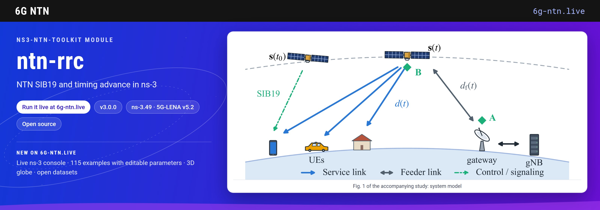
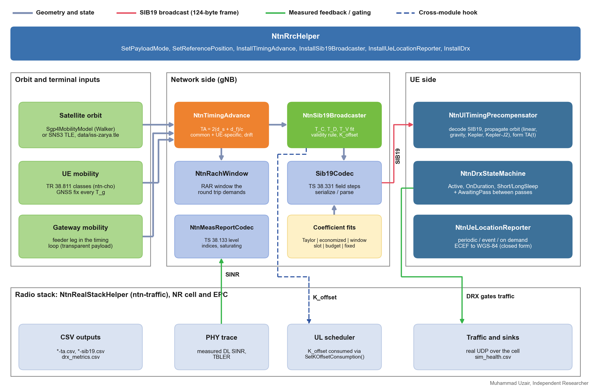
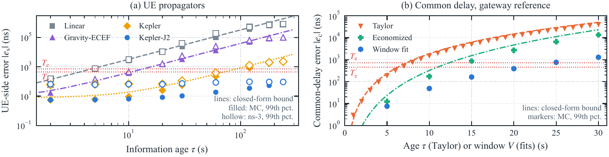
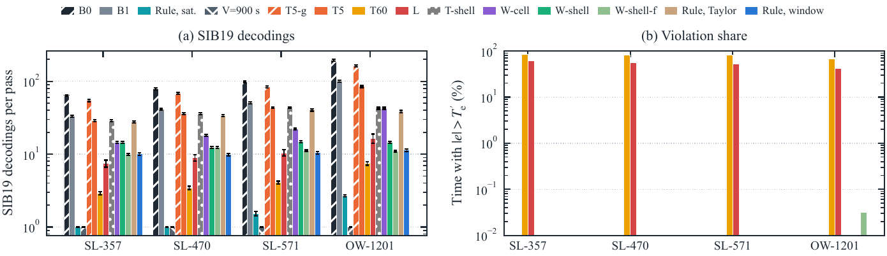

<!-- hero-banner -->
<p align="center"><a href="https://muhammaduazir69.github.io/ntn-rrc/"></a></p>

<h1 align="center">ntn-rrc</h1>

<p align="center"><strong>NR-NTN control plane for ns-3: SIB19 ephemeris that a UE actually decodes, payload-aware timing advance, and DRX that gates a real flow</strong></p>

<p align="center">
  <a href="https://youtu.be/JNStiBst68I"></a><br/>
  <a href="https://youtu.be/JNStiBst68I"></a><br/>
  <a href="https://6g-ntn.live"></a><br/>
  <sub><b>Try it live:</b> <a href="https://6g-ntn.live">6g-ntn.live</a> runs the toolkit's examples in the browser, with open datasets, a scenario gallery and a research forum.</sub><br/>
  <sub>The NTN Control Center runs and visualizes the ntn-rrc examples on a live 3D globe (5-minute video).</sub>
  <a href="https://muhammaduazir69.github.io/ntn-rrc/"></a>
  <a href="https://github.com/Muhammaduazir69/ntn-rrc/releases/latest"></a>
  <a href="https://www.linkedin.com/in/muhammad-uzair-285331185/"></a><br/>
  <sub><b>New on 6g-ntn.live:</b> a live ns-3 console, 115 examples with editable parameters, a 3D globe of real constellations, open datasets (CC BY 4.0) and a validation page with 690 test cases in 41 suites.</sub><br/>
</p>


<p align="center">
  <a href="https://www.nsnam.org"></a>
  <a href="https://www.gnu.org/licenses/old-licenses/gpl-2.0.en.html"></a>
  
  
  
</p>

<p align="center">
  <a href="https://github.com/Muhammaduazir69/ns3-ntn-toolkit">Toolkit</a>
  &nbsp;·&nbsp;
  <a href="https://muhammaduazir69.github.io/ns3-ntn-toolkit/modules/ntn-rrc/">Docs</a>
  &nbsp;·&nbsp;
  <a href="INSTALL.md">Install</a>
  &nbsp;·&nbsp;
  <a href="#examples">Examples</a>
  &nbsp;·&nbsp;
  <a href="#results">Results</a>
</p>

---

## Why this module

NR works over a satellite because three timing mechanisms absorb a round trip the terrestrial standard never planned for: a broadcast K_offset that shifts the uplink grant, a timing advance that pre-compensates propagation, and a validity duration after which the terminal must read SIB19 again. Each is useful only if something downstream consumes it. Stock ns-3 has none of them.

`ntn-rrc` adds them and wires them to consumers. The SIB19 broadcaster fills NTN-Config-r17 from a real orbit and quantizes it to the TS 38.331 field steps; a UE-side pre-compensator decodes it, propagates the satellite with a chosen orbit model and forms its own timing advance; the scheduler in the sibling `ntn-traffic` module can read the broadcast `cellSpecificKoffset`. Timing advance includes the feeder leg for a transparent payload, so the payload mode is not a label: in the shipped test geometry the transparent advance is 8.0 ms longer, twice 1200 km over c. DRX gates a real flow rather than scaling a measured goodput afterwards.

## System design

<p align="center">
  
</p>

*Figure 1. Classes and data flow. Orbit and terminal mobility (SGP4 from `ntn-constellation`, TR 38.811 UE classes from `ntn-cho`, an optional gateway for the feeder leg) feed the timing advance; the broadcaster turns it into SIB19 content, the codec serializes it, and the UE-side pre-compensator decodes it. Cross-module hooks reach the uplink scheduler (K_offset) and the PHY trace (measured SINR) of the `ntn-traffic` radio stack. Source: [`doc/figures/make_architecture.py`](doc/figures/make_architecture.py).*

## Results

The numbers below come from an uplink timing pre-compensation study run with this module's `ntn-rrc-ul-timing` example (`NtnSib19Broadcaster` plus `NtnUlTimingPrecompensator` on SGP4 orbits). The study binary is that example with one addition that is not yet merged here: SIB19 content announced 0.64 s ahead of its epoch (`--leadS`), as the si-Periodicity requires. The patch, its regression check and the campaign scripts are in `paper/tvt-2026-uplink-timing/` of the toolkit tree (`ns3_patch/`, `run_ns3_campaign.py`, `make_macros.py`).

**Experiment.** 400 LEO passes, 100 on each of four shells drawn from real element sets (357, 470 and 571 km Starlink shells, 1201 km OneWeb), with the closest approach drawn uniformly over a day, a 900 s window around it, a 25 degree elevation mask and 3 m GNSS error. Every scheme runs on the same passes (paired design, one noise seed per pass). The timing error limit is T_e' = 456 ns, the 716 ns NTN limit of TS 38.133 minus a 260 ns implementation allowance.

<p align="center">
  
</p>

*Figure 2. Timing error against information age on the 470 km shell. (a) UE-side error for four propagators: closed-form bound (lines), Monte Carlo 99th percentile (filled) and ns-3 99th percentile (hollow, pooled over 40 passes). (b) Common-delay error with the gateway as reference point: Taylor coefficients against age; economized and window-fit coefficients against the validity window. Dotted red lines mark T_e and T_e'.*

<p align="center">
  
</p>

*Figure 3. ns-3 comparison over 400 passes (100 per shell, paired; the L and T60 schemes over 160). (a) SIB19 decodings per pass, mean with 95 % bootstrap interval over passes. (b) Share of served time with timing error above T_e'; shares below 0.01 % are not drawn.*

| Reference point | Scheme | Mean validity (s) | SIB19 decodings per pass | Passes above T_e' | Largest error (ns) |
|---|---|---:|---:|---:|---:|
| Satellite | B0, fixed 5 s on a 2.56 s grid | 5.0 | 109.1 | 0 | 153 |
| Satellite | B1, fixed 5 s on a 1 s grid | 5.0 | 56.5 | 0 | 159 |
| Satellite | No expiry (V = 900 s), Kepler-J2 UE | 900.0 | 1.0 | 0 | 207 |
| Satellite | Error-budget rule (`--validity=budget`) | 612.9 | 1.6 | 0 | 162 |
| Gateway | T5, Taylor coefficients, 5 s | 5.0 | 48.3 | 0 | 393 |
| Gateway | T-shell, Taylor, fixed table per shell | 6.2 | 37.8 | 0 | 393 |
| Gateway | W-shell, window fit, fixed table per shell | 17.5 | 14.1 | 0 | 294 |
| Gateway | Error-budget rule, window fit | 25.1 | 10.4 | 0 | 370 |

What the data say: with the gateway as reference point, replacing Taylor coefficients by the window fit (`--fit=window`) cut decodings by a factor of 2.7 at the same validity table without a violation, and sizing the validity per epoch cut them by a further 1.35. Long validities with Taylor coefficients do fail: a fixed 60 s exceeded T_e' 76.4 % of the time. With the satellite as reference point no common term is broadcast, and a Kepler-J2 UE held one SIB19 for the whole pass. Values are copied from `paper/tvt-2026-uplink-timing/make_macros.py`, which `sim/make_macros.py` writes from `sim/out_r4` and `sim/out_r5`.

Two smaller stored runs of the in-tree examples, single seed each:

| Run | Output on disk | What it shows |
|---|---|---|
| `ntn-rrc-real-stack` (default arguments) | `ns-3-dev/ntn-rrc-real-stack-output/ntn-rrc-real-stack-ta.csv` | 48 samples over 24 s of a 550 km pass: slant range 550.1 to 576.8 km, total TA 3669 to 3847 us, measured SINR 18.6 to 21.9 dB (median 19.8 dB) after the first sample |
| `ntn-rrc-drx-data-traffic --drxOn=false` | `ns-3-dev/ntn-rrc-drx-data-traffic-output/drx_metrics.csv` | DRX disabled reference: awake fraction 1, measured goodput 17.66 Mb/s |

## Architecture and classes

| Class / API | Header | Role |
|---|---|---|
| `NtnTimingAdvance` | `model/ntn-timing-advance.h` | `ComputeTotalTa()` = 2(d_service + d_feeder)/c, `ComputeCommonTa()`, `ComputeUeSpecificTa()`, `ComputeTaDriftRate()`, `ComputeTaDriftVariation()`. The feeder leg is included for a transparent payload once a gateway mobility is set; a warning is logged when it is missing. |
| `EphemerisInfo`, `Sib19Content`, `Sib19Codec` | `model/ntn-sib19.h` | NTN-Config-r17 content (ECEF state vector, `ta-Common`, drift and drift variation, `ul-SyncValidityDuration`, K_offset, `kMac`), fixed-layout serialization at the TS 38.331 field steps. |
| `NtnSib19Broadcaster` | `model/ntn-sib19.h` | Periodic broadcaster driven by the live orbit. Uplink sync reference point (`UlSyncReference`: gateway or satellite), coefficient fit (`Sib19CoefficientFit`: Taylor, economized, window), validity rule (`Sib19ValidityRule`: slot over drift, error budget, fixed). Derives `K_offset = ceil(RTT / slot) + 1`. |
| `NtnUlTimingPrecompensator` | `model/ntn-ul-timing-precompensator.h` | UE side: decodes SIB19, propagates the satellite (`UeEphemerisModel`: linear, gravity-ECEF, Kepler, Kepler-J2) from the last GNSS fix and forms TA(t) = 2\|s(t) - p\|/c + T_C + T_D tau + T_V tau^2. |
| `NtnRachWindow`, `NtnRachWindowVerdict` | `model/ntn-rach-window.h` | The RAR window a given round trip demands and whether the configured `ra-ResponseWindow` can express it (TS 38.213 section 8.1, TR 38.821 section 7.3). |
| `NtnMeasReportCodec`, `NtnMeasQuantity` | `model/ntn-meas-report.h` | MeasurementReport content quantized to TS 38.133 level indices (RSRP, RSRQ, SINR), saturating at the range ends. |
| `NtnDrxStateMachine`, `NtnDrxConfig` | `model/ntn-drx.h` | Connected-mode DRX (`Active`, `OnDuration`, `ShortSleep`, `LongSleep`) plus an NTN `AwaitingPass` state between visibility windows. |
| `NtnUeLocationReporter` | `model/ntn-ue-location-report.h` | Periodic, event-triggered and on-demand GNSS reports; closed-form ECEF and WGS-84 conversion. |
| `PayloadMode`, `TaReferenceFrame`, `GnssCapability` | `model/ntn-rrc-types.h` | Transparent or regenerative payload, TA reference frame, UE GNSS capability. |
| `NtnRrcHelper` | `helper/ntn-rrc-helper.h` | Installs timing advance, SIB19 broadcaster, location reporter and DRX on node pairs. |

## Quick start

Inside the toolkit, where the module is already present and built:

```bash
./ns3 run ntn-rrc-real-stack
./ns3 run "ntn-rrc-ul-timing --model=kepler-j2 --ref=gateway --fit=window --validity=budget"
./ns3 run "ntn-rrc-drx-data-traffic --simSeconds=20 --numUes=4 --drxOn=true"
```

Standalone, into an existing ns-3.49 tree:

```bash
git clone -b ntn-rrc-v4 https://github.com/Muhammaduazir69/ntn-rrc.git contrib/ntn-rrc
./ns3 configure --enable-examples --enable-tests
./ns3 build
```

The model library needs only core ns-3 modules, but most examples build on `ntn-traffic` (the real-stack spine), `ntn-constellation` (SGP4) and `ntn-cho` (TR 38.811 UE mobility), so the toolkit tree is the path of least resistance. `INSTALL.md` lists every dependency.

## Examples

| Example | What it shows | Command |
|---|---|---|
| `ntn-rrc-ul-timing` | UE-side uplink timing pre-compensation over a real pass: SIB19 broadcast every `--sibPeriod`, decoded by the UE, timing error against the true two-way delay every 100 ms, written to `--out` | `./ns3 run "ntn-rrc-ul-timing --fit=window --validity=budget --out=ul.csv"` |
| `ntn-rrc-leo-pass` | TA and SIB19 on a real mmwave NR NTN cell over an SGP4 pass; measurement reports fire on the measured DL SINR | `./ns3 run "ntn-rrc-leo-pass --simTime=20 --transparent=true"` |
| `ntn-rrc-full-stack` | TA, SIB19, GNSS reporting and DRX together; beam-center reference offset 50 km so the UE-specific TA is non-zero | `./ns3 run "ntn-rrc-full-stack --simTime=20 --passAwareDrx=true"` |
| `ntn-rrc-from-tle` | The same cell driven by a real TLE through SNS3 `SatSGP4MobilityModel`; runs with no arguments on the bundled ISS TLE | `./ns3 run ntn-rrc-from-tle` |
| `ntn-rrc-drx-data-traffic` | Real UDP downlink with DRX gating; writes `drx_metrics.csv` (awake fraction from the state machine, measured goodput) | `./ns3 run "ntn-rrc-drx-data-traffic --drxOn=true"` |
| `ntn-rrc-real-stack` | Flagship: SIB19 re-broadcast from the live ephemeris while packets cross the radio; TA decomposition to `ntn-rrc-real-stack-ta.csv` | `./ns3 run "ntn-rrc-real-stack --duration=20 --numUes=4"` |

Every radio example writes `sim_health.csv` with the provenance of each measured KPI to `--outputDir`.

## Tests

```bash
./test.py -s ntn-rrc
```

The `ntn-rrc` suite (`Type::UNIT`, 28 test cases) covers closed-form TA for both payloads and the feeder leg, the common and UE-specific split, the LEO drift-rate bound, SIB19 codec round trip and truncation rejection, broadcaster cadence and K_offset, the UE pre-compensator, RACH window and measurement-report quantization, ECEF and WGS-84 round trips, the three location-report modes, and DRX including pass-aware sleep and invalid configurations.

## Dependencies

ns-3.49 core, network and mobility. Examples additionally use `ntn-traffic`, `ntn-constellation`, `ntn-cho`, the in-tree `mmwave` or `nr` stack, and SNS3 `satellite` for `ntn-rrc-from-tle`.

## Scope and limitations

- SIB19 is serialized to a trace source and a buffer, and decoded by `NtnUlTimingPrecompensator`; it is not carried on BCCH or PDSCH of the radio stack.
- K_offset is consumed only where `NtnRealStackHelper::SetKOffsetConsumption()` (in `ntn-traffic`) is enabled; the mmwave MAC never reads it.
- The radio examples use the mmwave ideal RRC (`UseIdealRrc=true`): bearers are set up at attach with no over-the-air RRC PDU exchange, and the core is the LTE EPC, not a 5GC. The machinery here runs alongside that RRC as assistance and accounting.
- The 0.64 s lead used in the Results section is in the study patch, not yet in this tree.

## Standards

3GPP TS 38.331 (SIB19, NTN-Config-r17, MeasurementReport), TS 38.213 section 4.2 (timing advance, K_offset) and section 8.1 (RAR window), TS 38.211 section 4.3.1, TS 38.321 (DRX, random access), TS 38.133 (timing error limits, measurement quantization), TR 38.821 (NTN timing budgets).

## Citation

If you use this module, please cite the toolkit article:

```bibtex
@article{uzair2026ns3ntntoolkit,
  author  = {Uzair, Muhammad and others},
  title   = {ns3-ntn-toolkit: An Integrated ns-3 Platform for {6G} Non-Terrestrial Networks},
  journal = {IEEE Open Journal of the Communications Society},
  year    = {2026},
  doi     = {10.1109/OJCOMS.2026.3745010}
}
```

## License

GPL-2.0-only, matching ns-3.

## Contact

**Muhammad Uzair**, Independent Researcher. muhammaduzairr69@gmail.com, [ORCID 0009-0002-4104-2680](https://orcid.org/0009-0002-4104-2680).
Part of the [ns3-ntn-toolkit](https://github.com/Muhammaduazir69/ns3-ntn-toolkit); mirrored on [GitLab](https://gitlab.com/ns3-ntn-toolkit).
