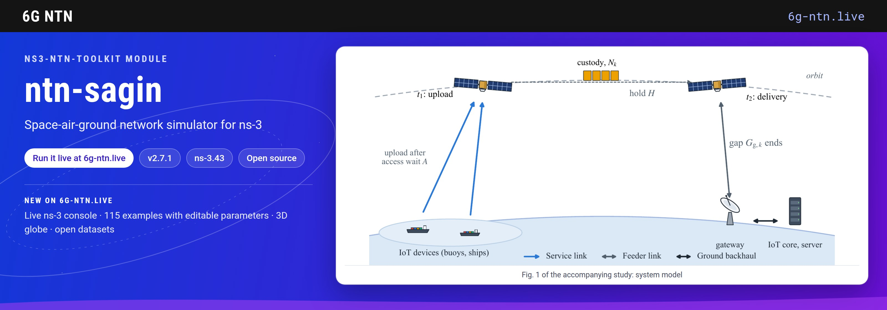
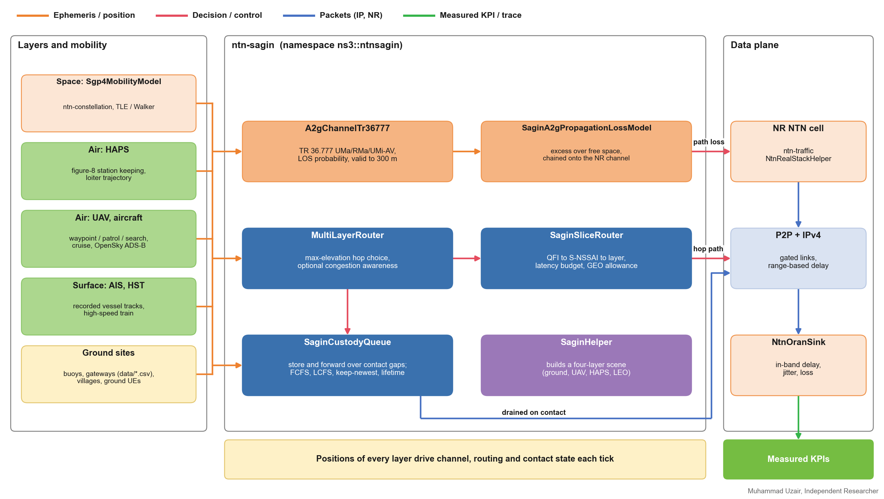
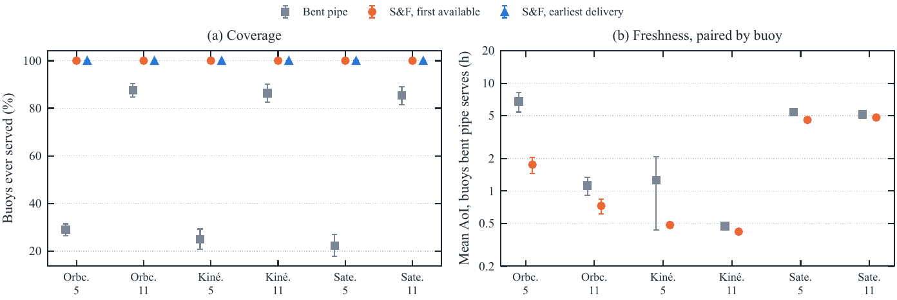
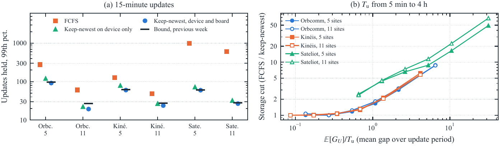

<!-- hero-banner -->
<p align="center"><a href="https://muhammaduazir69.github.io/ntn-sagin/"></a></p>

<h1 align="center">ntn-sagin</h1>

<p align="center"><strong>Space-air-ground integrated networking: ground, UAV, HAPS and LEO layers, a router that has to choose between them, and custody across contact gaps</strong></p>

<p align="center">
  <a href="https://youtu.be/JNStiBst68I"></a><br/>
  <a href="https://youtu.be/JNStiBst68I"></a><br/>
  <a href="https://6g-ntn.live"></a><br/>
  <sub><b>Try it live:</b> <a href="https://6g-ntn.live">6g-ntn.live</a> runs the toolkit's examples in the browser, with open datasets, a scenario gallery and a research forum.</sub><br/>
  <sub>The NTN Control Center runs and visualizes the ntn-sagin examples on a live 3D globe (5-minute video).</sub>
  <a href="https://muhammaduazir69.github.io/ntn-sagin/"></a>
  <a href="https://github.com/Muhammaduazir69/ntn-sagin/releases/latest"></a>
  <a href="https://www.linkedin.com/in/muhammad-uzair-285331185/"></a><br/>
  <sub><b>New on 6g-ntn.live:</b> a live ns-3 console, 115 examples with editable parameters, a 3D globe of real constellations, open datasets (CC BY 4.0) and a validation page with 690 test cases in 41 suites.</sub><br/>
</p>


<p align="center">
  <a href="https://www.nsnam.org"></a>
  <a href="https://www.gnu.org/licenses/old-licenses/gpl-2.0.en.html"></a>
  
  
  
</p>

<p align="center">
  <a href="https://github.com/Muhammaduazir69/ns3-ntn-toolkit">Toolkit</a>
  &nbsp;|&nbsp;
  <a href="https://muhammaduazir69.github.io/ns3-ntn-toolkit/modules/ntn-sagin/">Docs</a>
  &nbsp;|&nbsp;
  <a href="INSTALL.md">Install</a>
  &nbsp;|&nbsp;
  <a href="#examples">Examples</a>
  &nbsp;|&nbsp;
  <a href="#results">Results</a>
</p>

---

## Why this module

A space-air-ground network gets interesting exactly where the layers disagree: a UAV relay that is close but short of capacity, a HAPS that is stable but rare, a LEO satellite that is fast but leaving. This module gives each layer real mobility and a real channel and makes the router pick from a pool of candidates rather than a fixed index. When no layer is in view, traffic can wait in custody instead of being dropped.

The air-to-ground channel is TR 36.777, and it keeps its own boundary: the recommendation is validated up to 300 m of aerial height, so calls above that are recorded and reportable rather than silently extrapolated. The chained excess-over-free-space loss is signed. Clamping it at zero sounds harmless, but it turns the model into plain Friis at short line-of-sight range and rectifies the shadow-fading distribution, which removed about 35 percent of draws at 1 km.

## System design

<p align="center">
  
</p>

<p align="center"><em>Figure 1. Classes of ntn-sagin. Mobility models of every layer feed the TR 36.777 channel, the layer routers and the custody queue each tick; the channel is chained onto a real NR NTN cell from ntn-traffic, and the router's hop path and the drained custody queue drive gated point-to-point IPv4 links. Source: <code>doc/figures/make_architecture.py</code>.</em></p>

| Class | Header | Role |
|---|---|---|
| `HapsMobilityModel`, `HapsTrajectoryMobilityModel` | `haps-mobility-model.h`, `haps-trajectory-mobility-model.h` | Figure-8 (lemniscate) station keeping with a bounded vertical envelope; waypoint and loiter trajectory playback. |
| `UavWaypointMobilityModel`, `UavPatrolMobilityModel`, `UavSearchPatternMobilityModel` | `uav-mobility-models.h` | Random waypoint, A to B patrol, lawnmower search. |
| `AeronauticalMobilityModel`, `OpenSkyMobilityModel` | `aeronautical-scenario.h`, `opensky-mobility-model.h` | Constant-altitude cruise; aircraft replayed from OpenSky ADS-B traces. |
| `AisMobilityModel`, `HstMobilityModel` | `ais-mobility-model.h`, `hst-mobility-model.h` | Vessels replayed from AIS records; high-speed train along a track. Trace loaders in `ais-maritime-trace.h`, `hst-trace.h`, `opensky-adsb-trace.h`, `haps-trajectory-trace.h`. |
| `A2gChannelTr36777` | `a2g-channel-tr36777.h` | TR 36.777 v15.0.0 path loss and LOS probability for UMa-AV, RMa-AV and UMi-AV. |
| `SaginA2gPropagationLossModel` | `sagin-a2g-propagation-loss-model.h` | The same model as an ns-3 `PropagationLossModel`; chained onto a real NR spectrum channel it attenuates actual packets, returning the excess over free space to avoid double counting. |
| `MultiLayerRouter` | `multi-layer-router.h` | Greedy max-elevation path computation over ground, UAV, HAPS and LEO candidates, with a pluggable score callback. Optional congestion awareness (`SetLinkLoadSource`, `SetCongestionAware`, default off): a filling link is penalized and one at the cutoff is rejected; a link of unknown load is scored on elevation, not assumed idle. Returns a `SaginHop` vector. |
| `SaginSliceRouter` | `sagin-slice-router.h` | Wraps `MultiLayerRouter`: QFI to S-NSSAI to slice profile, layer choice biased by latency budget and a GEO allowance. |
| `SaginCustodyQueue` | `sagin-custody-queue.h` | Store and forward: holds packets while the next hop is out of contact and drains them when it opens. FCFS by default, `SetLastComeFirstServed`, `SetReplaceSameSource` (keep only the newest per source), per-hop or end-to-end lifetime, byte capacity with oldest-first eviction. Counters: forwarded immediately, forwarded from custody, expired, dropped for space, largest custody delay. Opt-in `SetCustodyTransfer` adds RFC 5050 5.10 custody transfer: a forwarded bundle stays in custody (and in storage) until `AcceptCustody`, `RefuseCustody` returns it to the queue, an overdue signal triggers a retransmission, and lifetime expiry of retained bundles is counted as a bundle-deletion status report (RFC 9171 6.1.1, reason 1). |
| `SaginBundleHeader`, `SaginBundleTrailer`, `SaginCustodySignalHeader` | `sagin-bundle-protocol.h` | BPv7 on the wire: the bundle as a CBOR indefinite-length array (RFC 9171 4.1), the 8-item primary block with ipn EIDs, creation timestamp [DTN ms, sequence] and lifetime (4.3.1), the payload block header (4.3.2), and the RFC 5050 6.3 custody signal record (succeeded, reason, subject bundle), CBOR (RFC 8949). |
| `SaginHelper` | `sagin-helper.h` | Builds a four-layer scene in one call. |

## Results

The results below come from a store-and-forward IoT study built on `SaginCustodyQueue` and `examples/sagin-store-forward-iot.cc`. Its code and data are in the toolkit workspace under `paper/iotj-2026-store-and-forward/` (campaign driver `run_ns3_sf4.py`, outputs `out/ns3_sf4.jsonl`, 825 ns-3 runs from one binary; numbers by `make_macros.py`). Setup: the Orbcomm, Kinéis and Sateliot fleets, each satellite flying its own element set through Vallado SGP4; 60 ocean buoys and either five or eleven gateways; one 40-byte status update per buoy every 15 min; every (device, satellite) and (satellite, gateway) pair a 1 Mb/s point-to-point IPv4 link that drops all packets while the pair is out of view and whose delay follows the slant range; four simulated days, three with traffic; five replications with different buoy subsets and random-number runs. Radio access is not modeled.

<p align="center">
  
</p>

<p align="center"><em>Figure 2. ns-3, five replications, 95 % intervals. (a) Share of buoys that were ever served, bent pipe against store and forward to the first visible satellite and to the satellite with the earliest predicted delivery, per fleet and gateway set (5 or 11 sites). (b) Mean age of information on the buoys that bent pipe also serves, paired by buoy.</em></p>

| Fleet (5 gateways, ns-3, mean with 95 % half-width over 5 replications) | Orbcomm | Kinéis | Sateliot |
|---|---|---|---|
| Buoys served by bent pipe (%) | 29 ± 3 | 25 ± 6 | 22 ± 6 |
| Age of information on those buoys, bent pipe (h) | 6.79 ± 1.97 | 1.26 ± 1.17 | 5.38 ± 0.24 |
| Same buoys, store and forward (h) | 1.76 ± 0.42 | 0.48 ± 0.04 | 4.57 ± 0.25 |
| Updates delivered under keep-newest (%) | 45.5 ± 1.2 | 59.1 ± 1.5 | 10.2 ± 0.7 |
| Updates held on board, 99th percentile: FCFS / keep-newest | 107 / 35 | 51 / 25 | 354 / 24 |
| Storage cut, FCFS over keep-newest (per replication) | 3.1 ± 0.2 | 2.1 ± 0.1 | 14.5 ± 0.9 |

<p align="center">
  
</p>

<p align="center"><em>Figure 3. Updates held by a satellite just before a gateway contact, 99th percentile over contacts, from the study's slot-level custody simulator on the same contact plans (mean over three weeks). (a) FCFS, keep-newest on the device only, keep-newest on device and board, and a bound computed from the previous week's plan. (b) The storage cut against the ratio of mean contact gap to update period.</em></p>

In short: on every fleet, custody served all buoys where bent pipe reached 22 to 29 percent of them, and keeping only the newest update per device cut the on-board backlog by a factor of 2.1 to 14.5 while delivering a smaller share of updates. Figure 3 is from the study's own slot simulator, not from ns-3; the ns-3 table above is the packet-level check.

## Quick start

Inside the toolkit, where the module is already present and built:

```bash
./ns3 run "sagin-store-forward-iot --policy=sf1 --days=2"
./ns3 run "ntn-sagin-remote-coverage --sharing=1"
./test.py -s ntn-sagin
```

Standalone, into an existing ns-3.43 tree:

```bash
git clone -b ntn-sagin-v2 https://github.com/Muhammaduazir69/ntn-sagin.git contrib/ntn-sagin
./ns3 configure --enable-examples --enable-tests
./ns3 build
```

`INSTALL.md` lists the dependencies. Most examples build on `ntn-traffic` (the real NR stack) and `ntn-constellation` (orbits), so the toolkit tree is the easiest place to run them.

## Examples

Fourteen programs ship under `examples/`; binaries land at `build/contrib/ntn-sagin/examples/ns3.43-<name>-default`. Real-cell examples build an NR NTN cell with `NtnRealStackHelper` and print SINR, TBLER and throughput measured off the PHY trace, plus `sim_health.csv` in `--outputDir`. Data-plane examples build point-to-point IPv4 links with geometry-driven error models and measure delay, jitter, loss and goodput at `NtnOranSink` from the in-band header.

| Example | What it shows | Command |
|---|---|---|
| `sagin-store-forward-iot` | Buoys report through a sparse LEO fleet (real element sets, Vallado SGP4) with custody on devices and satellites. `--policy` = `bp` (bent pipe), `sf1` (store and forward to the highest satellite), `sfe` (earliest predicted delivery); `--keepNewest`, `--lcfs`, `--lifetimeH`. The server writes one line per received update. Defaults reproduce the IoT-J output (0/1 visibility gate, no radio). Options: `--linkModel=satlink` (NtnSatLinkErrorModel per hop and direction on a declared TR 38.821 Set-1 budget; the noise bandwidth is the symbol rate the 1 Mb/s hop needs at QPSK 1/2), `--contacts=cgr` (contacts from ContactGraphScheduler, gateway choice from ContactGraphRouter), `--dtn=bpv7` (BPv7 bundles plus RFC 5050 custody transfer, `--custodyTimeoutS`). | `./ns3 run "sagin-store-forward-iot --policy=sfe --keepNewest=1"` |
| `ntn-sagin-remote-coverage` | Multi-operator sharing of one LEO cell for a remote village; with `--sharing=1` the second operator's UEs ride the first operator's cell on their own S-NSSAI and the measured per-operator volume gives the cost split. | `./ns3 run "ntn-sagin-remote-coverage --sharing=1"` |
| `sagin-haps-leo-relay` | Ground UE to UAV relay to HAPS to LEO; the router logs per-hop elevation and range each second while the access hop is a real NR cell with the TR 36.777 channel. The route columns are a geometry trace and do not actuate traffic. | `./ns3 run "sagin-haps-leo-relay --simTime=30 --csv=sagin.csv"` |
| `sagin-uav-swarm` | Eight UAVs (waypoint, patrol, search) as UEs of a ground gNB over the RMa-AV channel; per-UAV SINR each second. | `./ns3 run "sagin-uav-swarm --simTime=30 --fcGHz=2.0"` |
| `sagin-a2g-real-stack` | `SaginA2gPropagationLossModel` chained onto a real NR air interface; the LOS and NLOS branches appear as a measured SINR and throughput gap. | `./ns3 run "sagin-a2g-real-stack --duration=12 --link=NLOS --scenario=UMa_AV"` |
| `sagin-aeronautical` | A cruise leg at 11 km and 250 m/s served by a passing LEO over a real NR cell; geometry logged, radio KPIs measured. | `./ns3 run "sagin-aeronautical --simTime=30 --cruise=11000 --speed=250"` |
| `sagin-flight-leo-e2` | Long-haul flight with E2-KPM indications from the satellite gNB; a mid-pass elevation descent pushes measured SINR below threshold and logs a RELEASE event. | `./ns3 run "sagin-flight-leo-e2 --simSeconds=30 --reportMs=500"` |
| `sagin-multihop-traffic` | Three point-to-point hops, ground to UAV to HAPS to LEO, each with its own error model; the route is actuated, so it can be checked against per-leg bytes. | `./ns3 run "sagin-multihop-traffic --simSeconds=60 --dataRateMbps=20"` |
| `sagin-slice-traffic` | URLLC, eMBB and mMTC flows steered onto HAPS, LEO and GEO legs by latency budget; the mMTC flow on the GEO leg measures about 119 ms one-way, the 35 786 km propagation time. | `./ns3 run "sagin-slice-traffic --simSeconds=60 --dataRateMbps=10"` |
| `sagin-maritime-leo-traffic` | A vessel terminal under `AisMobilityModel` served by a passing LEO over a real NR cell. | `./ns3 run "sagin-maritime-leo-traffic --simSeconds=30 --vesselSpeedKn=20"` |
| `sagin-hst-leo-traffic` | A high-speed-train terminal served by a passing LEO over a real NR cell. | `./ns3 run "sagin-hst-leo-traffic --simSeconds=30 --trainSpeedKmh=500"` |
| `sagin-adsb-flight-leo-traffic` | An in-flight terminal replayed from an ADS-B trace, served by a passing LEO. | `./ns3 run "sagin-adsb-flight-leo-traffic --simSeconds=30"` |
| `sagin-sgp4-routed-traffic` | SGP4 shell plus contact-graph routing on a real IP data plane: contacts bring interfaces up and down, delays follow the slant range, global routing reroutes the live flow (recomputed on contact events only), cross-checked each second against the router's Dijkstra path. Each hop direction loses packets through NtnSatLinkErrorModel on a declared payload (Set-1 Ka satellite, VSAT HAPS/gateway terminals, 23 GHz ISL dishes, DVB-S2 8PSK 3/4), so a hop near the elevation floor is partly lossy; `--linkModel=gate` restores the old binary budget. Prints owd p95 and per-hop loss. | `./ns3 run "sagin-sgp4-routed-traffic --simSeconds=120 --altKm=550 --inclDeg=53"` |
| `ntn-sagin-orphan-mobility-showcase` | A HAPS flying a loiter racetrack, a ground to HAPS to LEO packet plane, relay geometry and Doppler from live positions, optional NetSimulyzer JSON and Cesium CZML. | `./ns3 run "ntn-sagin-orphan-mobility-showcase --duration=120"` |

## Tests

```bash
./test.py -s ntn-sagin
```

`test/sagin-bpv7-test.cc` (suite `ntn-sagin-bpv7`) checks the CBOR primary block and custody signal round trip and the custody-transfer accounting (accept, refuse, timer retransmission, lifetime deletion reports) under `Simulator::Run()`. `test/ntn-sagin-test-suite.cc` registers 42 test cases: HAPS, UAV, aeronautical, OpenSky, AIS and HST mobility (importers, interpolation, replay under simulator time), the TR 36.777 path loss, LOS probability, fading, validated height band and signed excess loss, the multi-layer router (scorers, congestion awareness, gating a data plane), slice routing, and the custody queue (forwarding, expiry, LCFS, end-to-end lifetime).

## Dependencies

- ns-3.43: `core`, `network`, `internet`, `mobility`, `propagation`, `point-to-point`, `applications`; toolkit module `ntn-slice` (linked by `CMakeLists.txt`).
- Examples: `ntn-traffic` (`NtnRealStackHelper`, `NtnOranApplication`), `ntn-constellation` (orbits, contact graph), and the toolkit's `mmwave`.
- Sample data in `data/`: AIS and OpenSky traces, buoy and gateway sites, Orbcomm, Kinéis and Sateliot element sets.

## Scope and limitations

- **Partial DTN.** `SaginCustodyQueue` holds and drains packets; with `--dtn=bpv7` the store-and-forward example carries real BPv7 primary blocks and RFC 5050 custody signals over the same radio hops. Not implemented: block CRCs (CRC type 0), extension blocks (previous node, bundle age, hop count), fragmentation, BPSec (RFC 9172), administrative records wrapped in bundles (the custody signal is a bare record over UDP), status reports on the wire (they are counted), a convergence layer (LTP RFC 5326, TCPCL RFC 9174; one bundle per UDP datagram) and SABR route computation (CCSDS 734.3-B-1; the `sfe` policy uses the example's own ephemeris plan).
- **Routers compute paths.** `MultiLayerRouter` and `SaginSliceRouter` return hop vectors and install no forwarding table. In `sagin-haps-leo-relay` and `sagin-aeronautical` the route is a geometry trace that no measured KPI validates; `sagin-multihop-traffic` is the example where the route is actuated.
- **Regenerative payload.** `RegenMode` in `ntn-constellation` filters Dijkstra transit and decides whether a satellite may run an Xn handover (`NtnXnHandover`: HANDOVER REQUEST, ACKNOWLEDGE, SN STATUS TRANSFER, UE CONTEXT RELEASE over the ISL, 20.01 ms at 1500 km measured). The XnAP messages are an ns-3 `Header` with toolkit-internal type values, not ASN.1 APER, and the Xn path is not yet wired to the `NrGnbNetDevice` that `NtnRealStackHelper` can build on a satellite. In `sagin-sgp4-routed-traffic` the satellites are plain IP routers. Treat ISL paths as transparent unless you wire that yourself.
- **A2G validity.** TR 36.777 is validated to 300 m aerial height; calls above it are recorded, not hidden.

## Standards

3GPP TR 36.777 (UAV air-to-ground: UMa-AV, RMa-AV, UMi-AV path loss, LOS probability, shadow fading), TR 38.811 and TR 38.821 (NTN layers and geometry), TS 23.501 (QFI and S-NSSAI), TS 28.552 (KPM names), TS 38.300 Section 9.2.3 (Xn handover).

## Citation

If you use this module, please cite the toolkit article:

```bibtex
@article{uzair2026ns3ntn,
  author  = {Uzair, Muhammad and others},
  title   = {ns3-ntn-toolkit: An Integrated ns-3 Platform for {6G} Non-Terrestrial Networks},
  journal = {IEEE Open Journal of the Communications Society},
  year    = {2026},
  doi     = {10.1109/OJCOMS.2026.3745010}
}
```

## License

GPL-2.0-only, matching ns-3. See [LICENSE](LICENSE).

## Contact

**Muhammad Uzair**, Independent Researcher
muhammaduzairr69@gmail.com · [ORCID 0009-0002-4104-2680](https://orcid.org/0009-0002-4104-2680)

Part of the [ns3-ntn-toolkit](https://github.com/Muhammaduazir69/ns3-ntn-toolkit), an integrated ns-3.43 platform for 6G non-terrestrial network research. Mirrored on [GitLab](https://gitlab.com/ns3-ntn-toolkit).
