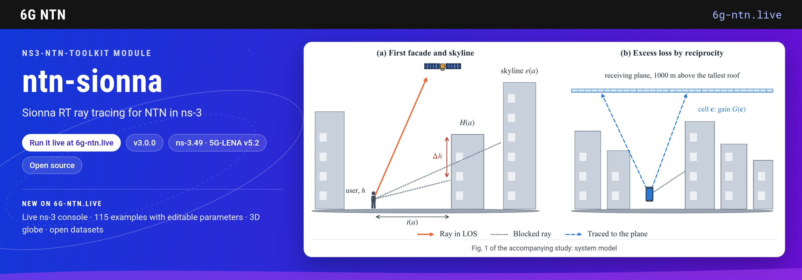
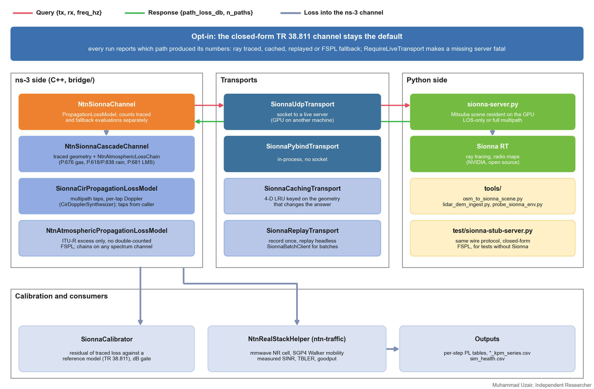
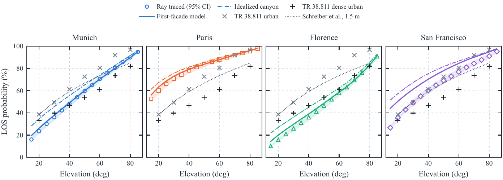
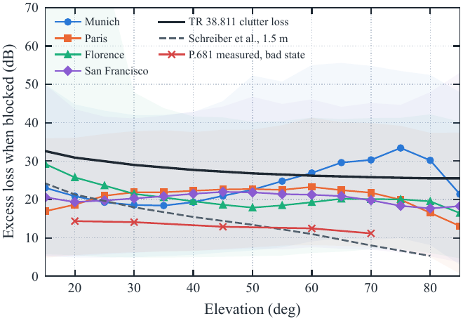

<!-- hero-banner -->
<p align="center"><a href="https://muhammaduazir69.github.io/ntn-sionna/"></a></p>

<h1 align="center">ntn-sionna</h1>

<p align="center"><strong>GPU ray tracing for the last kilometer of an NTN link: NVIDIA Sionna RT bridged into ns-3, with provenance on every query</strong></p>

<p align="center">
  <a href="https://youtu.be/JNStiBst68I"></a><br/>
  <a href="https://youtu.be/JNStiBst68I"></a><br/>
  <a href="https://6g-ntn.live"></a><br/>
  <sub><b>Try it live:</b> <a href="https://6g-ntn.live">6g-ntn.live</a> runs the toolkit's examples in the browser, with open datasets, a scenario gallery and a research forum.</sub><br/>
  <sub>The NTN Control Center runs and visualizes the ntn-sionna examples on a live 3D globe (5-minute video).</sub>
  <a href="https://muhammaduazir69.github.io/ntn-sionna/"></a>
  <a href="https://github.com/Muhammaduazir69/ntn-sionna/releases/latest"></a>
  <a href="https://www.linkedin.com/in/muhammad-uzair-285331185/"></a><br/>
  <sub><b>New on 6g-ntn.live:</b> a live ns-3 console, 115 examples with editable parameters, a 3D globe of real constellations, open datasets (CC BY 4.0) and a validation page with 690 test cases in 41 suites.</sub><br/>
</p>


<p align="center">
  <a href="https://www.nsnam.org"></a>
  <a href="https://www.gnu.org/licenses/old-licenses/gpl-2.0.en.html"></a>
  
  
  
  
</p>

<p align="center">
  <a href="https://github.com/Muhammaduazir69/ns3-ntn-toolkit">Toolkit</a>
  &nbsp;·&nbsp;
  <a href="https://muhammaduazir69.github.io/ns3-ntn-toolkit/modules/ntn-sionna/">Docs</a>
  &nbsp;·&nbsp;
  <a href="INSTALL.md">Install</a>
  &nbsp;·&nbsp;
  <a href="#examples">Examples</a>
  &nbsp;·&nbsp;
  <a href="#results">Results</a>
</p>

---

## Why this module

A closed-form NTN channel such as TR 38.811 is fast and reproducible, but it folds every building into one shadowing term and one LOS-probability table. For a street-level user that is the part that decides whether the link exists. `ntn-sionna` lets ns-3 ask a ray tracer instead: an opt-in `PropagationLossModel` streams `{tx, rx, freq_hz}` to a Sionna RT server that keeps the scene resident on a GPU, over a socket, so the GPU need not be on the machine running the simulation.

The part worth stressing is honesty about when tracing did not happen. A missing server used to degrade silently to free space. Now traced and fallback evaluations are counted separately, every run reports which path produced its numbers, and `SetRequireLiveTransport(true)` makes a missing server fatal where a traced result is load-bearing. Caching and replay transports let a whole simulation run with no GPU at all, and a calibrator compares traced loss against the TR 38.811 reference under its own declared configuration.

## System design

<p align="center">
  
</p>

*Figure 1. Classes and data flow. The ns-3 side (C++, `bridge/`) sends queries through a pluggable transport; `sionna-server.py` answers from a scene held on the GPU. The cascade model adds the ITU-R atmosphere that Sionna RT does not model; the CIR model applies caller-supplied taps with per-tap Doppler. A stub server with the same wire protocol serves the tests. Source: [`doc/figures/make_architecture.py`](doc/figures/make_architecture.py).*

## Results

The results below are a ray-tracing study of street-level LEO links in four city scenes. They were computed with **Sionna RT 2.0.1 directly from Python**, the solver this bridge serves, by the study scripts in `paper/tvt-2026-urban-los/` of the toolkit tree (`sky_maps2.py` for the sky maps, `analysis2.py`, `analysis3.py` and `loss_summary.py` for the statistics; commands in `sim/README_runs.md`). **They did not pass through the ns-3 bridge**; they show what the traced channel says that the closed-form default does not.

**Experiment.** The Munich, Paris, Florence and San Francisco scenes shipped with Sionna RT; 300 outdoor users per city at 1.5 m, two independent user realizations; 2 GHz, isotropic antennas; LOS, reflection and edge diffraction to depth 3 with 10^9 rays per user; a direction grid from 15 to 85 degrees elevation and 0 to 355 degrees azimuth in 5 degree steps. Intervals are 95 % cluster-bootstrap intervals over users. Every number is ray traced, none is a field measurement.

<p align="center">
  
</p>

*Figure 2. LOS probability against elevation for street-level users: ray traced (markers, 95 % cluster-bootstrap band), a first-facade model built from the same city (solid), an idealized canyon (dash-dot), the S-band fit of Schreiber et al. at 1.5 m (dotted) and the TR 38.811 tables (crosses).*

| City | LOS probability at 30 degrees (ray traced) |
|---|---:|
| Florence (compact medieval center) | 26 % |
| Munich (old town, squares, avenues) | 36 % |
| San Francisco (hilly mid-rise grid) | 49 % |
| Paris (Etoile, radiating avenues) | 71 % |

Of the two TR 38.811 tables, the better one per city had a mean error of 4 to 11 percentage points and a largest error of 7 to 21 points against the traced curve. A second user realization moved the mean LOS at 30 degrees by at most 3 points.

<p align="center">
  
</p>

*Figure 3. Excess loss of blocked directions against elevation, smooth 0.3 m concrete facades: censored median per city with 10th to 90th percentile band, against the TR 38.811 clutter loss for NLOS at S band, the Schreiber et al. fit and the ITU-R P.681 Annex 2 bad-state total measured at 2.2 GHz.*

| Censored median excess loss, blocked directions, 0.3 m concrete (dB) | 15 to 30 deg | 30 to 60 deg | 60 to 85 deg |
|---|---:|---:|---:|
| Munich | 21.2 | 20.5 | 28.9 |
| Paris | 18.6 | 22.3 | 21.3 |
| Florence | 26.0 | 19.5 | 19.7 |
| San Francisco | 19.9 | 21.2 | 19.9 |
| TR 38.811 clutter loss (reference) | 31.1 | 27.6 | 25.8 |

Below 60 degrees every city lay under the TR 38.811 clutter value, by 3 to 13 dB with smooth concrete over both realizations (intervals about plus or minus 3 dB), 6 to 14 dB with the shipped marble and 11 to 15 dB with rough concrete. Medians are censored: directions no ray reached (1 to 12 % with smooth concrete) count as above any finite value, so they lean high. Above 60 degrees the sign is unsettled. Values are copied from `paper/tvt-2026-urban-los/make_macros2.py`, written by `sim/make_macros2.py`.

**Module-level check you can run.** The bridge's own calibration path is `sionna-calibration-harness`, which drives `SionnaCalibrator` against the TR 38.811 reference and reports the residual with its gate. No stored output of a live-server run is kept in the tree, so run it against your server:

```bash
python3 contrib/ntn-sionna/bridge/sionna-server.py --port 8765 &
./ns3 run "sionna-calibration-harness --host=127.0.0.1 --port=8765"
```

## Architecture and classes

| Class | Header (`bridge/`) | Role |
|---|---|---|
| `NtnSionnaChannel` | `ns3-sionna-channel.h` | Opt-in `PropagationLossModel`; FSPL fallback on timeout, counted and optionally fatal (`SetRequireLiveTransport`) |
| `SionnaTransport`, `SionnaNoneTransport` | `sionna-transport.h` | Transport contract; request carries optional array and RIS configuration and `los_only` |
| `SionnaUdpTransport` | `sionna-udp-transport.h` | UDP client of a live `sionna-server.py` |
| `SionnaPybindTransport` | `sionna-pybind-transport.h` | In-process transport (built with `ENABLE_SIONNA_PYBIND11`) |
| `SionnaCachingTransport` | `sionna-caching-transport.h` | 4-D LRU decorator; array, RIS and `los_only` are part of the key |
| `SionnaReplayTransport` (`SionnaReplayWriter`, `SionnaReplayReader`) | `sionna-replay-transport.h` | Record once, replay without a GPU |
| `SionnaBatchClient` | `sionna-batch-client.h` | Synchronous and asynchronous batched queries |
| `NtnSionnaCascadeChannel` | `ntn-sionna-cascade-channel.h` | Traced loss plus `NtnAtmosphericLossChain` |
| `NtnAtmosphericLossChain` (`Itu618`, `Itu676`, `Itu681`) | `ntn-atmospheric-loss-chain.h` | Gaseous, rain and LMS shadowing chain |
| `NtnAtmosphericPropagationLossModel` | `ntn-atmospheric-propagation-loss-model.h` | ITU-R excess only, chainable on any spectrum channel without double-counting FSPL |
| `SionnaCirPropagationLossModel` | `sionna-cir-propagation-loss-model.h` | Multipath CIR with per-tap Doppler from the endpoints' live velocity; taps are supplied by the caller |
| `CirDopplerSynthesizer` | `cir-doppler-synth.h` | Advances a CIR snapshot by Doppler rotation |
| `SionnaCalibrator` | `sionna-calibrator.h` | Residual of traced loss against a reference model, with a declared LOS mode and reach |

Python side: `bridge/sionna-server.py` (scene loaded once, JSON over UDP, default port 8765, LOS-only or full multipath), `tools/` (`osm_to_sionna_scene.py`, `lidar_dem_ingest.py`, `probe_sionna_env.py`), `test/sionna-stub-server.py` (same protocol, closed-form FSPL).

## Quick start

Inside the toolkit, where the module is already present and built:

```bash
python3 contrib/ntn-sionna/bridge/sionna-server.py --port 8765 &
./ns3 run "leo-pass-sionna-vs-tr38811 --sionnaServer=127.0.0.1:8765"
./ns3 run "ntn-sionna-leo-downlink-traffic --simSeconds=60 --rainMmH=10"
```

Standalone, into an existing ns-3.49 tree:

```bash
git clone -b ntn-sionna-v4 https://github.com/Muhammaduazir69/ntn-sionna.git contrib/ntn-sionna
./ns3 configure --enable-examples --enable-tests
./ns3 build
```

No GPU is needed to build or to run the measured-radio examples. The four examples whose headline is ray traced (`mmimo-vs-codebook-leo`, `city-block-4ue-cache`, `ris-assisted-leo-link`, `sionna-calibration-harness`) run with `RequireLiveTransport` on by default: without a server they exit non-zero with a message naming `RequireLiveTransport`, and `--allowFallback=1` runs closed-form free space with the headline printed as "free space (no ray tracing)" and `raytrace_live=0`. `leo-pass-sionna-vs-tr38811` prints `raytrace_live=1` only with `--sionnaServer` (then fallback is fatal); otherwise it labels its parametric profile.

Server paths:

| Server | Command | What answers |
|---|---|---|
| Live Sionna RT | `python3 contrib/ntn-sionna/bridge/sionna-server.py --port 8765 --freq-hz 12e9` | Sionna RT 2.0.1 path solver on the `simple_reflector` scene (or `--scene-xml`); CPU Dr.Jit backend is enough (about 40 s start-up here). A request without an array descriptor is traced with the SISO default (fixed 16 Nov 2026: it used to inherit the previous request's array). A reply with no traced path carries `fspl_fallback: true`. |
| Protocol stub | `python3 contrib/ntn-sionna/test/sionna-stub-server.py --port 0` (prints `PORT=<n>`) | Closed-form FSPL with the same wire protocol. It exercises the transport, not ray tracing: a run against it reports `raytrace_live=1` because a server answered, but every number is free space. |

A live server needs Sionna RT; `INSTALL.md` has the version matrix.

## Examples

Measured-radio examples (NR or mmwave NTN cell from `ntn-traffic`, SGP4 Walker mobility, SINR, TBLER and goodput off the PHY trace and sinks):

| Example | What it shows | Command |
|---|---|---|
| `leo-pass-sionna-vs-tr38811` | A LEO pass with traced multipath when `--sionnaServer` is set, a labeled parametric profile otherwise; TR 38.811 free space printed as the reference column; replay file written | `./ns3 run "leo-pass-sionna-vs-tr38811 --sionnaServer=127.0.0.1:8765"` |
| `ntn-sionna-leo-downlink-traffic` | Declared Ku payload (10 W, 0.7 m satellite aperture, 0.6 m gateway dish, eta 0.6) with an independent budget line; ITU-R cascade (P.676, P.618/P.838, optional P.681 LMS) in the packet path (`--legacyConductedDbm=75` restores the old knob) | `./ns3 run "ntn-sionna-leo-downlink-traffic --rainMmH=10 --lms=1"` |
| `ntn-sionna-rain-event-traffic` | TR 38.821 Set-1 Ka payload; a moving EXCELL rain cell on the satellite ground track, integrated per RB (P.838-3) along the live slant path below the P.839 rain height, so the fade comes from the pass geometry (`--scripted=1 --legacyConductedDbm=95` restores the old schedule) | `./ns3 run ntn-sionna-rain-event-traffic` |
| `ntn-sionna-ris-relay-traffic` | Declared Ku payload (Pt, apertures); the descending satellite drops behind a building facade (TR 38.901 7.6.4.2 model B screen) and a RIS on the opposite facade, engaged by a controller on the measured SINR, adds a coherent per-RB ray (Tang 2021 law on live geometry) (`--scripted=1 --legacyConductedDbm=75` restores the old timeline) | `./ns3 run ntn-sionna-ris-relay-traffic` |
| `ntn-sionna-mimo-traffic` | SISO and N x N terminals on one cell | `./ns3 run ntn-sionna-mimo-traffic` |
| `ntn-sionna-constellation-handover-traffic` | Best-satellite following over a Walker constellation | `./ns3 run ntn-sionna-constellation-handover-traffic` |
| `ntn-sionna-composed-channel-traffic` | Friis, ITU-R excess and Nakagami chained with `SetNext()` | `./ns3 run ntn-sionna-composed-channel-traffic` |
| `ntn-sionna-cir-real-stack` | Synthetic Rician CIR (hand-authored taps, not traced) on `SionnaCirPropagationLossModel` | `./ns3 run ntn-sionna-cir-real-stack` |

Channel examples (no data plane):

| Example | What it shows | Command |
|---|---|---|
| `sionna-calibration-harness` | `SionnaCalibrator` residual against TR 38.811 | `./ns3 run "sionna-calibration-harness --host=127.0.0.1 --port=8765"` |
| `mmimo-vs-codebook-leo` | SISO against N x N cross-pol array under the cascade | `./ns3 run mmimo-vs-codebook-leo` |
| `ris-assisted-leo-link` | Before and after a RIS focused at the UE | `./ns3 run ris-assisted-leo-link` |
| `city-block-4ue-cache` | Four UEs over `SionnaCachingTransport`; hit, miss and eviction counts | `./ns3 run "city-block-4ue-cache --spatialResM=50"` |

## Tests

```bash
./test.py -s ntn-sionna                  # C++ suite
pytest contrib/ntn-sionna/test/          # Python server tests
pytest contrib/ntn-sionna/tools/tests/   # geospatial tool tests
```

The `ntn-sionna` C++ suite (`Type::UNIT`, 44 test cases) runs against the stub server and covers the FSPL fallback and its counting, a mid-run server kill, the UDP wire format with MIMO and RIS fields and `los_only`, the atmospheric chain and cascade, cache keys, quantization, time buckets and LRU eviction, the batch client, replay, CIR Doppler against v·k/lambda and the calibrator detecting a 3 dB offset.

## Dependencies

ns-3.49 core, network, mobility and propagation; `ntn-traffic`, `ntn-constellation`, `ntn-cho`, `mmwave` or `nr` for the measured-radio examples. For live tracing: Python 3, CUDA and Sionna RT on the server machine.

## Scope and limitations

- The server returns a scalar path loss and a path count, not taps. The CIR taps used by `SionnaCirPropagationLossModel` in the examples are a hand-authored Rician profile, not ray traced.
- The closed-form TR 38.811 channel remains the default; tracing happens only where a transport is installed and a server answers.
- The Results were produced with Sionna RT directly, not through this bridge, and in four shipped scenes with idealized materials; they are not field measurements.
- Sionna RT does not model the atmosphere; the cascade adds it from the ITU-R chain.

## Standards

3GPP TR 38.811 (NTN reference channel, the baseline the traced channel is calibrated against) and TR 38.901; ITU-R P.676 (gaseous), P.618 and P.838 (rain), P.681 (land mobile satellite shadowing). NVIDIA Sionna RT for the ray tracing.

## Citation

If you use this module, please cite the toolkit article:

```bibtex
@article{uzair2026ns3ntntoolkit,
  author  = {Uzair, Muhammad and others},
  title   = {ns3-ntn-toolkit: An Integrated ns-3 Platform for {6G} Non-Terrestrial Networks},
  journal = {IEEE Open Journal of the Communications Society},
  year    = {2026},
  doi     = {10.1109/OJCOMS.2026.3745010}
}
```

## License

GPL-2.0-only, matching ns-3.

## Contact

**Muhammad Uzair**, Independent Researcher. muhammaduzairr69@gmail.com, [ORCID 0009-0002-4104-2680](https://orcid.org/0009-0002-4104-2680).
Part of the [ns3-ntn-toolkit](https://github.com/Muhammaduazir69/ns3-ntn-toolkit); mirrored on [GitLab](https://gitlab.com/ns3-ntn-toolkit).
