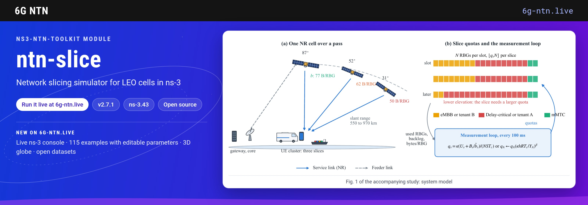
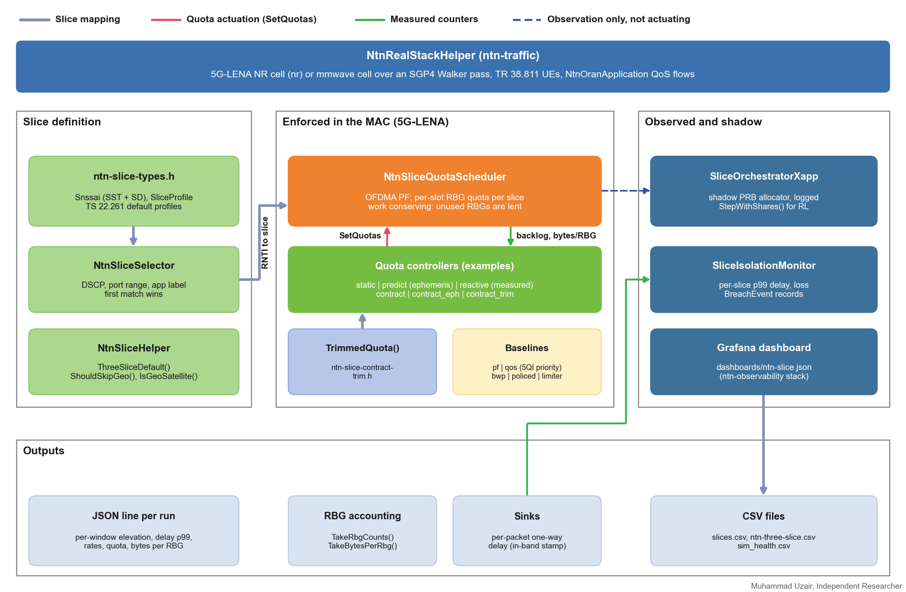
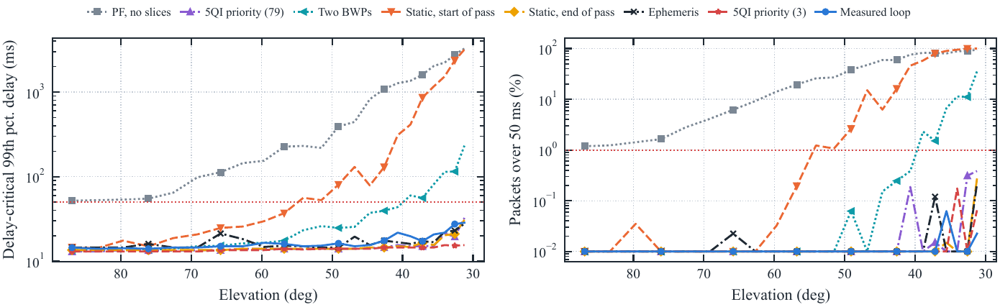
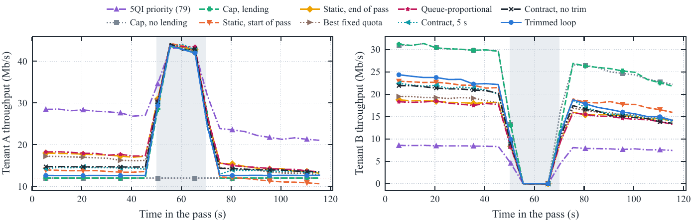

<!-- hero-banner -->
<p align="center"><a href="https://muhammaduazir69.github.io/ntn-slice/"></a></p>

<h1 align="center">ntn-slice</h1>

<p align="center"><strong>Network slicing on a satellite cell in ns-3: per-slot RBG quotas enforced in the NR MAC, controllers that follow the pass, and SLA monitors that report tails rather than means</strong></p>

<p align="center">
  <a href="https://youtu.be/JNStiBst68I"></a><br/>
  <a href="https://youtu.be/JNStiBst68I"></a><br/>
  <a href="https://6g-ntn.live"></a><br/>
  <sub><b>Try it live:</b> <a href="https://6g-ntn.live">6g-ntn.live</a> runs the toolkit's examples in the browser, with open datasets, a scenario gallery and a research forum.</sub><br/>
  <sub>The NTN Control Center runs and visualizes the ntn-slice examples on a live 3D globe (5-minute video).</sub>
  <a href="https://muhammaduazir69.github.io/ntn-slice/"></a>
  <a href="https://github.com/Muhammaduazir69/ntn-slice/releases/latest"></a>
  <a href="https://www.linkedin.com/in/muhammad-uzair-285331185/"></a><br/>
  <sub><b>New on 6g-ntn.live:</b> a live ns-3 console, 115 examples with editable parameters, a 3D globe of real constellations, open datasets (CC BY 4.0) and a validation page with 690 test cases in 41 suites.</sub><br/>
</p>


<p align="center">
  <a href="https://www.nsnam.org"></a>
  <a href="https://www.gnu.org/licenses/old-licenses/gpl-2.0.en.html"></a>
  
  
  
</p>

<p align="center">
  <a href="https://github.com/Muhammaduazir69/ns3-ntn-toolkit">Toolkit</a>
  &nbsp;·&nbsp;
  <a href="https://muhammaduazir69.github.io/ns3-ntn-toolkit/modules/ntn-slice/">Docs</a>
  &nbsp;·&nbsp;
  <a href="INSTALL.md">Install</a>
  &nbsp;·&nbsp;
  <a href="#examples">Examples</a>
  &nbsp;·&nbsp;
  <a href="#results">Results</a>
</p>

---

## Why this module

A slice is only a slice if the radio treats it differently. On a LEO cell that is harder than on the ground, because what a resource block carries changes over a pass: as the satellite recedes, the slant range grows, the MCS drops and a share that was enough at the start of the pass stops being enough near its end.

`ntn-slice` provides both halves. `NtnSliceQuotaScheduler`, a 5G-LENA OFDMA proportional-fair scheduler, enforces a per-slot RBG quota for each slice and lends what a slice leaves unused, so the partition is real in the MAC. The examples close loops around it: quotas from the ephemeris, from measured backlog and bytes per RBG, or from a tenant's rate contract with a delivered-rate trim. Around this sit the slice vocabulary (S-NSSAI, SliceProfile with TS 22.261 defaults, a flow selector), a GEO mode-skip rule for latency-bound slices, and an isolation monitor that keeps a delay histogram, so a p99 is a percentile and not a mean.

## System design

<p align="center">
  
</p>

*Figure 1. Classes and data flow. The selector maps flows (and through RNTIs, UEs) to slices; controllers in the examples call `SetQuotas()` on `NtnSliceQuotaScheduler` every control period and read back its measured counters. `SliceOrchestratorXapp` is a shadow allocator: its PRB split is logged but does not reach the MAC. Source: [`doc/figures/make_architecture.py`](doc/figures/make_architecture.py).*

## Results

The results come from a slicing study on a LEO pass, run with this module's `ntn-slice-pass-leo` and `ntn-slice-tenants-leo` examples on a 5G-LENA cell. The study binaries are those examples with passive additions not yet merged here (block counters read from the UE PHY trace, a queue-proportional baseline, an `--aLimited` switch); no scheduler code differs. Patch, regression check and campaign scripts: `paper/tnsm-2026-slice-quotas/` of the toolkit tree (`ns3_patch/`, `compare_rev.py`, `run_final.py`, `make_macros5.py`).

**Experiment.** One cell of 2.185 GHz and 20 MHz (numerology 1) through a 550 km, 53 degree SGP4 satellite with 55 dBm and an 8 x 8 array, free space plus TR 38.811 excess loss. The UE cluster sees the satellite recede from 87 to 31 degrees elevation over a 120 s run. Each mechanism runs on the same 12 seeds; every number below is a median over those seeds.

<p align="center">
  
</p>

*Figure 2. Delay-critical slice (16 Mb/s, 50 ms budget) at full load over the falling pass: 99th-percentile one-way delay (left) and share of packets over 50 ms (right) per 5 s window, medians over 12 seeds. Thin lines mark 50 ms and 1 %; a share of zero is drawn at 0.01 %.*

| Mechanism (`--policy`) | p99 delay, median (worst seed) | p99.9 delay | Windows over target (%) | eMBB (Mb/s) | All (Mb/s) |
|---|---|---|---:|---:|---:|
| PF, no slices (`pf`) | 2.8 s (6.7 s) | 3.4 s | 91 | 18.6 | 34.5 |
| Two equal BWPs (`bwp`) | 133 ms (429 ms) | 261 ms | 26 | 20.6 | 36.6 |
| Static quota sized at the start (`static`) | 2.6 s (3.6 s) | 3.4 s | 52 | 15.2 | 31.1 |
| Static quota sized at the end (`static`) | 16 ms (22 ms) | 39 ms | 0 | 14.8 | 30.9 |
| Ephemeris-driven quota (`predict`) | 20 ms (33 ms) | 49 ms | 0 | 14.2 | 30.3 |
| Measured closed loop (`reactive`) | 19 ms (26 ms) | 47 ms | 0 | 14.4 | 30.4 |
| 5QI priority, 5QI 79 (`qos`) | 15 ms (54 ms) | 58 ms | 0 | 17.2 | 33.3 |
| 5QI priority, 5QI 3 (`qos`) | 14 ms (15 ms) | 32 ms | 0 | 17.1 | 33.2 |

What the data say: on the calibration seed the delay-critical slice carried 77 bytes per RBG at 87 degrees and 50 at 31 degrees, 36 % less, so the quota it needs rises from 0.48 to 0.74 of the RBGs. A quota sized for the start of the pass failed once that headroom was used up; the measured loop and the ephemeris loop both kept up, and knowing the orbit bought nothing measurable over measuring. Priority with the strong 5QI 3 class gave the lowest tail, and both priority settings left eMBB about 2.7 Mb/s more than the measured loop; the study traces most of that lead to how this stack schedules retransmissions, not to the priority rule itself.

<p align="center">
  
</p>

*Figure 3. Two tenants on the same cell, contract R = 12 Mb/s for tenant A, decoding errors on, medians over 12 seeds. Tenant B pauses in the shaded interval. "Queue-proportional" is the study-only baseline.*

| Mechanism (`--policy`) | A (Mb/s) | Lowest A window | Busy windows below R | B (Mb/s) | Busy total (Mb/s) |
|---|---:|---:|---:|---:|---:|
| PF, no slices (`pf`) | 17.6 | 15.4 | 0 % | 17.4 | 35.0 |
| 5QI priority (`qos`) | 25.1 | 20.6 | 0 % | 8.1 | 33.3 |
| Rate cap, no lending (`policed`) | 12.0 | 12.0 | 0 % | 27.4 | 39.4 |
| Rate cap, lending (`limiter`) | 12.0 | 12.0 | 0 % | 27.5 | 39.5 |
| Static quota, start of pass (`static`) | 12.5 | 10.6 | 33 % | 19.9 | 32.5 |
| Static quota, best of sweep, 0.42 (`static`) | 15.2 | 12.4 | 0 % | 17.3 | 32.5 |
| Contract quota (`contract`) | 14.3 | 13.4 | 0 % | 18.3 | 32.6 |
| Contract quota, ephemeris table (`contract_eph`) | 14.4 | 12.9 | 0 % | 18.1 | 32.4 |
| Trimmed contract loop (`contract_trim`) | 12.6 | 12.5 | 0 % | 19.8 | 32.5 |

The trimmed loop held tenant A near its 12.6 Mb/s target and left tenant B more than the best fixed quota did; the rate cap with lending left B the most, and the cap without lending held A at 12.0 Mb/s even while B was idle, so it is not work conserving. Values are copied from `paper/tnsm-2026-slice-quotas/make_macros5.py`, written by `sim/make_macros5.py` from the run outputs in `sim/out/`.

## Architecture and classes

| Header | Provides |
|---|---|
| `model/ntn-slice-quota-scheduler.h` | `NtnSliceQuotaScheduler` (derived from `NrMacSchedulerOfdmaPF`): `SetSliceOfRnti()`, `SetQuotas()`, `TakeRbgCounts()`, `TakeBacklog()`, `TakeBytesPerRbg()`, and a per-slot allocation trace. A slice with demand gets at least floor(quota x RBGs) per slot; leftover RBGs go to any slice with data. Uplink stays plain PF. |
| `model/ntn-slice-contract-trim.h` | `TrimmedQuota()`: scales a tenant quota by (target bytes / delivered bytes)^gain, clamped. |
| `model/ntn-slice-types.h` | `SliceSst`, `Snssai` (8-bit SST + 24-bit SD, packed codecs), `SliceProfile`, default eMBB, URLLC and mMTC profiles after TS 22.261 Table 7.1-1. |
| `model/ntn-slice-selector.h` | `NtnSliceSelector`: DSCP, port-range and app-label rule chain, first match wins, default fallback. |
| `model/slice-orchestrator-xapp.h` | `SliceOrchestratorXapp`: min-throughput reservation plus priority-weighted sharing; `Step()` and `StepWithShares()` for an RL policy. Shadow allocator, see limitations. |
| `model/slice-isolation-monitor.h` | `SliceIsolationMonitor`: rolling per-slice p99 delay and cumulative loss, `BreachEvent` records. |
| `helper/ntn-slice-helper.h` | `NtnSliceHelper::ThreeSliceDefault()`, `ShouldSkipGeo()`, `IsGeoSatellite()` (30 000 km boundary). |

A Grafana dashboard (`dashboards/ntn-slice.json`) plugs into the stack of the `ntn-observability` module.

## Quick start

Inside the toolkit, where the module is already present and built:

```bash
./ns3 run "ntn-slice-quota-leo --policy=reactive"
./ns3 run "ntn-slice-pass-leo --policy=reactive --duration=120"
./ns3 run "ntn-slice-tenants-leo --policy=contract_trim --contractMbps=12"
```

Standalone, into an existing ns-3.43 tree:

```bash
git clone -b ntn-slice-v2 https://github.com/Muhammaduazir69/ntn-slice.git contrib/ntn-slice
./ns3 configure --enable-examples --enable-tests
./ns3 build
```

The library links `nr` (5G-LENA), `ntn-traffic` and `ntn-constellation`; the examples also use `ntn-cho` and, for the older three, `mmwave` and `lte`. The toolkit tree has all of them. `INSTALL.md` lists the details.

## Examples

| Example | What it shows | Command |
|---|---|---|
| `ntn-slice-pass-leo` | Three slices on one 5G-LENA cell while the satellite recedes; policies `pf`, `qos`, `bwp`, `static`, `predict`, `reactive`; one JSON line with per-window elevation, delay-critical p99, deadline misses, rates, quota and bytes per RBG | `./ns3 run "ntn-slice-pass-leo --policy=predict"` |
| `ntn-slice-tenants-leo` | Two elastic tenants and an mMTC slice; tenant A buys `--contractMbps`; policies `pf`, `qos`, `policed`, `limiter`, `static`, `contract`, `contract_eph`, `contract_trim`; tenant B pauses to show who may borrow | `./ns3 run "ntn-slice-tenants-leo --policy=limiter"` |
| `ntn-slice-quota-leo` | eMBB, URLLC and mMTC with the partition enforced by the MAC; `pf`, `bwp`, `static`, `reactive`; per-slice delay percentiles and the RBG share actually granted | `./ns3 run "ntn-slice-quota-leo --policy=static"` |
| `ntn-three-slice-leo-geo` | Three slices over LEO and GEO with URLLC GEO mode-skip; measured one-way delay distribution on the LEO cell, plus the modeled transparent-GEO service and feeder legs (TR 38.821) for GEO-served slices; losses from measured sequence gaps | `./ns3 run "ntn-three-slice-leo-geo --simTime=30"` |
| `ntn-slice-isolation-traffic` | Slices on per-slice BWPs of one NR cell under eMBB saturation; writes `slices.csv` with per-slice SINR, throughput, delay and breach flags, and separates breaches caused by a budget below the one-way floor from isolation violations | `./ns3 run "ntn-slice-isolation-traffic --simSeconds=15 --numUes=9"` |
| `ntn-slice-real-stack` | Minimal shared-cell recipe with the isolation monitor on measured delivery | `./ns3 run "ntn-slice-real-stack --duration=15 --numUes=9"` |

## Tests

```bash
./test.py -s ntn-slice
./test.py -s ntn-slice-quota-scheduler
```

`ntn-slice` (`Type::UNIT`, 9 cases): S-NSSAI round trips, selector first match, URLLC minimum under eMBB load, p99 breach detection, GEO mode-skip, three-slice coexistence, RL shares, cumulative loss, and the monitor under `Simulator::Run()`. `ntn-slice-quota-scheduler` (`Type::SYSTEM`, 3 cases): each saturated slice gets at least its quota, an idle slice's quota goes to a slice with data, and the contract trim converges despite leftovers and rounding.

## Dependencies

ns-3.43 with `nr` (5G-LENA) for the quota scheduler; `ntn-traffic`, `ntn-constellation`, `ntn-cho`; `mmwave` and `lte` for the three shared-cell examples.

## Scope and limitations

- The quota scheduler acts on the downlink only; the uplink is scheduled by the parent PF scheduler unchanged.
- `SliceOrchestratorXapp` is an open-loop shadow allocator: its PRB decisions are computed and logged but do not drive any MAC. In the three mmwave examples the 5QI and S-NSSAI are packet labels the MAC never reads, and isolation there is observed, not enforced. Enforcement is the 5G-LENA quota scheduler path.
- The V2X SST value (4) is defined but has no default profile.
- The Results are one cell, one satellite pass geometry and 12 seeds; the queue-proportional baseline and the block counters exist only in the study patch.

## Standards

3GPP TS 23.501 (S-NSSAI, 5QI and standardized QoS characteristics), TS 22.261 (service requirements and demand profiles), TS 38.300 (QoS flow to DRB mapping), TS 38.101-5 (NTN FR1 channel bandwidths), TR 38.811 and TR 38.821 (NTN channel and latency budgets).

## Citation

If you use this module, please cite the toolkit article:

```bibtex
@article{uzair2026ns3ntntoolkit,
  author  = {Uzair, Muhammad and others},
  title   = {ns3-ntn-toolkit: An Integrated ns-3 Platform for {6G} Non-Terrestrial Networks},
  journal = {IEEE Open Journal of the Communications Society},
  year    = {2026},
  doi     = {10.1109/OJCOMS.2026.3745010}
}
```

## License

GPL-2.0-only, matching ns-3.

## Contact

**Muhammad Uzair**, Independent Researcher. muhammaduzairr69@gmail.com, [ORCID 0009-0002-4104-2680](https://orcid.org/0009-0002-4104-2680).
Part of the [ns3-ntn-toolkit](https://github.com/Muhammaduazir69/ns3-ntn-toolkit); mirrored on [GitLab](https://gitlab.com/ns3-ntn-toolkit).
