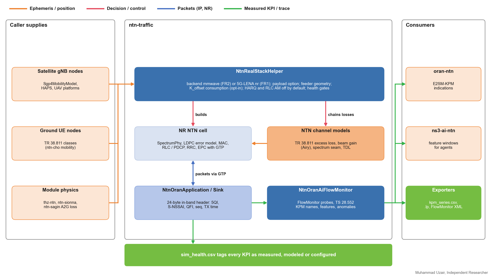
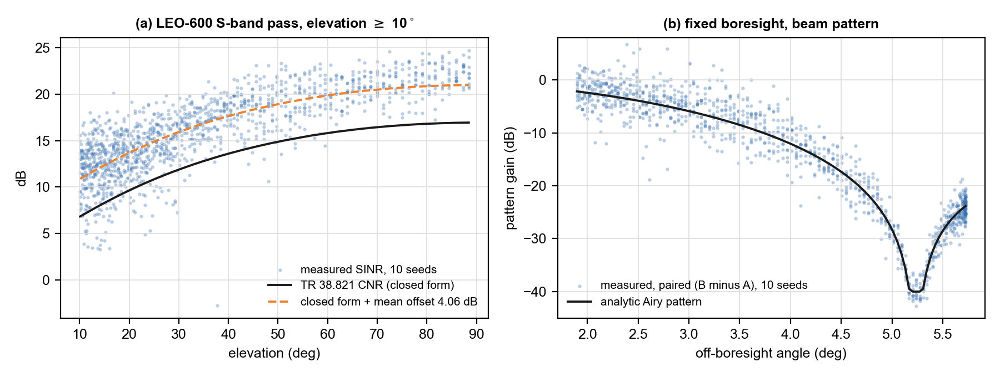

<h1 align="center">ntn-traffic</h1>

<p align="center"><strong>The real-stack spine: a 5G NR NTN data plane under satellite mobility, with every KPI measured in band</strong></p>

<p align="center">
  <a href="https://www.nsnam.org"></a>
  <a href="https://www.gnu.org/licenses/old-licenses/gpl-2.0.en.html"></a>
  
  
  
</p>

<p align="center">
  <a href="https://github.com/Muhammaduazir69/ns3-ntn-toolkit">Toolkit</a>
  &nbsp;|&nbsp;
  <a href="https://muhammaduazir69.github.io/ns3-ntn-toolkit/modules/ntn-traffic/">Docs</a>
  &nbsp;|&nbsp;
  <a href="INSTALL.md">Install</a>
  &nbsp;|&nbsp;
  <a href="#examples">Examples</a>
  &nbsp;|&nbsp;
  <a href="#results">Results</a>
</p>

---

## Why this module

Most satellite network studies compute their KPIs from a closed form: slant range over the speed of light for latency, a Shannon bound for throughput, a threshold for loss. That is fast, and it makes the mechanism under study impossible to falsify, because the KPI cannot disagree with the model that produced it. `ntn-traffic` exists so that it can disagree.

`NtnRealStackHelper` assembles a genuine NR cell, either the mmWave backend or 5G-LENA `nr` at FR1, and puts it under satellite mobility: a real SpectrumPhy, an LDPC error model, RLC and PDCP with timers relaxed to the slant round trip, RRC, and an EPC with GTP tunneling. Delay, jitter and loss then come from an in-band header that carries a sequence number and a transmit timestamp through the tunnel, so they are properties of packets that crossed the air interface. Every scenario writes a health record that labels each KPI as measured, modeled or configured, so a reader can tell the difference without reading the code. This module is the spine the other toolkit modules build their examples on, which is why it ships only inside the toolkit tree.

## System design

<p align="center">
  
</p>

<p align="center"><em>Figure 1. The caller supplies satellite and ground nodes that already carry mobility, plus any module physics; <code>NtnRealStackHelper</code> builds the NR NTN cell and chains the NTN channel models onto it. ORAN applications carry their QoS identity and timestamps in band through GTP, and <code>NtnOranAiFlowMonitor</code> turns the flows into KPM series for oran-ntn, ns3-ai-ntn and the exporters. Source: <code>doc/figures/make_architecture.py</code>.</em></p>

### Real-radio helper (`helper/ntn-real-stack-helper.h`)

| Area | API | Notes |
|---|---|---|
| Build | `Build(gnbNodes, ueNodes)`, `SetRadioBackend`, `SetCarrierFrequencyHz`, `SetBandwidthHz`, `SetSatEirpDbm`, `SetUeTxPowerDbm` | Both node sets must already carry a `MobilityModel` (SGP4, TR 38.811, HAPS). Default carrier 2 GHz. |
| Payload | `SetPayloadOption`, `SetFeederGeometry`, `ComputePayloadExtraDelay` | `Transparent` (slant/c: the feeder is crossed once, TR 38.821 Table 4.2-2), `RegenerativeRu` (slant/c + 0.25 ms), `RegenerativeRuDu` (slant/c + 0.15 ms), `FullGnb` (slant/c + 0.05 ms, default); feeder delay re-evaluated every second from live geometry. |
| HARQ and RLC | `SetHarqEnabled`, `SetNtnHarqProfile`, `SetRlcAmEnabled` | HARQ is off by default because terrestrial timers break over the slant; the NTN profile rescales the HARQ timeout and process count from the geometry. Shipped runs carry RLC UM. |
| Uplink timing | `SetKOffsetConsumption`, `ComputeKOffsetSlots`, `GetGnbN2Delay` | Opt-in, nr backend: K_offset = ceil(RTT / slot) + 1, programmed into the UL DCI to PUSCH gap (TS 38.213 Section 4.2). Uses a vendored nr patch that raises the `N2Delay` cap. |
| Channel | `AddExtraPropagationLoss`, `AddSpectrumChannelLoss`, `SetChannelUpdatePeriod`, `SetTddPattern` | Chains module physics (THz, Sionna RT, A2G) onto the live channel; the 3GPP channel regenerates every 100 ms so clusters follow the satellite. |
| Traffic | `InstallTraffic(profile, start, stop)`, `InstallOranFlow(ueIdx, fiveQi, sst, sd, profile, start, stop)` | Canned mixes backed by `NtnOranApplication`. |
| Measurement | `EnableAiFlowMonitor(prefix)`, `Collect()`, `GetMeanDlSinrDb`, `GetMeanDlTbler`, `GetRxThroughputMbps`, `GetMeanDelayMs`, `GetUeRecentSinrDb`, `WriteHealthReport()` | `sim_health.csv` gates assert trace provenance (transport blocks decoded, SINR from the PHY trace, an active error model); its `air_interface` tag is derived from the carrier per TS 38.104. |

### ORAN application suite and flow monitor (`model/`)

| Class | Role |
|---|---|
| `NtnOranPayloadHeader` | 24-byte in-band header: version, payload type, per-flow sequence (u32), TX timestamp in ns (u64), 5QI, S-NSSAI SST and SD, QFI, source and destination IDs. Rides inside the GTP tunnel, so it survives re-encapsulation. |
| `NtnOranApplication` | Traffic source with TS 23.501 profiles: conversational voice (5QI 1), eMBB video (5QI 2), URLLC periodic (5QI 82), mMTC periodic, Poisson background (5QI 9), saturating CBR. |
| `NtnOranSink` | Per QoS flow: one-way delay from the in-band timestamp, RFC 3550 jitter, loss from sequence gaps, throughput over the active span. |
| `NtnCommandAndControlApp` | Platform telemetry (5QI 69) sampled from the node's real mobility, with a battery model. |
| `NtnOranAiFlowMonitor`, `NtnOranFlowClassifier`, `NtnOranFlowProbe` | Built on ns-3 FlowMonitor; flows keyed by QoS identity instead of the IP 5-tuple; KPM series under TS 28.552 names (`DRB.UEThpDl`, `DRB.RlcSduDelayDl`, `DRB.PacketLossRateDl`, `L1M.RS-SINR`, ...); sliding-window features; EWMA z-score anomalies; XML, CSV, InfluxDB line protocol and E2SM-KPM-shaped exporters. |
| `NtnTr38811ExcessLossModel`, `NtnSatBeamGainModel`, `NtnSpectrumSeamModel`, `NtnTdlSpectrumPropagationLossModel`, `NtnStaticExtraLossModel` | TR 38.811 excess loss with the scenario shadow-fading tables; the TR 38.811 Section 6.4.1 circular-aperture (Airy) beam pattern; a spectrum seam that composes losses; a frequency-selective tapped delay line (stand-in tap table); a runtime scalar loss for blockage or RIS events. |

The module also keeps the classic generators: 3GPP HTTP over a satellite link, NRTV video over TCP or UDP, a CBR application, and the lightweight `NtnRealisticTrafficHelper` point-to-point data plane (no radio physics).

## Results

Measured radio against the 3GPP TR 38.821 Section 6.1.3 link-budget method, from a ten-seed campaign of the two shipped calibration examples (stored in the toolkit workspace under `papers/paper1_ojcoms_toolkit/revision_experiments/r1_seeds/`: per-seed run folders, `r1_calibration_samples.csv`, `r1_arraygain_samples.csv` and the summaries, September 2026). Study case Set-1 LEO-600, S-band downlink, handheld terminal, mmwave backend, a real SGP4 satellite at 600 km. Commands: `ntn-tr38821-calibration --simSeconds=600 --radio=mmwave --RngRun=1..10`, and `ntn-tr38821-array-gain-calibration` with `--boresightMode=point` and `nadir`, RngRun 1 to 10. The figure is built by `doc/figures/make_results.py`.

<p align="center">
  
</p>

<p align="center"><em>Figure 2. (a) SINR measured off the PHY trace against the TR 38.821 closed-form CNR over the pass, elevation at or above 10 deg, 10 seeds x 132 samples; the dashed line is the closed form shifted by the mean measured offset. (b) Beam pattern recovered from the paired difference of a fixed-boresight and a steered run sampled at the same instants, against the analytic TR 38.811 Airy pattern, 10 seeds x 118 pairs.</em></p>

| Measured (10 seeds, mean with 95 % Student-t half-width across seeds) | Value |
|---|---|
| Offset of measured SINR over the TR closed form, elevation at or above 10 deg | 4.06 ± 0.22 dB |
| Within-run spread of that offset (standard deviation) | 2.47 dB |
| SINR decay from zenith to 10 deg: measured / TR free-space prediction | 10.47 ± 1.30 dB / 9.97 dB |
| Beam pattern, fixed ground point: angles swept / RMS error / bias | 1.90 to 5.73 deg (0.87 beamwidths) / 2.85 ± 0.24 dB / 0.32 ± 0.58 dB |
| Beam pattern, nadir-fixed: angles swept / RMS error | 1.27 to 50.5 deg / 2.71 ± 0.21 dB |

Reading this honestly: the measured decay follows the TR free-space prediction within its interval, and the constant offset is the array gain of the spectrum model, reported rather than calibrated away. The examples' own pass or fail gates are stricter than the aggregate. On these 600 s runs the calibration example printed FAIL every time, because its spread gate is evaluated over all samples, including geometry below the horizon. The array-gain example's pattern gate (RMS under 3 dB) passed in all ten nadir runs and in five of the ten fixed-ground-point runs.

## Quick start

`ntn-traffic` ships only inside the toolkit tree; there is no standalone repository for it.

```bash
./ns3 run ntn-real-stack-smoke
./ns3 run "ntn-oran-qos-flows --simSeconds=40"
./ns3 run "ntn-tr38821-calibration --simSeconds=120"
```

Minimal use in your own scenario:

```cpp
NtnRealStackHelper rs;
rs.SetSimTime(Seconds(30));
rs.SetOutputDir("out");
rs.Build(satNodes, ueNodes);                  // nodes already carry mobility
rs.InstallOranFlow(0, 82, 2, 0x000001, NtnOranApplication::URLLC_PERIODIC, Seconds(1), Seconds(29));
rs.EnableAiFlowMonitor("my-run");
Simulator::Stop(Seconds(30));
Simulator::Run();
rs.Collect();
rs.WriteHealthReport();
Simulator::Destroy();
```

`InstallOranFlow` takes the UE index, 5QI, SST, SD, an `NtnOranApplication::Profile` and the start and stop times. `INSTALL.md` lists the dependencies.

## Examples

All build to `build/contrib/ntn-traffic/examples/`.

| Example | What it shows | Command |
|---|---|---|
| `ntn-oran-qos-flows` | One real LEO cell carrying four QoS flows (5QI 1, 2, 82, 9) plus satellite C&C telemetry (5QI 69); TR 38.811 terminals; KPM series, anomalies and per-flow measured KPIs. | `./ns3 run "ntn-oran-qos-flows --simSeconds=40"` |
| `ntn-tr38821-calibration` | Measured SINR against the TR 38.821 closed-form CNR every 2 s over an SGP4 pass; prints a verdict and exits non-zero on a failed gate. | `./ns3 run "ntn-tr38821-calibration --simSeconds=120"` |
| `ntn-tr38821-array-gain-calibration` | The same pass twice, steered and fixed boresight, so the paired difference isolates the beam pattern. Writes `array_gain_calibration.csv` and `array_gain_summary.csv`. | `./ns3 run "ntn-tr38821-array-gain-calibration --simSeconds=120"` |
| `ntn-real-stack-smoke` | A single SGP4 gNB over a few TR 38.811 terminals, eMBB streaming, health gates. | `./ns3 run "ntn-real-stack-smoke --simTime=10 --numUes=4 --altKm=600"` |
| `ntn-nr-fr1-demo` | The 5G-LENA backend at FR1: 30 kHz SCS, 2.185 GHz (band n256 downlink), 20 MHz. | `./ns3 run "ntn-nr-fr1-demo --simTime=2 --numerology=1"` |
| `ntn-nr-deep-integration-demo` | Native NR stats, three-slice BWPs with the QoS scheduler, MIMO with measured rank, armed A3 + X2 handover (no handover fires here by design). | `./ns3 run ntn-nr-deep-integration-demo` |
| `ntn-nr-handover-pass` | A real NR A3-RSRP + X2 handover on a 600 km pass; one handover at the shipped defaults. Keep `--numUes=1`. | `./ns3 run ntn-nr-handover-pass` |
| `ntn-scalability-load-regimes` | Offered load measured from application counters, wall clock, peak RSS, and whether a run is bound by geometry or by the packet plane. Appends rows to `scalability_regimes.csv`. | `./ns3 run "ntn-scalability-load-regimes --regime=embb --sats=66 --ues=30 --duration=60"` |
| `ntn-cbr-leo-link` | CBR over one point-to-point LEO link with a TR 38.821-derived delay and a receive error model; FlowMonitor summary. | `./ns3 run "ntn-cbr-leo-link --simTime=10 --intervalMs=5"` |
| `nrtv-p2p-example` | NRTV video over a point-to-point link; writes a gnuplot client trace. | `./ns3 run "nrtv-p2p-example --time=10 --protocol=UDP"` |
| `nrtv-variables-plot` | Histograms of the NRTV traffic-model distributions. | `./ns3 run "nrtv-variables-plot --numOfSamples=100000"` |

## Tests

```bash
./test.py -s ntn-real-stack-helper
./test.py -s ntn-oran-application
./test.py -s ntn-oran-ai-flow-monitor
./test.py -s ntn-spectrum-seam
./test.py -s ntn-tdl-spectrum
./test.py -s ntn-http-satellite
./test.py -s cbr-test
./test.py -s nrtv
```

Eight suites, 55 test cases in all. `ntn-real-stack-helper` alone has 40, among them EIRP budget gates, X2 and feeder delays that follow geometry, K_offset consumed and not consumed, one-way delay bounded by the speed of light, slice BWP isolation, beam-gain angle dependence, channel update period, an independent budget oracle, and health gates that can fail.

## Dependencies

ns-3.49 `core`, `network`, `internet`, `applications`, `point-to-point`, `propagation`, `mobility`, `flow-monitor`, `lte`, the toolkit's vendored `mmwave` and `nr` (with the ntn patches in `contrib/nr/ntn-patches/`), and `magister-stats`.

## Scope and limitations

- **mmwave backend numerology.** On the mmwave path the S-band carrier runs with FR2 numerology (60 kHz SCS) on a terrestrial 8 x 8 array gNB, with the satellite EIRP applied as a conducted transmit power; it is not a reflector beam with a 3 dB footprint. Use `SetRadioBackend` for 5G-LENA at FR1.
- **HARQ off, RLC UM by default.** Turn them on deliberately; the defaults reflect what the terrestrial timers tolerate over the slant.
- **Multi-UE uplink.** K_offset consumption enables single-UE or downlink-heavy uplink under a real air-interface delay; full multi-UE uplink also needs per-UE timing advance and NTN-aware SRS and PUCCH timing, which the vendored nr v5.2 still lacks.
- **TDL tap table.** `NtnTdlSpectrumPropagationLossModel` uses a documented stand-in, not TR 38.811 Table 6.9.2, so "NTN-TDL" is not claimable.
- **Multi-UE NR handover.** `ntn-nr-handover-pass` with more than one UE hits a limitation of the vendored 5G-LENA X2 data-forwarding path; the A3 and X2 decision itself fires.
- Half-duplex collisions are dropped and counted (`halfduplex_*_drops` in `sim_health.csv`) rather than fatal; read them next to `phy_rx_tb`.

## Standards

3GPP TR 38.811 (NTN channel, shadow fading, beam pattern), TR 38.821 (Set-1 LEO-600 link budget), TS 38.101-5 (NTN FR1 bands n255 and n256), TS 38.213 (K_offset), TS 38.104 (frequency ranges), TS 23.501 (5QI, QFI, S-NSSAI), TS 38.415, TS 28.552 (KPM), RFC 3550 (jitter).

## Citation

If you use this module, please cite the toolkit article:

```bibtex
@article{uzair2026ns3ntn,
  author  = {Uzair, Muhammad and others},
  title   = {ns3-ntn-toolkit: An Integrated ns-3 Platform for {6G} Non-Terrestrial Networks},
  journal = {IEEE Open Journal of the Communications Society},
  year    = {2026},
  doi     = {10.1109/OJCOMS.2026.3745010}
}
```

## License

GPL-2.0-only, matching ns-3. See [LICENSE](LICENSE).

## Contact

**Muhammad Uzair**, Independent Researcher
muhammaduzairr69@gmail.com · [ORCID 0009-0002-4104-2680](https://orcid.org/0009-0002-4104-2680)

Part of the [ns3-ntn-toolkit](https://github.com/Muhammaduazir69/ns3-ntn-toolkit), an integrated ns-3.49 platform for 6G non-terrestrial network research. Mirrored on [GitLab](https://gitlab.com/ns3-ntn-toolkit).
