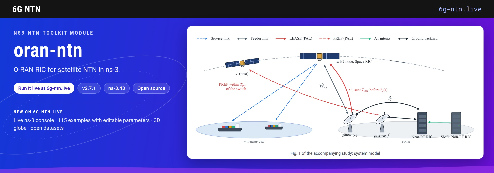
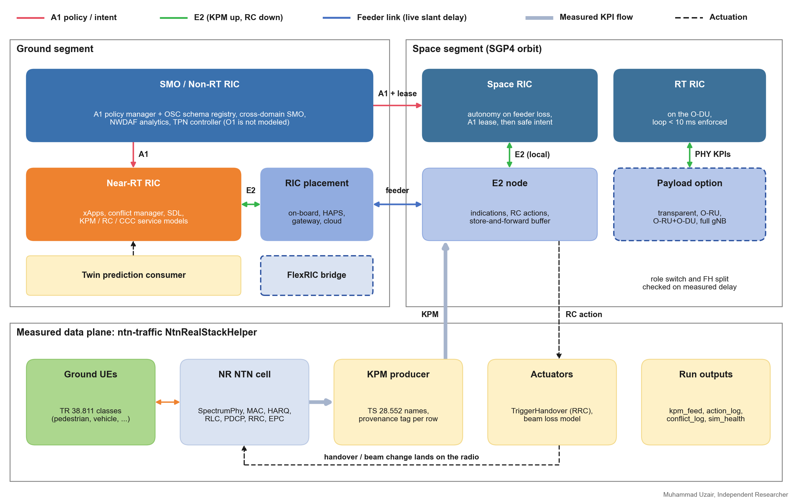
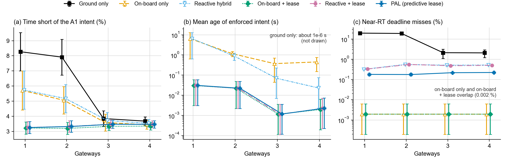

<!-- hero-banner -->
<p align="center"><a href="https://muhammaduazir69.github.io/oran-ntn/"></a></p>

<h1 align="center">oran-ntn</h1>

<p align="center"><strong>Space O-RAN for ns-3: E2 and A1 control loops over a measured NR NTN radio, with the RIC placed on board, at a gateway or in the cloud</strong></p>

<p align="center">
  <a href="https://youtu.be/JNStiBst68I"></a>
  <a href="https://6g-ntn.live"></a>
  <a href="https://muhammaduazir69.github.io/oran-ntn/"></a>
  <a href="https://github.com/Muhammaduazir69/oran-ntn/releases/latest"></a>
  <a href="https://www.linkedin.com/in/muhammad-uzair-285331185/"></a><br/>
  <sub><b>New on 6g-ntn.live:</b> a live ns-3 console, 115 examples with editable parameters, a 3D globe of real constellations, open datasets (CC BY 4.0) and a validation page with 690 test cases in 41 suites.</sub><br/>
</p>

<p align="center">
  <a href="https://www.nsnam.org"></a>
  <a href="https://www.gnu.org/licenses/old-licenses/gpl-2.0.en.html"></a>
  
  
  
  <a href="https://doi.org/10.1109/OJCOMS.2026.3745010"></a>
</p>

<p align="center">
  <a href="https://github.com/Muhammaduazir69/ns3-ntn-toolkit">Toolkit</a>
  &nbsp;·&nbsp;
  <a href="https://muhammaduazir69.github.io/ns3-ntn-toolkit/modules/oran-ntn/">Docs</a>
  &nbsp;·&nbsp;
  <a href="INSTALL.md">Install</a>
  &nbsp;·&nbsp;
  <a href="#results">Results</a>
  &nbsp;·&nbsp;
  <a href="#examples">Examples</a>
</p>

---

## Why this module

Putting a RAN Intelligent Controller (RIC) in space is an architecture question
before it is an algorithm question. Where the RIC sits decides how stale its view
is when a decision lands, and whether the satellite can still act when its feeder
link to the ground is down. `oran-ntn` makes those questions measurable in ns-3.
The RIC placement is an experiment variable whose E2 latency comes from live slant
geometry, the KPIs the xApps read are measured on a real NR NTN cell, and the
helper counts how many decisions changed anything, not only how many were made.
A decision that names a cell with no radio behind it is reported as a decision,
not as a handover.

## System design

<p align="center">
  
</p>

<p align="center"><sub>Ground segment, space segment and the measured data plane. A1 intents (red) reach the Near-RT RIC directly and the Space RIC over the feeder with a lease. E2 (green) carries KPM up and RC actions down; on the ground path it crosses the feeder link (blue), whose delay follows the live slant range. Dashed boxes are optional or not on the in-simulation path. O1 is not modeled. Script: <code>doc/figures/make_oran_ntn_design.py</code>.</sub></p>

How a control loop runs:

1. `NtnRealStackHelper` (from `ntn-traffic`) stands up an NR NTN cell on an SGP4
   orbit: SpectrumPhy, MAC with HARQ and AMC, RLC, PDCP, RRC and EPC. UEs move
   under TR 38.811 mobility classes.
2. Per-UE SINR and TBLER are measured on that cell and packed into E2SM-KPM
   indications under TS 28.552 names. Every KPM row carries its provenance
   (`phy-trace` or, for scale-out cells, `geometry-budget`).
3. `OranNtnE2Node` sends each indication one feeder delay up to the Near-RT RIC,
   optionally aligned to the 100 ms RIC tick. During a feeder outage it buffers
   them (store and forward) and the Space RIC takes over on board.
4. xApps decide; the conflict manager resolves contention; the RC action travels
   one feeder delay back down and reaches a registered actuator, for example
   `NtnRealStackHelper::TriggerHandover` or a beam loss model on the live channel.
5. The next KPM report shows whether the action changed the radio.

## Results

All numbers below come from stored runs. Each figure has a script that reads the
raw files, so the plot can be regenerated and checked.

### Stale A1 intents, lease fallback and control placement under feeder outages

<p align="center">
  
</p>

<p align="center"><sub>Example <code>oran-ntn-feeder-mgmt</code>, 550 km Walker-Delta shell, 1 to 4 gateways, 6 strategies, 10 seeds each, 1 h simulated per run (240 runs, one binary, sha256 prefix <code>3232e23199cd6002</code>). Markers are means, bars are 95 % t-intervals over seeds; on log axes the lower whisker is clipped at 10 % of the mean. Data: <code>paper/tnsm-2026-stale-a1-intents/runs.tar.xz (runs/main/)</code> in the toolkit workspace; per-configuration table: <a href="doc/figures/oran_ntn_results_summary.csv"><code>doc/figures/oran_ntn_results_summary.csv</code></a>; script: <code>doc/figures/make_oran_ntn_results.py</code>.</sub></p>

What the campaign shows, at one gateway unless stated (mean ± 95 % interval over 10 seeds):

| Strategy | Time short of intent | Mean age of enforced intent | Near-RT deadline misses |
|---|---:|---:|---:|
| Ground only | 8.27 % ± 1.26 | about 0 s | 19.57 % ± 1.08 |
| On-board only (intent held without expiry) | 5.71 % ± 1.29 | 6.45 s ± 6.36 | 0.002 % |
| Reactive hybrid (heartbeat failover) | 5.74 % ± 1.26 | 6.45 s ± 6.39 | 0.32 % ± 0.02 |
| On-board + lease | 3.22 % ± 0.40 | 0.031 s ± 0.028 | 0.002 % |
| Reactive + lease | 3.26 % ± 0.39 | 0.031 s ± 0.028 | 0.33 % ± 0.03 |
| PAL (contact-plan prediction + lease) | 3.26 % ± 0.39 | 0.031 s ± 0.028 | 0.18 % ± 0.02 |

- **Stale intents.** A satellite that keeps enforcing an A1 intent it cannot
  refresh holds it for 6.45 s on average at one gateway. Giving the on-board copy
  a lease, after which it falls back to a safe intent, cuts that age to about
  30 ms and the time short of intent from about 5.7 % to about 3.3 %. The lease
  does the work: on-board, reactive and predictive hosts with the same lease land
  within each other's intervals.
- **More gateways close the gap.** With 3 or 4 gateways the feeder is rarely
  down, and every strategy sits between 3.3 % and 3.9 %.
- **Control placement.** Ground-only near-RT control misses about 19 % of its
  deadlines with one or two gateways (the feeder delay alone breaks the budget),
  and still about 2 % with four. Moving near-RT control on board removes almost
  all misses; contact-plan prediction (PAL) roughly halves the misses of the
  reactive hybrid, from 0.32 % to 0.18 %.

> Scope of this campaign. `oran-ntn-feeder-mgmt` has no radio stack: cell demand
> is a stochastic session process and the slice share is a control parameter, not
> scheduled PRBs. Orbits (SGP4 on Walker elements), feeder visibility and the
> control plane are real: every E2, A1, heartbeat and lease message is a UDP
> packet on ns-3 point-to-point links whose delay follows the live slant range.
> E2AP over SCTP is not simulated. The campaign binary was built from this
> example plus the default-off campaign options in
> `paper/tnsm-2026-stale-a1-intents/ns3_patch/`.

### Five concurrent xApps on the full constellation scenario

One run of `oran-ntn-full-scenario --duration=600 --numUes=20` (seed 1), stored in
`papers/sim_runs/oran-ntn/run1/` (`xapp_metrics.csv`, `ric_metrics.txt`): 71 E2
nodes, 5 xApps, 0 conflicts, 0 policy violations.

| xApp | Decisions | Actions recorded | p95 decision latency |
|---|---:|---:|---:|
| ho-predict | 464 | 464 | 0.033 ms |
| beam-hop | 2,994 | 2,994 | 0.026 ms |
| slice-manager | 6 | 18 | 0.033 ms |
| doppler-comp | 4,272 | 68,489 | 0.080 ms |
| tn-ntn-steering | 2 | 2 | 0.005 ms |
| **Total** | **7,738** | **71,967** | |

One decision can fan out to many actions, which is why Doppler compensation
dominates the action count. In this scenario the RC path records actions; it does
not actuate the radio unless the scenario registers an actuator (see
[Honest scope](#honest-scope)). The decision latency is xApp computation only,
not the end-to-end loop.

## Classes

| Area | Classes | Header |
|---|---|---|
| Near-RT RIC | `OranNtnNearRtRic`, `OranNtnE2Termination`, `OranNtnSdl`, `OranNtnConflictManager` | `model/oran-ntn-near-rt-ric.h`, `model/oran-ntn-conflict-manager.h` |
| RT tier and placement | `OranNtnRtRic` (loop period below 10 ms or it refuses to start), `OranNtnRicPlacement` (`OnBoardSatellite`, `Haps`, `GroundGateway`, `GroundCloud`; `ComputeE2Delay()`, `BindToGeometry()`) | `model/oran-ntn-rt-ric.h`, `model/oran-ntn-ric-placement.h` |
| Space RIC | `OranNtnSpaceRic` (`EnterAutonomousMode()` on feeder loss), `OranNtnSpaceRicInference`, `OranNtnIslHeader` | `model/oran-ntn-space-ric.h` |
| E2 and service models | `OranNtnE2Node` (feeder delay each way, store-and-forward buffer, `AlignToControlLoop`), canonical KPM IDs, KPM / RC / CCC / ephemeris models behind `OranNtnServiceModelRegistry`, E2SM-RC Style 3 | `model/oran-ntn-e2-interface.h`, `model/oran-ntn-kpm-canonical-ids.h`, `model/oran-ntn-service-model*.h` |
| A1 and intent leasing | `OranNtnA1PolicyManager`, `OranNtnA1Adapter`, OSC-aligned schema registry (`a1-policies/`), `OranNtnAuthorityLease`, `OranNtnContactPlan` | `model/oran-ntn-a1-interface.h`, `model/oran-ntn-authority-lease.h`, `model/oran-ntn-contact-plan.h` |
| Cross-domain SMO | `OranNtnNwdaf`, `OranNtnTpnController`, `OranNtnCrossDomainSmo` | `model/oran-ntn-cross-domain.h` |
| Payload and platform | `NtnFhSplitModel` (Opt 2, 7.2a, 7.2b, 8; `ChooseBestSplit()`), `NtnPlatformSpec` (UAV, HAP, LEO, MEO, GEO), `OranNtnRoleSwitch` (RU to RU+DU to full gNB) | `model/oran-ntn-fh-split.h`, `model/ntn-platform-spec.h` |
| xApps | `OranNtnXappBase` (serving cell resolved by identity) and HO Predict, Beam Hop, Slice Manager, Doppler Comp, TN-NTN Steering; advanced xApps in the same directory | `model/oran-ntn-xapp-*.h` |
| AI inference | `OranNtnOnnxXapp` (ONNX Runtime optional, heuristic fallback), gym environments, `OranNtnFederatedLearning` | `model/oran-ntn-onnx-xapp.h`, `model/oran-ntn-gym-*.h` |
| Digital-twin loop | `OranNtnTwinPredictionConsumer` (loads the twin's `t_s,ueId,recommendedGnbId,confidence` file and fires `HANDOVER_TRIGGER` at `t_s`) | `model/oran-ntn-twin-prediction-consumer.h` |
| Disaggregated gNB | `OranNtnSplitGnbEntity`, `OranNtnF1Interface`, `OranNtnOfhInterface` | `model/oran-ntn-split-gnb.h` |
| Helpers | `OranNtnHelper` (RICs, E2 nodes, A1, xApps, CSV writers, `RegisterBeamLossModel`, `SetHandoverActuator`), `OranNtnSplitGnbHelper` | `helper/` |

## Quick start

Inside the toolkit, where the module is present and built:

```bash
./ns3 run "oran-ntn-full-scenario --duration=90 --numUes=30 --numRealCells=1"
./ns3 run "oran-ntn-ric-controlled-traffic --simSeconds=40 --xapp=1"
for p in onboard gateway cloud; do
  ./ns3 run "oran-ntn-ric-placement-ab --simSeconds=40 --placement=$p"
done
./ns3 run "oran-ntn-feeder-mgmt --strategy=pal --shell=550 --numGw=1 --simSeconds=3600 --run=1"
```

Standalone, into an existing ns-3.49 tree (most examples also need `ntn-traffic`,
so the toolkit tree is the easier path):

```bash
git clone -b oran-ntn-v2 https://github.com/Muhammaduazir69/oran-ntn.git contrib/oran-ntn
./ns3 configure --enable-examples --enable-tests
./ns3 build oran-ntn
```

With Docker, prebuilt:

```bash
docker run --rm uzairdocker69/ns3-ntn-toolkit:latest \
  ./ns3 run "oran-ntn-ric-placement-ab --simSeconds=40 --placement=cloud"
```

## Examples

Binaries land in `build/contrib/oran-ntn/examples/`; run them with
`./ns3 run "<name> [--args]"`.

| Example | What it measures | Actuates the radio |
|---|---|:---:|
| `oran-ntn-full-scenario` | 66-satellite SGP4 constellation, 5 xApps, conflict resolution, Space RIC autonomy during a feeder outage | no (records decisions) |
| `oran-ntn-real-stack-scenario` | Near-RT RIC driven by measured mmWave PHY KPM on a real Walker pass | no |
| `oran-ntn-ric-controlled-traffic` | closed loop: an E2SM-RC `BEAM_SWITCH` lands on the live channel and SINR, TBLER and goodput recover; compare `--xapp=1` with `--xapp=0` | yes |
| `oran-ntn-gym-handover-example` | `OranNtnGymHandover` on the measured radio; the action leg travels xApp, RIC, E2, RC | yes |
| `oran-ntn-ric-placement-ab` | reaction time (fade onset to beam actuation) and PHY recovery time per RIC placement | yes (beam restore) |
| `oran-ntn-feeder-mgmt` | A1 intent leasing and control placement under intermittent feeder links; 12 strategies (see Results) | control plane only, no radio |
| `ntn-e2e-full-stack` | one cell feeding the RIC, the `ntn-slice` SLA monitor and an observability CSV | no |
| `oran-ntn-cross-domain-slice` | NWDAF, SMO and TPN path switch at the latency crossover between two satellites | example code sets rates and routes |
| `oran-ntn-payload-options-ab` | measured one-way delay for transparent, O-RU, O-RU+O-DU and full gNB payloads | n/a |
| `ntn-platform-latency-validation` | round trip per platform class (UAV, HAP, LEO, MEO, GEO) against its latency band | n/a |
| `oran-ntn-emergency-communication` | gateway failure with a real 0.5 s backhaul outage, role switch to an on-board gNB, measured data-plane restoration, operator-defined emergency slice (SST 128, 5QI 69) | yes (role switch) |
| `oran-ntn-e2-termination` | two-process E2 setup and indications over a real SCTP association (TCP fallback); exits non-zero on failure | n/a |

Common outputs (in `--outputDir`): `kpm_feed.csv` with a `provenance` column,
`kpm_canonical.csv`, `action_log.csv`, `conflict_log.csv`, `xapp_metrics.csv`,
`space_ric_metrics.csv`, `ric_metrics.txt` and `sim_health.csv`. An empty
`conflict_log.csv` is correct for the shipped xApp mix, because the active xApps
act on disjoint resources.

`OranNtnE2Node` attributes that shape the E2 loop:

| Attribute | Default | Meaning |
|---|---|---|
| `FeederLinkDelay` | 20 ms (4 ms from `CreateSatelliteE2Nodes`) | one-way delay applied to each direction |
| `MaxBufferSize` | 1000 | on-board store-and-forward buffer during a feeder outage |
| `AlignToControlLoop` | false | queue indications for the next RIC tick instead of running xApps inline |
| `ControlLoopPeriod` | 100 ms | Near-RT RIC tick used by `AlignToControlLoop` |
| `UnixEpochOffset` | 0 | offset added to timestamps for external consumers such as FlexRIC |

## Tests

```bash
./test.py -s oran-ntn                  # RIC, service models, A1, Space RIC, actuator wiring, twin loop
./test.py -s oran-ntn-multi-tier-ric   # RT RIC bound, placement geometry, cross-domain loop, ONNX fallback
./test.py -s oran-ntn-ws4              # payload delay ladder, FH-split feasibility, endurance, role switch
./test.py -s oran-ntn-feeder-mgmt      # feeder-management strategies, leases, reconciliation
```

`OranNtnHelperActuatorsWiredTest` drives a `BEAM_SWITCH` and a `HANDOVER_TRIGGER`
through RIC, E2 termination, E2 node and RC path to the registered actuators;
`OranNtnRlActionImprovesSinrTest` and `OranNtnTwinConsumerClosesLoopTest` check
the RL action leg and the twin consumer.

## Dependencies

- **Required, in tree:** `ntn-traffic` (`NtnRealStackHelper`, `NtnOranApplication`,
  `NtnOranAiFlowMonitor`), `mmwave`, `satellite`, `ns3-ai-ntn`. Several examples
  also use `ntn-constellation` and `ntn-cho`; `ntn-e2e-full-stack` uses `ntn-slice`.
- **Optional, detected at configure time:** ONNX Runtime (`OranNtnOnnxXapp`
  inference), SQLite (`OranNtnDataRepository` backend), libsctp (FlexRIC bridge,
  TCP fallback when absent).

See [INSTALL.md](INSTALL.md) and the toolkit [INSTALL.md](../../INSTALL.md).

## Honest scope

- **Transport.** E2 indications and RC actions are delay-modeled simulator events
  (one feeder delay per direction), the same substitution ns-3 mainline makes for
  S1-AP and X2-AP. The in-simulation E2 transport is an ns-3 header with
  toolkit-internal type values, not ASN.1 APER over SCTP.
- **ASN.1 codec.** `asn1/` holds a hand-written PER codec that round-trips against
  itself but is not bit-conformant Aligned-PER, so an asn1c peer would not decode
  it. The FlexRIC listener (`flexric-bridge/e2-listener.cc`) echoes frame types
  and does not decode payloads; neither is on the in-simulation control path.
- **Open loop by default.** The default RC handler records the decision and
  returns success. A scenario closes the loop by registering an actuator
  (`SetRcActionCallback`, `RegisterBeamLossModel`, `SetHandoverActuator`); without
  one the generic path logs `actuated=false`.
- **AI.** No trained `.onnx` model ships. Without ONNX Runtime or a model,
  `OranNtnOnnxXapp` runs its registered heuristic; `IsModelLoaded()` says which.
- **Experimental classes.** `OranNtnGymBeamHop`, `OranNtnGymPredictive`,
  `OranNtnGymSlice`, `OranNtnGymSteering`, the THz xApps and
  `OranNtnMmWaveBeamforming` are not yet exercised by any example or test.
  `OranNtnHelper` methods `SetupMmWaveNtnStack`, `SetupDualConnectivity`,
  `SetupAiIntegration`, `EnablePhyKpmExtraction`, `CreateAllAdvancedXapps`,
  `SetupIslNetwork`, `SetupFederatedLearning` and `GetSatBridge` are declared but
  not implemented; calling them is a link error.
- **O1** is not modeled.

## Standards

O-RAN Alliance E2AP, E2SM-KPM, E2SM-RC (including Style 3), E2SM-CCC, A1 policy,
WG2 Non-RT RIC and WG3 Near-RT RIC architecture and conflict mitigation, WG4
fronthaul split options. 3GPP TS 28.552, TS 38.331 (reconfiguration with sync),
TS 38.413, TS 38.423, TR 38.821 (transparent and regenerative payloads),
TS 38.214. ETSI EN 302 307-1 (DVB-S2 MODCOD).

## Citation

If this module contributes to a publication, please cite the toolkit article:

> M. Uzair et al., "ns3-ntn-toolkit: An integrated ns-3 platform for 6G
> non-terrestrial networks," *IEEE Open Journal of the Communications Society*,
> 2026, doi: [10.1109/OJCOMS.2026.3745010](https://doi.org/10.1109/OJCOMS.2026.3745010).

```bibtex
@article{uzair2026ns3ntntoolkit,
  author  = {Uzair, Muhammad and others},
  title   = {ns3-ntn-toolkit: An Integrated ns-3 Platform for 6G Non-Terrestrial Networks},
  journal = {IEEE Open Journal of the Communications Society},
  year    = {2026},
  doi     = {10.1109/OJCOMS.2026.3745010}
}
```

## License

GPL-2.0-only, matching ns-3.

## Contact

**Muhammad Uzair**, Independent Researcher.
Email [muhammaduzairr69@gmail.com](mailto:muhammaduzairr69@gmail.com),
ORCID [0009-0002-4104-2680](https://orcid.org/0009-0002-4104-2680).
Part of the [ns3-ntn-toolkit](https://github.com/Muhammaduazir69/ns3-ntn-toolkit),
mirrored on [GitLab](https://gitlab.com/ns3-ntn-toolkit).
