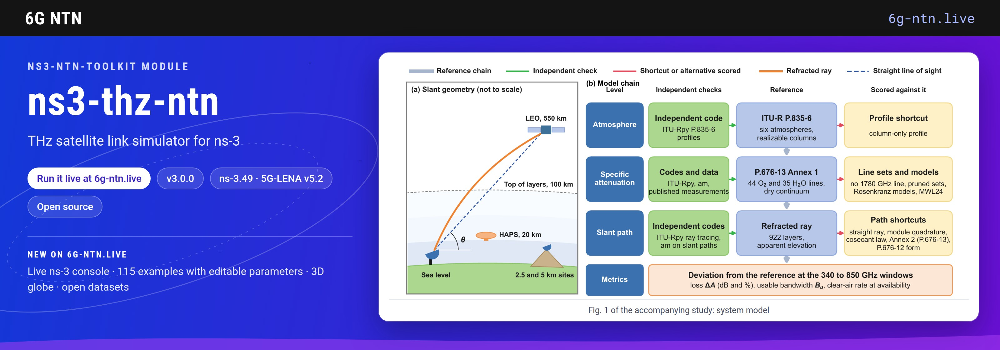
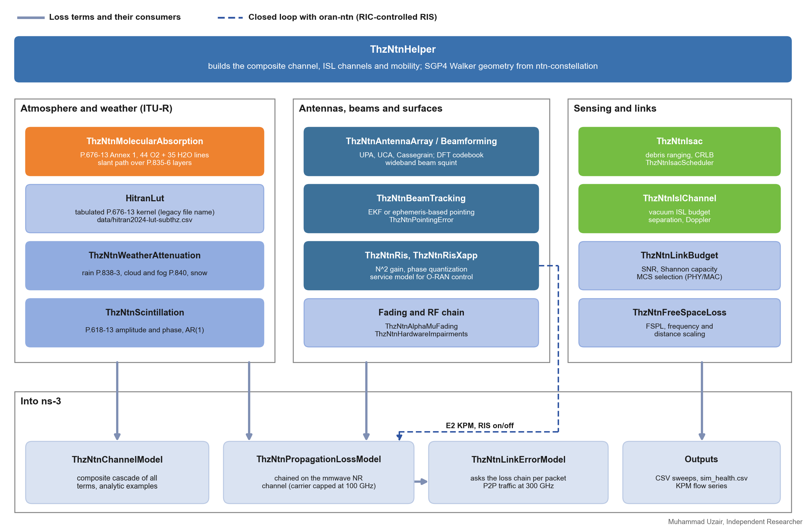
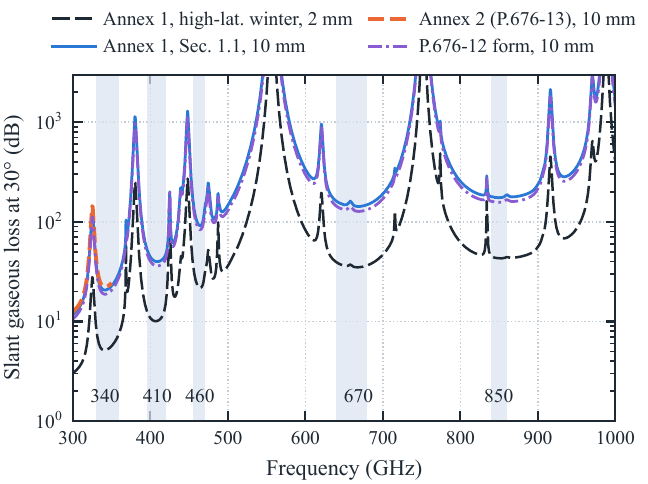
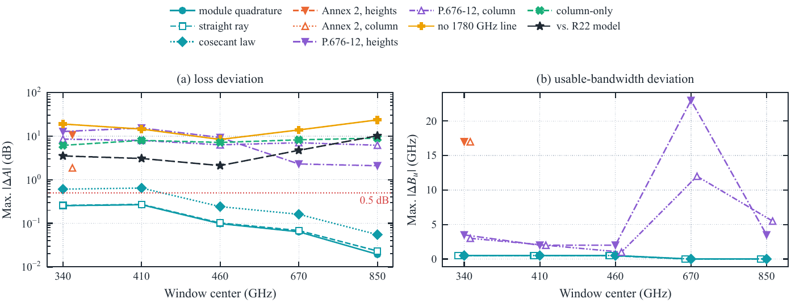
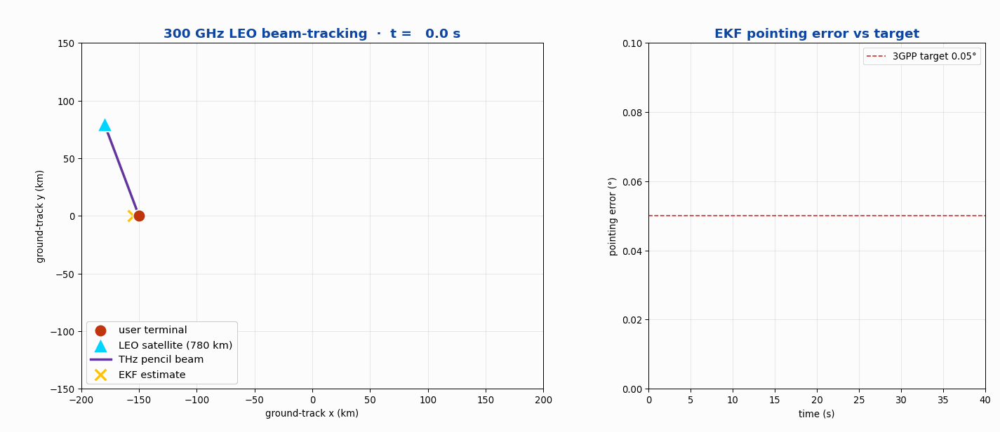
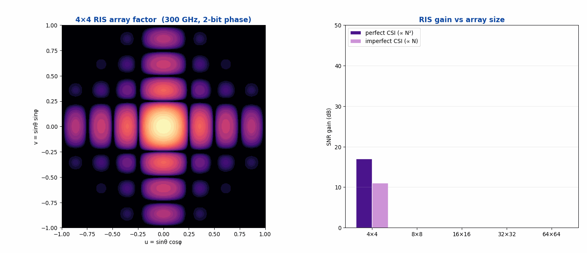

<!-- hero-banner -->
<p align="center"><a href="https://muhammaduazir69.github.io/ns3-thz-ntn/"></a></p>

<h1 align="center">thz-ntn</h1>

<p align="center"><strong>Sub-terahertz and terahertz non-terrestrial links for ns-3, 100 GHz to 1 THz, built on the ITU-R recommendations rather than fitted curves</strong></p>

<p align="center">
  <a href="https://youtu.be/JNStiBst68I"></a><br/>
  <a href="https://youtu.be/JNStiBst68I"></a><br/>
  <a href="https://6g-ntn.live"></a><br/>
  <sub><b>Try it live:</b> <a href="https://6g-ntn.live">6g-ntn.live</a> runs the toolkit's examples in the browser, with open datasets, a scenario gallery and a research forum.</sub><br/>
  <sub>The NTN Control Center runs and visualizes the ns3-thz-ntn examples on a live 3D globe (5-minute video).</sub>
  <a href="https://muhammaduazir69.github.io/ns3-thz-ntn/"></a>
  <a href="https://github.com/Muhammaduazir69/ns3-thz-ntn/releases/latest"></a>
  <a href="https://www.linkedin.com/in/muhammad-uzair-285331185/"></a><br/>
  <sub><b>New on 6g-ntn.live:</b> a live ns-3 console, 115 examples with editable parameters, a 3D globe of real constellations, open datasets (CC BY 4.0) and a validation page with 690 test cases in 41 suites.</sub><br/>
</p>


<p align="center">
  <a href="https://www.nsnam.org"></a>
  <a href="https://www.gnu.org/licenses/old-licenses/gpl-2.0.en.html"></a>
  
  
  
</p>

<p align="center">
  <a href="https://github.com/Muhammaduazir69/ns3-ntn-toolkit">Toolkit</a>
  &nbsp;·&nbsp;
  <a href="https://muhammaduazir69.github.io/ns3-ntn-toolkit/modules/thz-ntn/">Docs</a>
  &nbsp;·&nbsp;
  <a href="INSTALL.md">Install</a>
  &nbsp;·&nbsp;
  <a href="#examples">Examples</a>
  &nbsp;·&nbsp;
  <a href="#results">Results</a>
</p>

---

## Why this module

Above 100 GHz the atmosphere stops being a detail. Molecular absorption, rain, fog and scintillation each move a space-to-ground budget by tens of decibels, and a model that gets one of them wrong by a factor of two still produces a coverage map that looks plausible.

`thz-ntn` implements each term from its recommendation and says which one: ITU-R P.676-13 Annex 1 line-by-line absorption (44 O2 and 35 H2O lines) integrated over the P.835-6 reference atmospheres, P.838-3 rain, P.840 cloud and fog, and P.618-13 scintillation. On top of the channel it adds ultra-massive MIMO arrays with beam squint, reconfigurable intelligent surfaces (RIS), EKF beam tracking with pointing error, integrated sensing and communication (ISAC), inter-satellite links and alpha-mu fading. The losses enter ns-3 as real `PropagationLossModel`s, so they attenuate packets instead of decorating a CSV.

## System design

<p align="center">
  
</p>

*Figure 1. Classes and data flow. The atmosphere, weather, antenna and pointing terms feed three consumers: `ThzNtnChannelModel` for the analytic sweeps, `ThzNtnPropagationLossModel` chained on the mmwave NR spectrum channel (carrier at most 100 GHz, the limit of the 3GPP model), and `ThzNtnLinkErrorModel`, which carries IP packets at 300 GHz on a point-to-point link. The RIS can be switched by an xApp through `oran-ntn`. Source: [`doc/figures/make_architecture.py`](doc/figures/make_architecture.py).*

## Results

The results verify the absorption engine, `ThzNtnMolecularAbsorption`, which the channel, link-budget and propagation-loss classes all call. They come from a study that swept the engine with the `thz-ntn-absorption-sweep` example and compared it with a reference: the same P.676-13 Annex 1 kernel and P.835-6 atmospheres integrated along a refracted ray, plus the P.676-13 Annex 2 and P.676-12 approximations. Sweeps, scripts and outputs are in `paper/thz-2026-gaseous-absorption/` of the toolkit tree (`cpp_sweeps.sh` runs the example; `analysis.py` writes the numbers).

**Experiment.** Deterministic evaluations on fixed grids, so no random seeds apply. The six P.835-6 atmospheres, each scaled to the precipitable water vapor (PWV) columns from 0.5 to 50 mm that it can hold, give 26 realizable atmospheres; with seven elevations from 10 to 90 degrees they form the operable domain at each window. A Python transcription of the engine reproduced all 88 263 C++ sweep points to a relative difference below 1e-7.

<p align="center">
  
</p>

*Figure 2. Slant gaseous loss at 30 degrees from Annex 1 (reference) in a dry high-latitude winter atmosphere at 2 mm PWV and in the P.835-6 Section 1.1 atmosphere at 10 mm, with the P.676-13 Annex 2 form (valid to 350 GHz) and the P.676-12 form. Shaded bands mark where each window center was searched.*

<p align="center">
  
</p>

*Figure 3. Largest deviation of each shortcut from the refracted Annex 1 reference at the window centers. (a) Loss over the operable domain; (b) usable bandwidth on the controlled grid. "Module quadrature" is the engine as shipped.*

| Window center (GHz) | 341.5 | 409.0 | 464.0 | 668.5 | 849.5 |
|---|---:|---:|---:|---:|---:|
| Slant loss at 30 degrees, Sec. 1.1 atmosphere, 10 mm PWV (dB) | 20.7 | 39.8 | 91.5 | 142.5 | 174.6 |
| Slant loss at 30 degrees, high-latitude winter, 2 mm PWV (dB) | 5.1 | 10.1 | 21.7 | 35.0 | 43.1 |
| Operable conditions (atmosphere x elevation) | 128 | 88 | 37 | 19 | 12 |

| Check of the engine | Largest deviation found |
|---|---|
| Shipped straight-ray quadrature against the refracted reference, all windows, operable domain | 0.27 dB |
| Flat-Earth cosecant law against the reference | 0.64 dB |
| Regenerated lookup table (`data/hitran2024-lut-subthz.csv`) against the in-process kernel, within 5 GHz of a window center | 0.057 dB (0.74 %) |
| Quadrature raised from 10 to 200 sub-steps per slab | 0.02 % |
| Engine against ITU-Rpy at the five centers and 10, 30, 90 degrees | 1.0 % |
| Usable bandwidth, any of the geometric shortcuts | at most one 0.5 GHz grid step |

What the data say: the geometric and numerical simplifications inside the engine cost a fraction of a decibel, while the choice of absorption model does not: the P.676-12 form and a column-only model are off by several to tens of decibels (Figure 3a). Above 600 GHz even the most favorable realizable sea-level atmosphere costs 32.7 dB at 850 GHz and 30 degrees, so the operable domain shrinks quickly with frequency. Against the independent *am* 14.0 line-by-line model in zenith, P.676-13 lies within 7 % at 340, 410 and 460 GHz and 6 to 18 % higher at 670 and 850 GHz. The same study found and fixed four defects in the engine (a stale lookup-table generator, a table that overrode the configured atmosphere, invented seasonal profiles, a floor on the wrong mixing ratio), each with a regression test. Values are copied from `paper/thz-2026-gaseous-absorption/run_all.sh` and `am_macros.tex`.

## Architecture and classes

| Class (header under `model/`) | Role |
|---|---|
| `ThzNtnMolecularAbsorption` (`thz-ntn-molecular-absorption.h`) | P.676-13 Annex 1 line-by-line absorption over the P.835-6 atmospheres; `WaterVapourScale`, `HumidityProfile` and `IntegrationSteps` attributes |
| `HitranLut` (`thz-ntn-hitran-lut.h`, namespace `ns3::thzntn`) | Tabulated P.676-13 specific attenuation, 100 to 1000 GHz in 1 GHz steps; used only in the atmosphere it declares (legacy file name) |
| `Itu838RainModel`, `Itu618LossModel`, `Itu676AbsorptionModel`, `Itu681LmsModel` (`thz-ntn-itu-recommendations.h`) | Reference implementations, unit-tested against ITU-R values |
| `ThzNtnWeatherAttenuation`, `ThzNtnScintillation` | Rain, cloud, fog, snow; P.618 amplitude and phase scintillation |
| `ThzNtnFreeSpaceLoss`, `ThzNtnChannelModel` | FSPL and the composite cascade |
| `ThzNtnPropagationLossModel`, `ThzNtnPointingLossModel` | Atmospheric and pointing excess as `PropagationLossModel`s for a live spectrum channel |
| `ThzNtnLinkErrorModel` | Per-packet decode against the current received power, for packet traffic above 100 GHz |
| `ThzNtnAntennaArray`, `ThzNtnBeamforming` | UPA, UCA and Cassegrain arrays, DFT codebook, `ComputeBeamSquintLoss_dB()` |
| `ThzNtnBeamTracking`, `ThzNtnPointingError` | EKF or ephemeris-based tracking; vibration, refraction and latency pointing terms |
| `ThzNtnRis`, `ThzNtnRisController`, `ThzNtnRisServiceModel`, `ThzNtnRisXapp` | RIS gain 20 log10(N) with perfect CSI, phase quantization loss; O-RAN service model and xApp |
| `ThzNtnIsac`, `ThzNtnIsacScheduler`, `ThzNtnIsacProcessor` | Debris ranging, comm and sensing split of sub-bands |
| `ThzNtnIslChannel`, `ThzNtnIslLink` | Inter-satellite link budget and lifecycle |
| `ThzNtnAlphaMuFading`, `ThzNtnHardwareImpairments` | alpha-mu small-scale fading; PA, phase noise, ADC, I/Q impairments |
| `ThzNtnPhy`, `ThzNtnPhySat`, `ThzNtnPhyGround`, `ThzNtnMac`, `ThzNtnMacScheduler`, `ThzNtnLinkBudget`, `ThzNtnWaveform`, `ThzNtnSpectrum` | PHY and MAC abstractions, link budget, waveform candidates, transmission windows |
| `ThzNtnNyusimReference`, `ThzNtnNyusimCalibrator` | NYUSIM 140 GHz calibration reference (`data/nyusim-140-reference.csv`) |
| `ThzNtnHelper` (`helper/thz-ntn-helper.h`) | Builds channels and ISL channels and attaches mobility |

## Quick start

Inside the toolkit, where the module is already present and built:

```bash
./ns3 run "thz-ntn-absorption-sweep --mode=inproc --elevs=30 --out=sweep.csv"
./ns3 run thz-ntn-leo-ground
./ns3 run "thz-ntn-real-stack --rainMmH=25"
```

Standalone, into an existing ns-3.49 tree (the GitHub repository of this module is `ns3-thz-ntn`):

```bash
git clone -b thz-ntn-v2 https://github.com/Muhammaduazir69/ns3-thz-ntn.git contrib/thz-ntn
./ns3 configure --enable-examples --enable-tests
./ns3 build
```

The analytic examples need only the module plus `ntn-constellation` and `ntn-cho` for SGP4 geometry; the measured-radio examples build on `ntn-traffic` and the in-tree `mmwave` stack. `INSTALL.md` lists every dependency.

## Examples

Analytic examples (link budgets and sweeps, no packet data plane; each prints an `[analytic-tool]` banner):

| Example | What it shows | Command |
|---|---|---|
| `thz-ntn-absorption-sweep` | Slant gaseous loss over frequency, elevation and PWV; `inproc`, `lut` or `lutfile` engine paths | `./ns3 run "thz-ntn-absorption-sweep --mode=lut --pwvs=none"` |
| `thz-ntn-altitude-relay` | Absorption avoided by lifting the lower endpoint above the water vapor | `./ns3 run thz-ntn-altitude-relay` |
| `thz-ntn-leo-ground` | LEO-to-ground sub-THz budget over an SGP4 pass, `pass_timeseries.csv` | `./ns3 run "thz-ntn-leo-ground --freq=300e9"` |
| `thz-ntn-isl` | ISL SNR, capacity and Doppler between two SGP4 neighbors | `./ns3 run thz-ntn-isl` |
| `thz-ntn-um-mimo` | Array gain, DFT codebook and wideband beam squint | `./ns3 run "thz-ntn-um-mimo --numElements=128"` |
| `thz-ntn-ris-assisted` | Direct against RIS-assisted SNR, N^2 scaling, quantization loss | `./ns3 run "thz-ntn-ris-assisted --risSize=64"` |
| `thz-ntn-dband-constellation` | D-band UT association on real Walker geometry | `./ns3 run thz-ntn-dband-constellation` |
| `thz-ntn-full-stack` | Downlink, RIS, ISL, ISAC and EKF tracking together on two SGP4 orbits | `./ns3 run thz-ntn-full-stack` |
| `thz-ntn-demo` | Eight analytic sections over the module APIs, CSV output | `./ns3 run "thz-ntn-demo --example=0"` |

Packet examples (measured SINR, TBLER and goodput; mmwave NR cell unless noted, carrier at most 100 GHz):

| Example | What it shows | Command |
|---|---|---|
| `thz-ntn-native-300ghz-traffic` | IP traffic at 300 GHz over Friis plus the module's loss chain on a point-to-point link (no NR PHY, MAC or HARQ) | `./ns3 run "thz-ntn-native-300ghz-traffic --freqGhz=300"` |
| `thz-ntn-real-stack` | Gaseous absorption and rain chained on the cell; rain applied in the second half | `./ns3 run "thz-ntn-real-stack --rainMmH=25"` |
| `thz-ntn-leo-ground-downlink-traffic` | Downlink over a receding SGP4 satellite with absorption on real packets | `./ns3 run thz-ntn-leo-ground-downlink-traffic` |
| `thz-ntn-isl-traffic` | NR link between two cross-plane SGP4 satellites, analytic ISL budget alongside | `./ns3 run thz-ntn-isl-traffic` |
| `thz-ntn-beam-tracking` | EKF fed by the measured SINR; prediction error becomes a live pointing loss | `./ns3 run "thz-ntn-beam-tracking --trackingMode=EKF"` |
| `thz-ntn-ris-relay-traffic` | Blockage, then RIS engagement, as live channel events | `./ns3 run "thz-ntn-ris-relay-traffic --blockageDb=30"` |
| `thz-ntn-isac-coexist-traffic` | `ThzNtnIsacScheduler` comm share gates the downlink | `./ns3 run thz-ntn-isac-coexist-traffic` |
| `thz-ntn-weather-traffic` | Fog, rain and snow phases on the live cell | `./ns3 run "thz-ntn-weather-traffic --rainMmH=25"` |
| `thz-ntn-ric-controlled-traffic` | KPM to `oran-ntn`; an xApp engages the RIS when SINR drops | `./ns3 run "thz-ntn-ric-controlled-traffic --xapp=1"` |

`thz-ntn-isac.cc` is kept out of the build (`if(FALSE)` in `examples/CMakeLists.txt`) until the ISAC scheduler redesign.

## Tests

```bash
./test.py -s thz-ntn
```

The `thz-ntn` suite (`Type::UNIT`, 49 test cases) covers FSPL, P.676-13 zenith absorption against reference values, the bundled lookup table (coverage, agreement with the in-process kernel, bypass in a foreign atmosphere), the P.835-6 profiles and `WaterVapourScale`, P.838-3 coefficients, P.618 rain and scintillation scaling, P.681 LMS, pointing and hardware terms, array gain and codebooks, RIS gain, ISAC range resolution and scheduler modes, NYUSIM calibration, alpha-mu fading, the RIS service model and xApp, and a link budget and error model above 100 GHz. Several cases run under `Simulator::Run()` (HAPS ascent, rain event, alpha-mu trace).

## Dependencies

ns-3.49 core, network, mobility, propagation and spectrum; `ntn-constellation` and `ntn-cho` for SGP4 and terminal geometry; `ntn-traffic`, `mmwave` and `lte` for the measured-radio examples; `oran-ntn` for the RIC-controlled example.

## Scope and limitations

- The engine integrates a straight ray; the refracted reference differs by at most 0.27 dB at the windows (Results). Spectroscopy is P.676-13, not HITRAN; the lookup table keeps a legacy file name.
- The NR packet examples are capped at 100 GHz by the in-tree 3GPP spectrum model. Above that, packets run only in `thz-ntn-native-300ghz-traffic`, which has no NR PHY, MAC or HARQ; read its throughput as link-limited transport.
- `ThzNtnIsacProcessor`, `ThzNtnIslLink` and `ThzNtnWaveform` have neither an example nor a test. `ThzNtnAlphaMuFading`, the RIS controller, service model and xApp, the NYUSIM classes and the `Itu*` reference models are unit-tested but not used by an example.
- Tesseral orbit terms and terrain are outside this module; geometry comes from `ntn-constellation`.

## Standards

ITU-R P.676-13 (gaseous attenuation), P.835-6 (reference atmospheres), P.838-3 (rain), P.840 (clouds and fog), P.618-13 (Earth-space propagation, scintillation), P.681-11 (land mobile satellite). 3GPP TR 38.811 and TR 38.821 for NTN geometry, TR 38.901 for the terrestrial baseline.

## Animations

<p align="center">
  
  
</p>

## Citation

If you use this module, please cite the toolkit article:

```bibtex
@article{uzair2026ns3ntntoolkit,
  author  = {Uzair, Muhammad and others},
  title   = {ns3-ntn-toolkit: An Integrated ns-3 Platform for {6G} Non-Terrestrial Networks},
  journal = {IEEE Open Journal of the Communications Society},
  year    = {2026},
  doi     = {10.1109/OJCOMS.2026.3745010}
}
```

## License

GPL-2.0-only, matching ns-3.

## Contact

**Muhammad Uzair**, Independent Researcher. muhammaduzairr69@gmail.com, [ORCID 0009-0002-4104-2680](https://orcid.org/0009-0002-4104-2680).
Part of the [ns3-ntn-toolkit](https://github.com/Muhammaduazir69/ns3-ntn-toolkit); mirrored on [GitLab](https://gitlab.com/ns3-ntn-toolkit).
